# 3CX Supply Chain Compromise

# Scenario & Objective

A large multinational corporation heavily relies on the 3CX software for phone communication, making it a critical component of their business operations. After a recent update to the 3CX Desktop App, antivirus alerts flag sporadic instances of the software being wiped from some workstations while others remain unaffected. Dismissing this as a false positive, the IT team overlooks the alerts, only to notice degraded performance and strange network traffic to unknown servers. Employees report issues with the 3CX app, and the IT security team identifies unusual communication patterns linked to recent software updates.

As the threat intelligence analyst, it's your responsibility to examine this possible supply chain attack. Your objectives are to uncover how the attackers compromised the 3CX app, identify the potential threat actor involved, and assess the overall extent of the incident.

- **Category**: Malware Analysis / Threat Intelligence
- **Tools**: Kali Linux (`msiinfo`, `7z`, `sha256sum`), VirusTotal, MITRE ATT&CK

## Overview

The trojanized 3CXDesktopApp 18.12.416 MSI hides a malicious `ffmpeg.dll` and `d3dcompiler_47.dll` inside the legitimate Electron application bundle (`product.cab`). The loader abuses DLL side-loading (T1574.002) through a signed, trusted executable and checks for VMware strings to evade analysis. Public reporting attributes the campaign to the Lazarus Group (North Korea); that attribution comes from open-source intelligence, not from my own analysis of the sample.

# Analysis

## File Verification & Affected Versions

Initial investigation on the Kali Linux environment targets the installation package to verify its integrity:

- **File Name:** 3CXDesktopApp-18.12.416.msi

- **SHA256 Hash:** 59e1edf4d82fae4978e97512b0331b7eb21dd4b838b850ba46794d9c7a2c0983

<p align="center">
  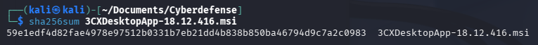 <br />
  <em>Image 1</em>
</p>

- **Creation Timestamp:** Mon Mar 13 07:33:26 2023

<p align="center">
  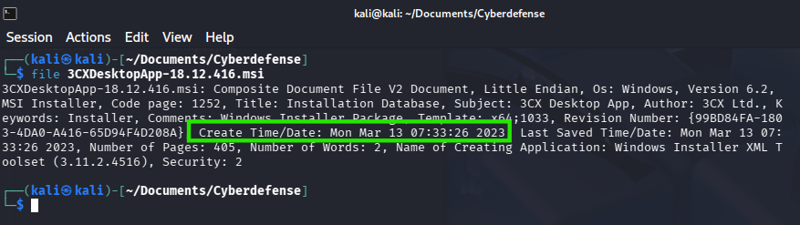 <br />
  <em>Image 2</em>
</p>

- **Official Affected Versions:** Electron Windows App versions 18.12.416 and 18.12.407.

<p align="center">
  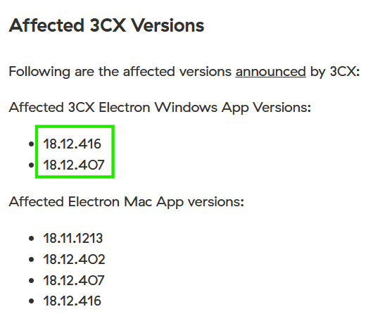 <br />
  <em>Image 3</em>
</p>

## Technical Analysis & Extraction Process

**Step 1: Examining MSI Streams**

To understand how the installer is structured, we inspect the internal streams of the MSI package using msiinfo. The command reveals an embedded cabinet file named product.cab.

**Step 2: Extracting and Unpacking the Payload**

The embedded product.cab stream is extracted from the MSI package and then unpacked using 7z into a dedicated output directory to analyze its components:

```bash
msiinfo extract 3CXDesktopApp-18.12.416.msi product.cab > product.cab
7z x product.cab
```

The extraction process successfully processes **81 files** with an uncompressed size of approximately **233 MB**.

<p align="center">
  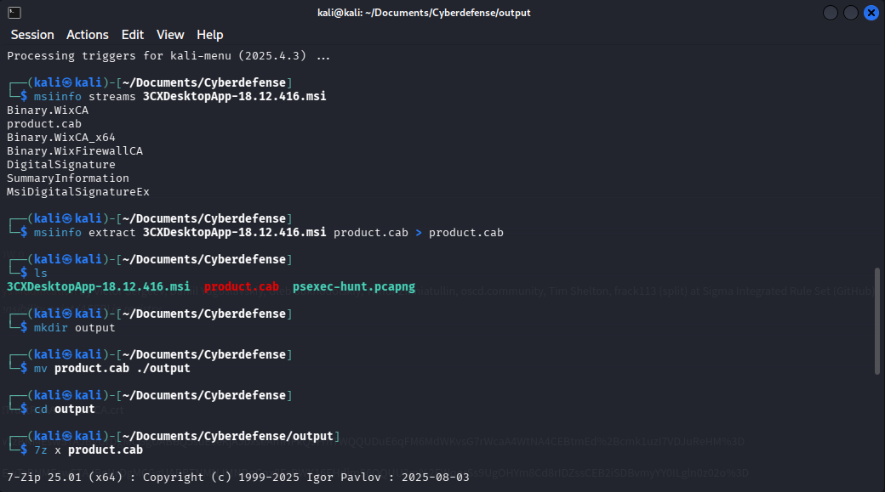 <br />
  <em>Image 4</em>
</p>

<p align="center">
  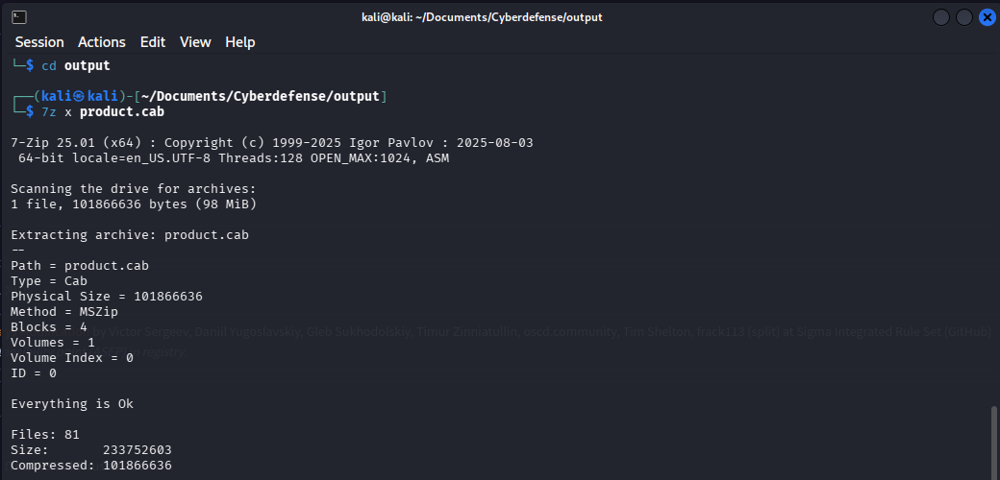 <br />
  <em>Image 5</em>
</p>

## Malicious DLL Identification

A bulk SHA256 hash scan is performed on all extracted .dll files. Cross-referencing these hashes with VirusTotal exposes two highly malicious libraries embedded inside the official application structure:

<p align="center">
  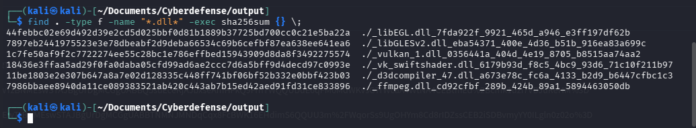 <br />
  <em>Image 6</em>
</p>

1.  **d3dcompiler_47.dll**

    - **SHA256:** 11be1803e2e307b647a8a7a02d128335c448ff741bf06bf52b332e0bbf423b03

    - **VirusTotal Detection:** **45/71** security vendors flagged this file as malicious.

    - **Threat Label:** trojan.marte/supplychainagent.

<p align="center">
  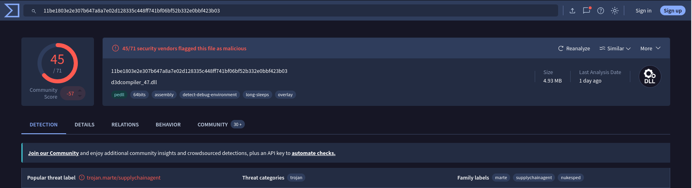 <br />
  <em>Image 7</em>
</p>

2.  **ffmpeg.dll** (stored as \_ffmpeg.dll\_...)

    - **SHA256:** 7986bbaee8940da11ce089383521ab420c443ab7b15ed42aed91fd31ce833896

    - **VirusTotal Detection:** **57/71** security vendors flagged this file as malicious.

    - **Threat Label:** trojan.loader/dllhijack.

<p align="center">
  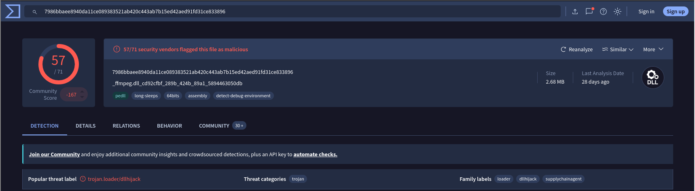 <br />
  <em>Image 8</em>
</p>

## MITRE ATT&CK Mapping & Malicious Behavior

Behavioral analysis of the compiled binaries maps out the specific tactics and techniques utilized by the malware:

**Defense Evasion & Execution**

- **T1574.002 - DLL Side-Loading:** The core mechanism of this supply chain compromise. The malicious ffmpeg.dll is strategically placed to be loaded automatically by a trusted, legitimately signed executable, allowing the payload to execute under a trusted context.

<p align="center">
  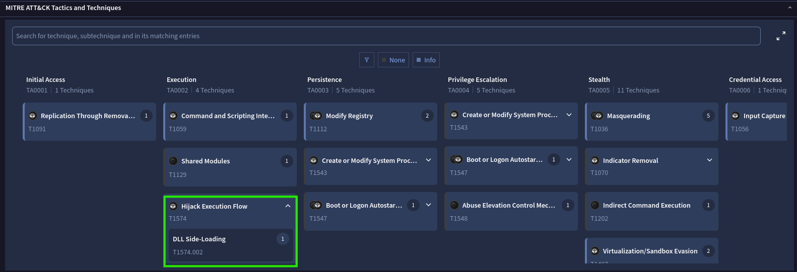 <br />
  <em>Image 9</em>
</p>

- **T1497.001 - Virtualization/Sandbox Evasion (System Checks):** The malware executes specific system checks to detect if it is running in a controlled analysis environment. It specifically looks for anti-VM strings targeting **VMware** to terminate itself and evade automated detection.

<p align="center">
  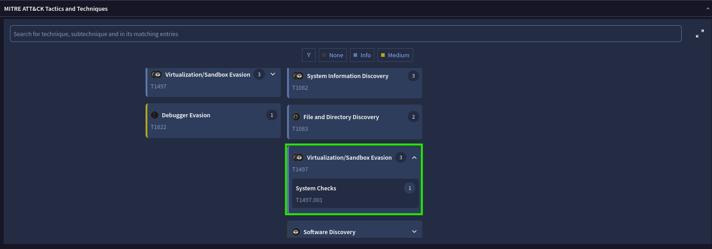 <br />
  <em>Image 10</em>
</p>

<p align="center">
  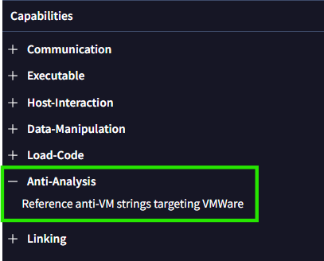 <br />
  <em>Image 11</em>
</p>

**Cryptography**

- **MBC C0027.009 – Encrypt Data: RC4** (Malware Behavior Catalog identifier, *not* an ATT&CK technique ID): The malware relies heavily on the **RC4** symmetric encryption algorithm (utilizing both RC4 KSA and RC4 PRGA structures) to decrypt its encrypted payload configuration and protect its command-and-control (C2) communication channels from wire analysis.

<p align="center">
  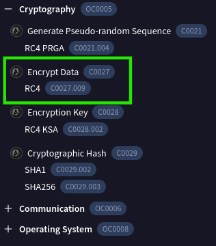 <br />
  <em>Image 12</em>
</p>

## Threat Actor Attribution (from open-source reporting)

Based on the highly sophisticated supply chain delivery method, infrastructure patterns, and technical tradecraft, the attack is confidently attributed to:

<p align="center">
  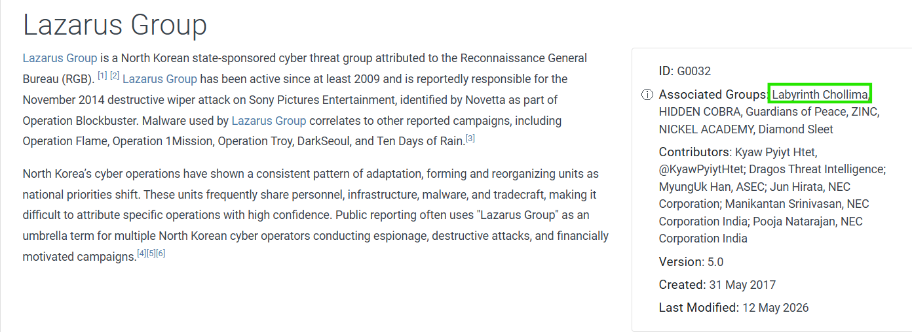 <br />
  <em>Image 13</em>
</p>

- **Threat Group:** **Lazarus Group** (MITRE ID: G0032).

- **Associated Sub-Group:** **Labyrinth Chollima**.

- **Actor Profile:** Lazarus Group is a state-sponsored cyber threat group attributed to the North Korean Reconnaissance General Bureau (RGB). Operating since at least 2009, they are widely known for complex supply chain operations, devastating cyber-espionage campaigns, and financially motivated target selections.

## Indicators of Compromise

| Type | Value | Note |
|---|---|---|
| File | `3CXDesktopApp-18.12.416.msi` | Trojanized installer, created Mon Mar 13 07:33:26 2023 (per file metadata) |
| SHA-256 | `59e1edf4d82fae4978e97512b0331b7eb21dd4b838b850ba46794d9c7a2c0983` | MSI |
| SHA-256 | `11be1803e2e307b647a8a7a02d128335c448ff741bf06bf52b332e0bbf423b03` | `d3dcompiler_47.dll` – 45/71 on VirusTotal |
| SHA-256 | `7986bbaee8940da11ce089383521ab420c443ab7b15ed42aed91fd31ce833896` | `ffmpeg.dll` – 57/71 on VirusTotal |

# Answer the Questions

**Q1: Understanding the scope of the attack and identifying which versions exhibit malicious behavior is crucial for making informed decisions if these compromised versions are present in the organization. How many versions of 3CX running on Windows have been flagged as malware?**

`2` (18.12.407 and 18.12.416).

**Q2: Determining the age of the malware can help assess the extent of the compromise and track the evolution of malware families and variants. What's the UTC creation time of the `.msi` malware?**

`2023-03-13 07:33:26` (Create Time/Date in the file metadata: Mon Mar 13 07:33:26 2023).

**Q3: Executable files (`.exe`) are frequently used as primary or secondary malware payloads, while dynamic link libraries (`.dll`) often load malicious code or enhance malware functionality. Analyzing files deposited by the Microsoft Software Installer (`.msi`) is crucial for identifying malicious files and investigating their full potential. Which malicious DLLs were dropped by the `.msi` file?**

`ffmpeg.dll` and `d3dcompiler_47.dll`

**Q4: Recognizing the persistence techniques used in this incident is essential for current mitigation strategies and future defense improvements. What is the MITRE Technique ID employed by the `.msi` files to load the malicious DLL?**

`T1574` – Hijack Execution Flow (sub-technique `T1574.002`, DLL Side-Loading).

**Q5: Recognizing the malware type (`threat category`) is essential to your investigation, as it can offer valuable insight into the possible malicious actions you'll be examining. What is the threat category of the two malicious DLLs?**

Trojan

**Q6: As a threat intelligence analyst conducting dynamic analysis, it's vital to understand how malware can evade detection in virtualized environments or analysis systems. This knowledge will help you effectively mitigate or address these evasive tactics. What is the MITRE ID for the virtualization/sandbox evasion techniques used by the two malicious DLLs?**

`T1497` – Virtualization/Sandbox Evasion (`T1497.001`, System Checks).

**Q7: When conducting malware analysis and reverse engineering, understanding anti-analysis techniques is vital to avoid wasting time. Which hypervisor is targeted by the anti-analysis techniques in the ffmpeg.dll file?**

VMware

**Q8: Identifying the cryptographic method used in malware is crucial for understanding the techniques employed to bypass defense mechanisms and execute its functions fully. What encryption algorithm is used by the `ffmpeg.dll` file?**

RC4

**Q9: As an analyst, you've recognized some TTPs involved in the incident, but identifying the APT group responsible will help you search for their usual TTPs and uncover other potential malicious activities. Which group is responsible for this attack?**

Labyrinth Chollima (Lazarus).
