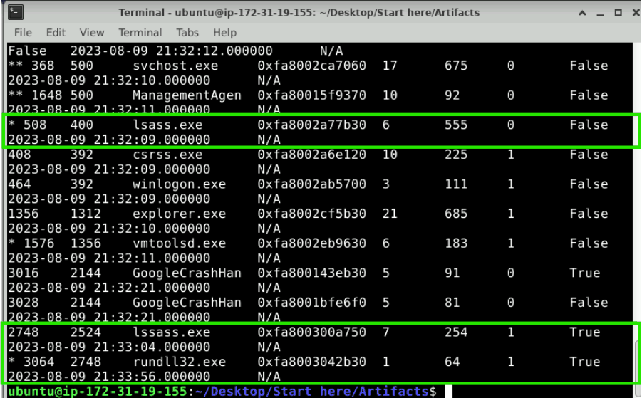
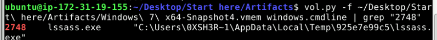
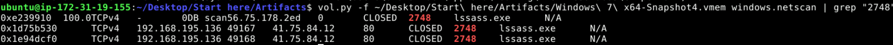
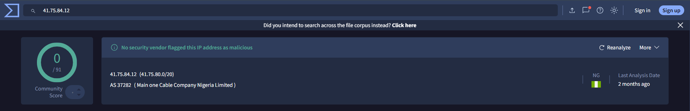
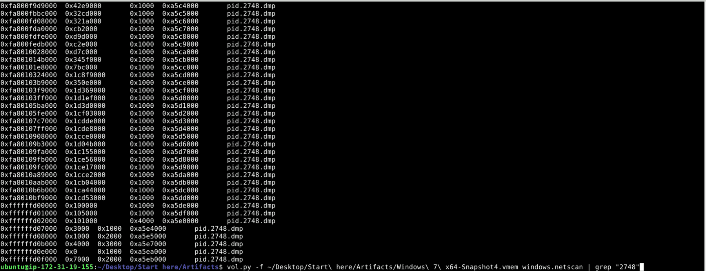
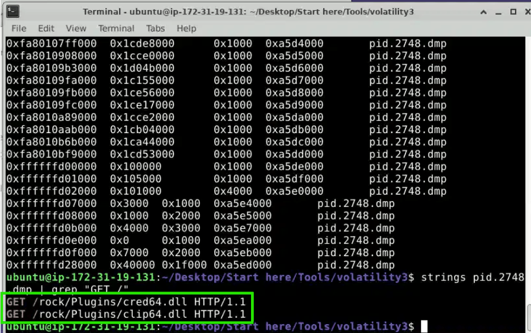
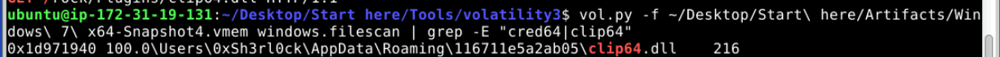
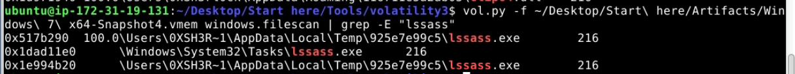

# Amadey – Memory Forensics (Windows 7 x64)

# Scenario & Objective

A Windows 7 machine was flagged for odd behaviour and a memory snapshot was taken. I have to find the malicious process in the image, see where it connects to, and list what it left on disk.

- **Category**: Memory Forensics
- **Tools**: Volatility, VirusTotal

## Overview

A process called `lssass.exe` (note the extra *s*) with PID 2748 started at 21:33:04 UTC on 2023-08-09 from a folder under the user's `AppData\Local\Temp`. It talks over HTTP to `41[.]75[.]84[.]12` and pulled the plugins `cred64.dll` and `clip64.dll`, which is typical for the Amadey bot. The real `lsass.exe` is running as PID 508 from System32, so the look-alike stands out once the two are side by side.

# Analysis

I began with the process list. Most of it looks like a clean Windows 7 boot, but there are two processes that look like `lsass.exe`. The real one is PID 508 with parent 400, and then there is `lssass.exe` (PID 2748, parent 2524) with a `rundll32.exe` child (PID 3064) started at 21:33:56.

    
  <em>Image 1: Process list: <code>lssass.exe</code> (PID 2748) and its child <code>rundll32.exe</code></em>

The command line settles it. `lssass.exe` does not run from `C:\Windows\System32` but from a randomly named folder in the user's Temp directory.

    
  <em>Image 2: Command line of PID 2748</em>

Next I checked the network side with `netscan`, filtered on PID 2748. The process connected from `192.168.195.136` to `41[.]75[.]84[.]12` on port 80 (two connections, both CLOSED by now). VirusTotal had no detections for that IP when I looked, which proves nothing either way; the address belongs to a Nigerian provider (AS37282).

    
  <em>Image 3: <code>netscan</code> output for PID 2748</em>

    
  <em>Image 4: VirusTotal page of <code>41[.]75[.]84[.]12</code></em>

To see what it did with that connection I dumped the process memory and read the output. The HTTP requests in there ask for `GET /rock/Plugins/cred64.dll` and `GET /rock/Plugins/clip64.dll`, a credential stealer and a clipboard plugin.

    
  <em>Image 5: Memory-map dump output for PID 2748</em>

    
  <em>Image 6: Continuation of the dump output</em>

Finally I used `filescan` to see what exists on disk. `clip64.dll` sits under `AppData\Roaming\116711e5a2ab05\`, and there is also a file called `lssass.exe` under `\Windows\System32\Tasks`, which is where scheduled tasks are stored. That looks like the persistence mechanism, but I did not open the task XML to confirm it.

    
  <em>Image 7: <code>filescan</code>: <code>clip64.dll</code></em>

    
  <em>Image 8: <code>filescan</code>: <code>lssass.exe</code></em>

Techniques: T1036.005 (masquerading as `lsass.exe`), T1218.011 (rundll32 child), T1071.001 (HTTP to the remote host) and probably T1053.005 for the task file.

# Answer the Questions

**Q1: In the memory dump analysis, determining the root of the malicious activity is essential for comprehending the extent of the intrusion. What is the name of the parent process that triggered this malicious behavior?**

`lssass.exe` (PID 2748, parent of the suspicious `rundll32.exe`; note the extra *s*, the real one is `lsass.exe`).

**Q2: Once the rogue process is identified, its exact location on the device can reveal more about its nature and source. Where is this process housed on the workstation?**

`C:\Users\0XSH3R~1\AppData\Local\Temp\925e7e99c5\lssass.exe`

**Q3: Persistent external communications suggest the malware's attempts to reach out C2C server. Can you identify the Command and Control (C2C) server IP that the process interacts with?**

`41[.]75[.]84[.]12` (port 80).

**Q4: Following the malware link with the C2C, the malware is likely fetching additional tools or modules. How many distinct files is it trying to bring onto the compromised workstation?**

`2` (`cred64.dll` and `clip64.dll`).

**Q5: Identifying the storage points of these additional components is critical for containment and cleanup. What is the full path of the file downloaded and used by the malware in its malicious activity?**

`C:\Users\0xSh3rl0ck\AppData\Roaming\116711e5a2ab05\clip64.dll`

**Q6: Once retrieved, the malware aims to activate its additional components. Which child process is initiated by the malware to execute these files?**

`rundll32.exe`

**Q7: Understanding the full range of Amadey's persistence mechanisms can help in an effective mitigation. Apart from the locations already spotlighted, where else might the malware be ensuring its consistent presence?**

`C:\Windows\System32\Tasks\lssass.exe` (a scheduled task).
