# Andromeda Bot (UNC4210) – USB-Delivered Malware

# Scenario & Objective

A Windows machine got infected from a USB drive. I get a memory image and its event logs and have to show which USB device was used and when, what ran from it, what the malware dropped, and which group is behind the re-activated Andromeda botnet.

- **Category**: Endpoint Forensics
- **Tools**: MemProcFS, EvtxECmd, Timeline Explorer, VirusTotal, Google/Mandiant threat-intelligence article

## Overview

On `DESKTOP-REEGDSA` a USB stick with serial `7095411056659025437` was plugged in, last on 2024-10-04 at 13:48 UTC. A file `E:\hidden\Trusted Installer.exe` (named to look like the Windows TrustedInstaller) then started PowerShell with an execution-policy bypass and turned off Defender real-time protection. After that it dropped `Sahofivizu.exe` and four DLLs into the user's Temp folder, the first one being `Gozekeneka.dll`. Public reporting on this Andromeda re-activation points to Turla.

# Analysis

The memory image was a `memory.dmp`, so my first step was to mount it with MemProcFS. It exposes the registry and the event logs as a normal drive (`M:`), which makes everything after this a file-browsing exercise.

  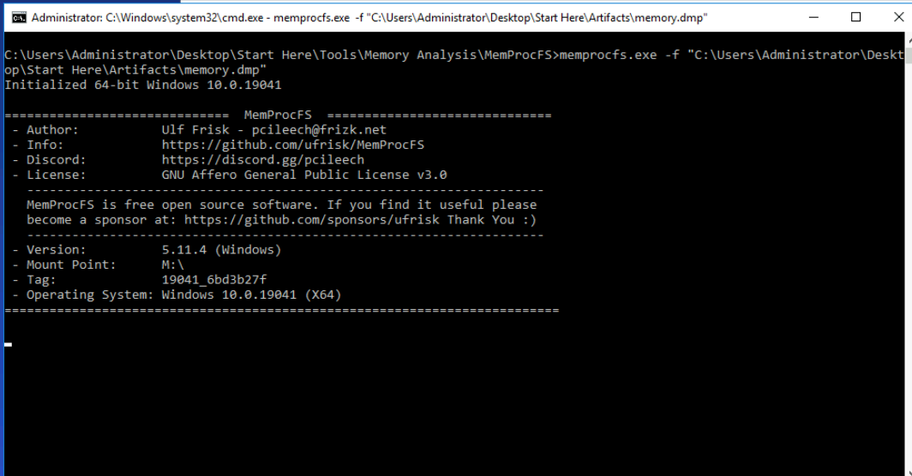  
  <em>Image 1: MemProcFS mounting <code>memory.dmp</code></em>

  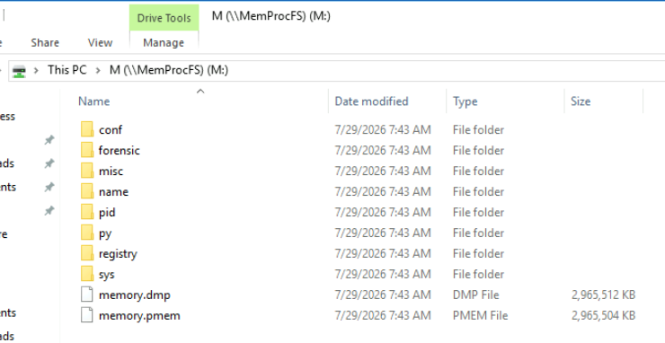  
  <em>Image 2: Mounted drive layout</em>

For the USB history I went to `HKLM\SYSTEM\ControlSet001\Enum\USBSTOR`. There is a single device, `Disk&Ven_VendorCo&Prod_ProductCode&Rev_2.00`, and its instance ID gives the serial number.

  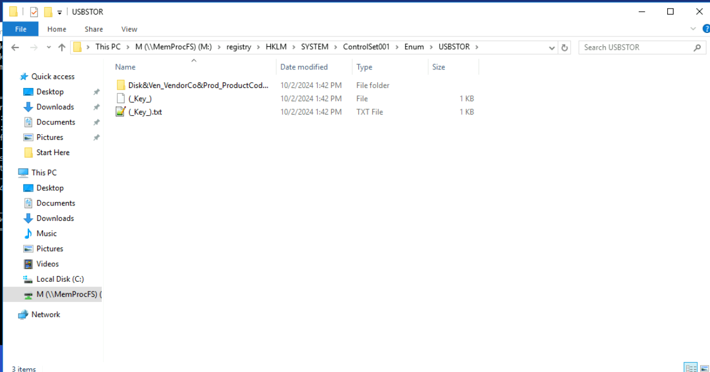  
  <em>Image 3: <code>USBSTOR</code> registry key</em>

  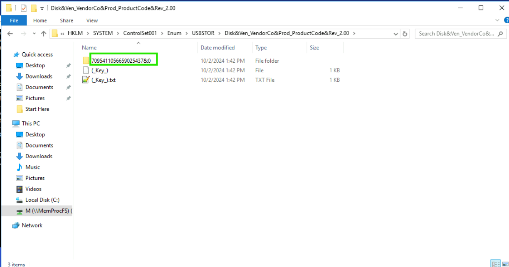  
  <em>Image 4: Device key <code>Disk&amp;Ven_VendorCo&amp;Prod_ProductCode&amp;Rev_2.00</code></em>

The event logs live under `M:\misc\eventlog`. I converted them to CSV with EvtxECmd and loaded the result into Timeline Explorer, which is far easier to filter than the raw `.evtx` files.

  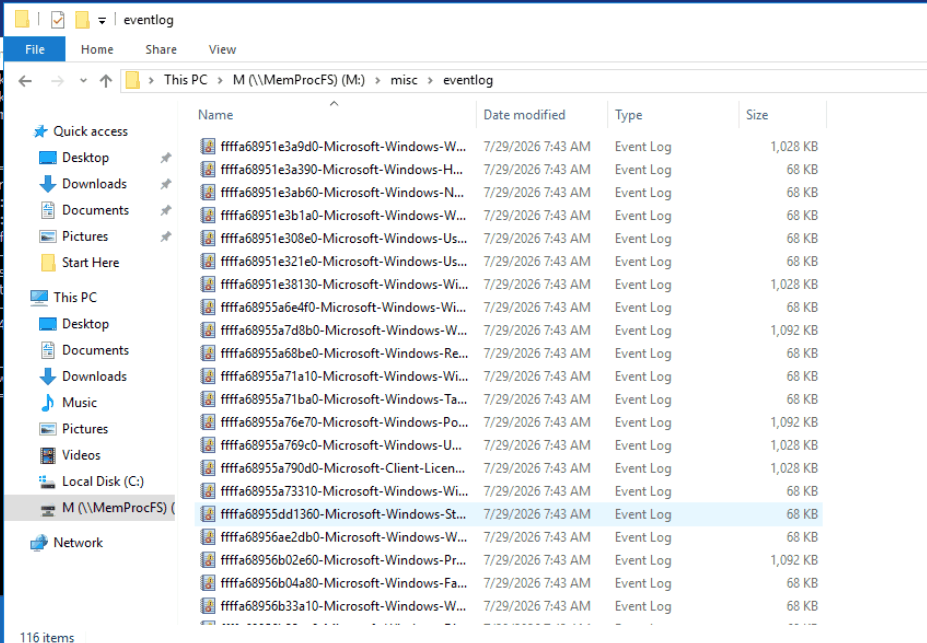  
  <em>Image 5: Event log folder exposed by MemProcFS</em>

  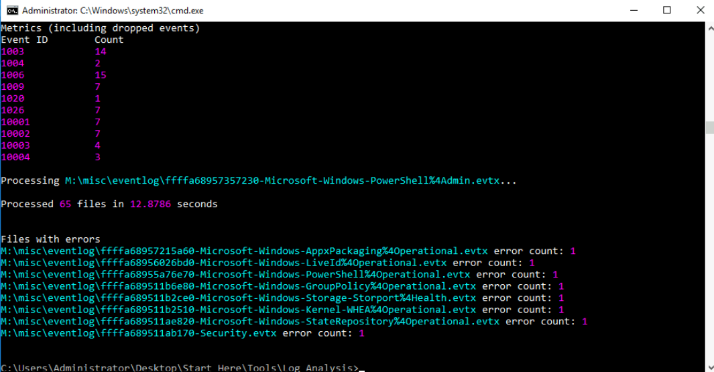  
  <em>Image 6: EvtxECmd processing metrics</em>

  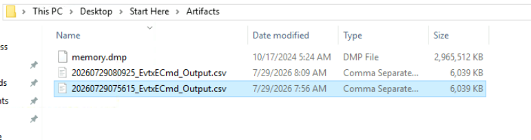  
  <em>Image 7: Generated CSV files</em>

  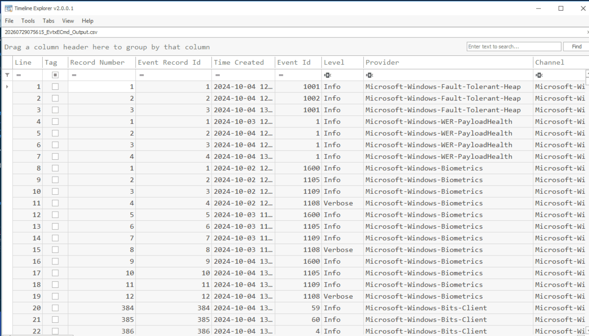  
  <em>Image 8: Timeline Explorer with the CSV loaded</em>

Filtering on Event ID 207 together with the serial shows every time the device was connected: 2024-10-02 13:42:08 and 2024-10-04 13:48:18 (each entry shows up twice in the list). The payload columns confirm manufacturer, model and serial.

  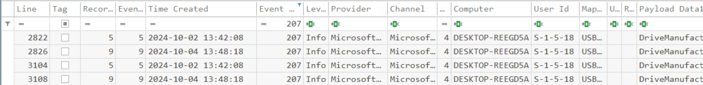  
  <em>Image 9: Event ID 207 entries</em>

  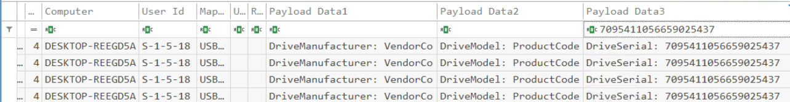  
  <em>Image 10: Drive manufacturer, model and serial in the payload columns</em>

Next, I searched for `Set-MpPreference`. The hits are PowerShell started with `-ExecutionPolicy Bypass` and a switch that disables Defender real-time monitoring, and the parent process is `E:\hidden\Trusted Installer.exe`, so it ran straight from the USB drive. The process-create events also carry the MD5 hashes in the payload data.

  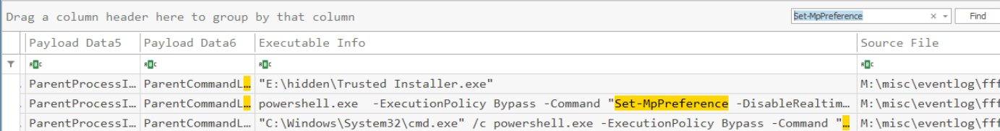  
  <em>Image 11: <code>Set-MpPreference</code> command lines and their parent process</em>

  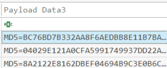  
  <em>Image 12: Process-create events with MD5 hashes</em>

The same launcher created `C:\Users\Tomy\AppData\Local\Temp\Sahofivizu.exe`, and the process line for it gives the MD5 `7FE00CC4EA8429629AC0AC610DB51993`. In the file-create events (Sysmon Event ID 11) around 13:49:53 UTC there are four DLLs written next to it: `Gozekeneka.dll` is the first one, followed by `xuxokuxoka.dll`, `Zojemilocan.dll` and `natigezeholi.dll`.

  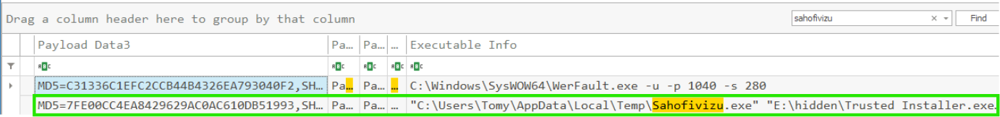  
  <em>Image 13: Process creation for <code>Sahofivizu.exe</code> with its MD5</em>

  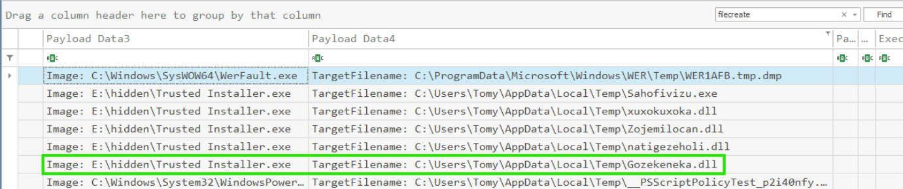  
  <em>Image 14: File-create events by the launcher; the first DLL is <code>Gozekeneka.dll</code></em>

  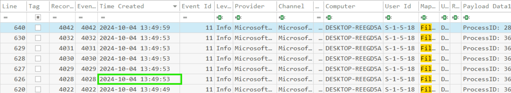  
  <em>Image 15: Surrounding Sysmon events</em>

To put a name on the malware I took the sample hash to VirusTotal (59/69 detections). In the relations tab there are contacted URLs ending in `in.php` and a handful of IPs, and the behaviour tab shows the ATT&CK tactics. A Google/Mandiant article, "Turla: A Galaxy of Opportunity", describes exactly this story, where the group registered expired Andromeda C2 domains and used the old botnet to pick victims.

  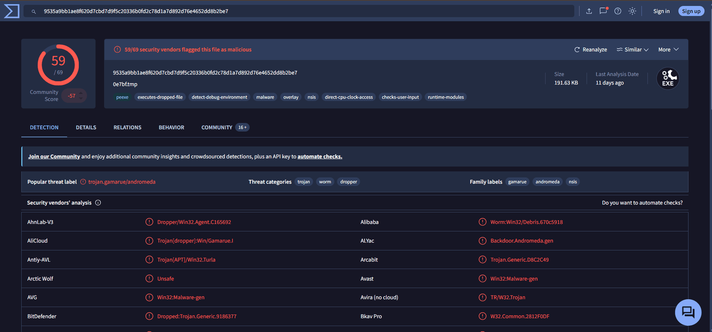  
  <em>Image 16: VirusTotal detection page (59/69)</em>

  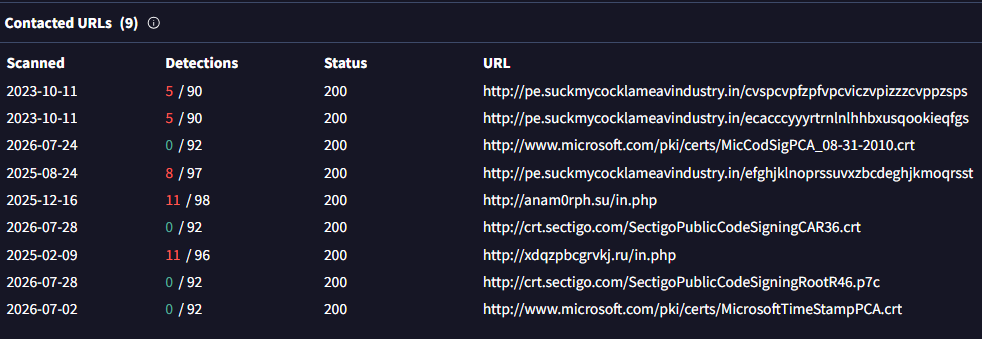  
  <em>Image 17: VirusTotal: contacted URLs</em>

  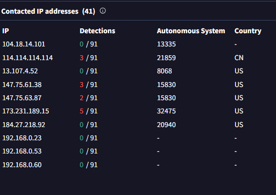  
  <em>Image 18: VirusTotal: contacted IP addresses</em>

  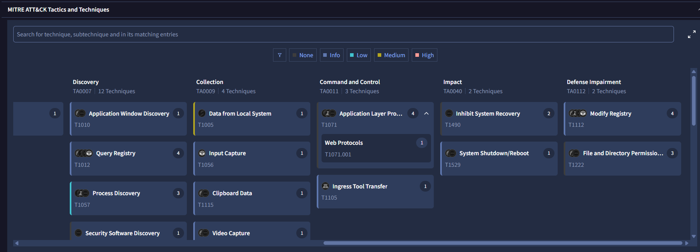  
  <em>Image 19: VirusTotal: ATT&amp;CK tactics and techniques</em>

  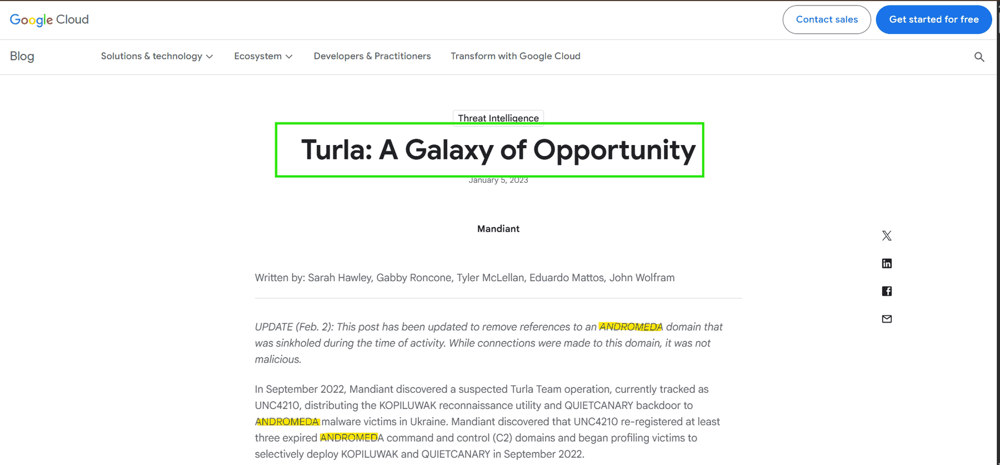  
  <em>Image 20: Google/Mandiant article</em>

ATT&CK mapping as I see it: T1091 (replication through removable media), T1059.001 (PowerShell), T1562.001 (disabling Defender) and T1036 (the launcher is named after TrustedInstaller).

# Answer the Questions

**Q1: Tracking the serial number of the USB device is essential for identifying potentially unauthorized devices used in the incident, helping to trace their origin and narrow down your investigation. What is the serial number of the inserted USB device?**

`7095411056659025437&0`

**Q2: Tracking USB device activity is essential for building an incident timeline, providing a starting point for your analysis. When was the last recorded time the USB was inserted into the system?**

`2024-10-04 13:48` UTC.

**Q3: Identifying the full path of the executable provides crucial evidence for tracing the attack's origin and understanding how the malware was deployed. What is the full path of the executable that was run after the PowerShell commands disabled Windows Defender protections?**

`E:\hidden\Trusted Installer.exe`

**Q4: Identifying the bot malware’s C&C infrastructure is key for detecting IOCs. According to threat intelligence reports, what URL does the bot use to download its C&C file?**

`hxxp[://]anam0rph[.]su/in[.]php`

**Q5: Understanding the IOCs for files dropped by malware is essential for gaining insights into the various stages of the malware and its execution flow. What is the MD5 hash of the dropped .exe file?**

`7FE00CC4EA8429629AC0AC610DB51993` (`Sahofivizu.exe`).

**Q6: Having the full file paths allows for a more complete cleanup, ensuring that all malicious components are identified and removed from the impacted locations. What is the full path of the first DLL dropped by the malware sample?**

`C:\Users\Tomy\AppData\Local\Temp\Gozekeneka.dll`

**Q7: Connecting malware to APT groups is crucial for uncovering an attack's broader strategy, motivations, and long-term goals. Based on IOCs and threat intelligence reports, which APT group reactivated this malware for use in its campaigns?**

Turla

# References

- [Andromeda Bot (UNC4210) lab write-up](https://portfolio-v2-f2y.pages.dev/blue-team/labs/andromeda-bot-unc4210/)
- [Mandiant: Turla – A Galaxy of Opportunity](https://cloud.google.com/blog/topics/threat-intelligence/turla-galaxy-opportunity)
