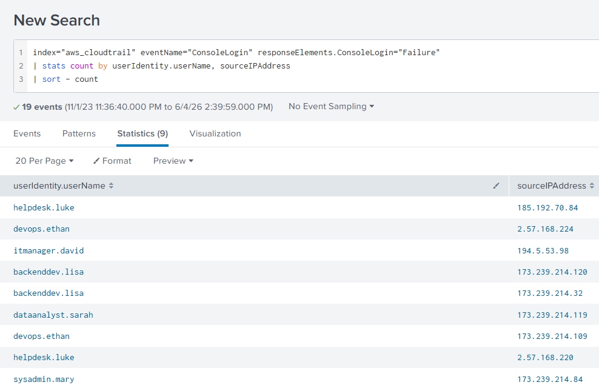
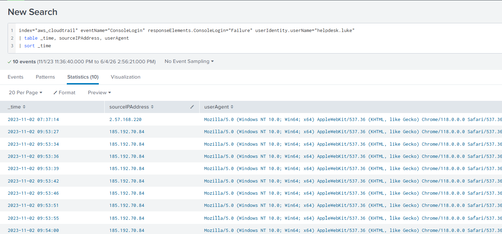
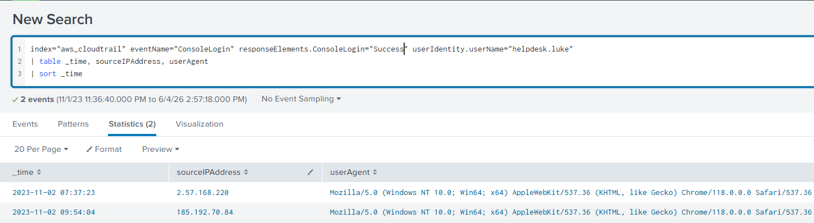
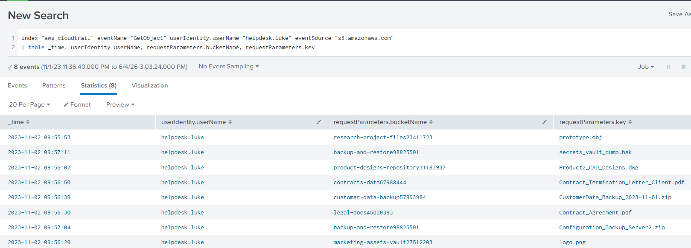
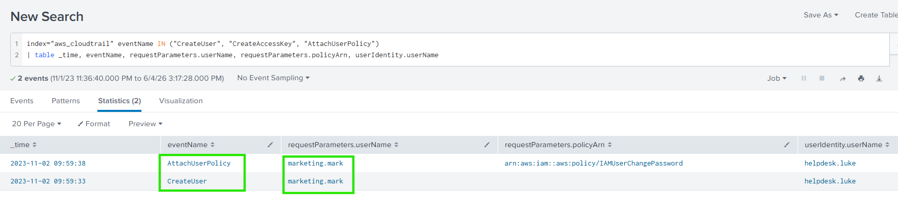
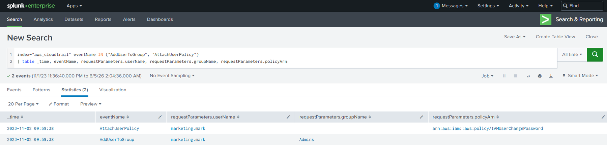

# AWS Raid – CloudTrail Investigation in Splunk

# Scenario & Objective

Your organization utilizes AWS to host critical data and applications. An incident has been reported that involves unauthorized access to data and potential exfiltration. The security team has detected unusual activities and needs to investigate the incident to determine the scope of the attack.

- **Category**: Cloud Forensics (Splunk)
- **Tools**: Splunk (SPL), AWS CloudTrail

## Overview

Someone brute-forced the IAM user `helpdesk.luke` from `185[.]192[.]70[.]84` between 09:53:27 and 09:54:00 UTC and got a successful `ConsoleLogin` at 09:54:04 UTC. Between 09:55:53 and 09:57:11 UTC five S3 `GetObject` downloads followed (R&D files, a legal contract, a customer-data backup and a secrets vault dump). At 09:59:33 UTC the attacker created a rogue IAM user, `marketing.mark`, and at 09:59:38 UTC gave it `IAMUserChangePassword` and added it to the `Admins` group.

# Analysis

## Initial Access

- The investigation was initiated by analyzing ConsoleLogin events to pinpoint the origin of the unauthorized access. In a cloud environment, the AWS Management Console acts as the front door. We executed a Splunk query filtering for failed authentication attempts (responseElements.ConsoleLogin="Failure").

    
  <em>Image 1</em>

- This analysis revealed a massive, automated brute-force campaign originating from the IP address **185[.]192[.]70[.]84**. The attacker did not attempt to spray multiple accounts; instead, they exclusively targeted a single user identity: **helpdesk.luke**.

    
  <em>Image 2</em>

- The telemetry shows that this intense brute-force activity occurred over a 33-second window, from **09:53:27 UTC to 09:54:00 UTC**. The critical breach occurred moments later. At exactly **09:54:04 UTC**, CloudTrail recorded a ConsoleLogin event yielding a "Success" status originating from the identical malicious IP address. This timestamp definitively marks the exact moment the attacker cracked the user's password and gained access to the AWS control plane.

    
  <em>Image 3</em>

## Data Discovery & Exfiltration

- Following the successful compromise of the helpdesk.luke account, the threat actor wasted no time. They immediately pivoted to enumerate cloud storage, specifically targeting Amazon S3 buckets. By tracking the GetObject API calls—which represent a user downloading a file from S3—we successfully mapped the entire scope of the data exfiltration.

    
  <em>Image 4</em>

The data theft was executed rapidly and methodically over a narrow two-minute window. The attacker prioritized high-value targets:

- Beginning at **09:55:53 UTC**, the attacker accessed the research-project-files23411723 bucket, downloading proprietary intellectual property named prototype.obj.

- At **09:56:07 UTC**, they pulled further intellectual property: Product2_CAD_Designs.dwg.

- Shifting focus to legal and client data, they accessed the legal-docs45020393 bucket to exfiltrate Contract_Agreement.pdf at **09:56:30 UTC**.

- At **09:56:50 UTC**, a massive archive containing sensitive client PII, CustomerData_Backup_2023-11-01.zip, was downloaded from the customer-data-backup57893984 bucket.

- The most critical exfiltration occurred at **09:57:11 UTC**, when the attacker successfully downloaded secrets_vault_dump.bak. This action severely compromised the organization's internal credentials and cryptographic keys.

## Persistence

- Experienced threat actors operate under the assumption that their initial access vector (the helpdesk.luke password) will eventually be discovered and rotated. To ensure permanent access to the AWS environment, they immediately established a backdoor.

- We queried CloudTrail for Identity and Access Management (IAM) modification events, specifically looking for CreateUser, AttachUserPolicy, and AddUserToGroup.

    
  <em>Image 5</em>

- The forensic logs revealed a textbook persistence mechanism. At **09:59:33 UTC**, the attacker utilized the compromised helpdesk.luke session to silently provision a new, rogue IAM (Identity and Access Management) user named **marketing.mark**. Merely five seconds later, at **09:59:38 UTC**, they escalated the privileges of this backdoor account. The attacker attached the **IAMUserChangePassword** policy to ensure they could manage the account's credentials, and forcefully added **marketing.mark** into the highly privileged **Admins** group. This final action effectively granted the attacker total, persistent administrative control over the entire AWS infrastructure.

    
  <em>Image 6</em>

## MITRE ATT&CK mapping

| Tactic | Technique | Evidence |
|---|---|---|
| Credential Access | T1110.001 – Brute Force: Password Guessing | Burst of failed `ConsoleLogin` for one user from one IP |
| Initial Access / Persistence | T1078.004 – Valid Accounts: Cloud Accounts | Successful `ConsoleLogin` as `helpdesk.luke` |
| Collection | T1530 – Data from Cloud Storage | S3 `GetObject` calls on four buckets |
| Persistence | T1136.003 – Create Account: Cloud Account | `CreateUser` → `marketing.mark` |
| Privilege Escalation / Persistence | T1098 – Account Manipulation | `AttachUserPolicy`, `AddUserToGroup` (Admins) |

## Indicators of Compromise

| Type | Value |
|---|---|
| IP address | `185[.]192[.]70[.]84` |
| Compromised user | `helpdesk.luke` |
| Rogue IAM user | `marketing.mark` (member of `Admins`) |
| Accessed objects | `prototype.obj`, `Product2_CAD_Designs.dwg`, `Contract_Agreement.pdf`, `CustomerData_Backup_2023-11-01.zip`, `secrets_vault_dump.bak` |

# Answer the Questions

**Q1: Knowing which user account was compromised is essential for understanding the attacker's initial entry point into the environment. What is the username of the compromised user?**

`helpdesk.luke`

**Q2: We must investigate the events following the initial compromise to understand the attacker's motives. What is the timestamp for the first access to an S3 object by the attacker?**

`2023-11-02 09:55` UTC (first `GetObject`, 09:55:53).

**Q3: Among the S3 buckets accessed by the attacker, one contains a DWG file. What is the name of this bucket?**

`product-designs-repository31183937`, which holds `Product2_CAD_Designs.dwg`.

**Q4: We've identified changes to a bucket's configuration that allowed public access, a significant security concern. What is the name of this particular S3 bucket?**

`backup-and-restore98825501`

**Q5: Creating a new user account is a common tactic attackers use to establish persistence in a compromised environment. What is the username of the account created by the attacker?**

`marketing.mark`

**Q6: Following account creation, the attacker added the account to a specific group. What is the name of the group to which the account was added?**

`Admins`
