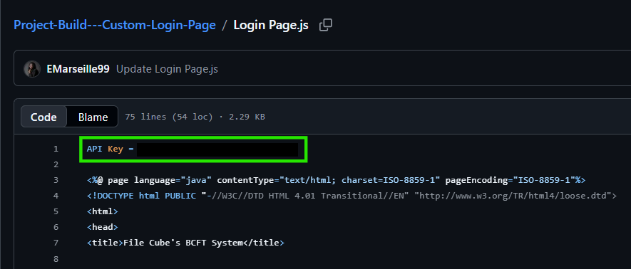
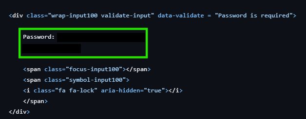
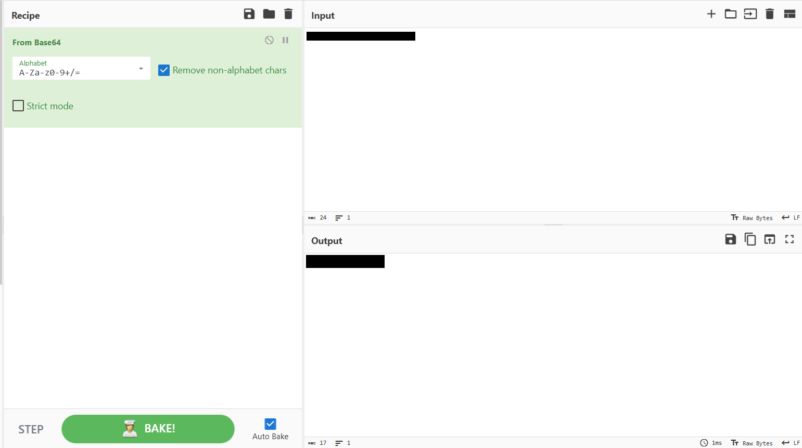
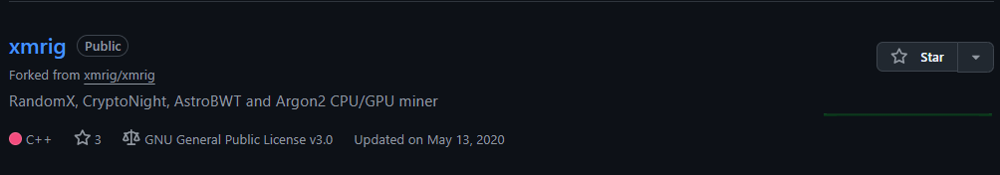
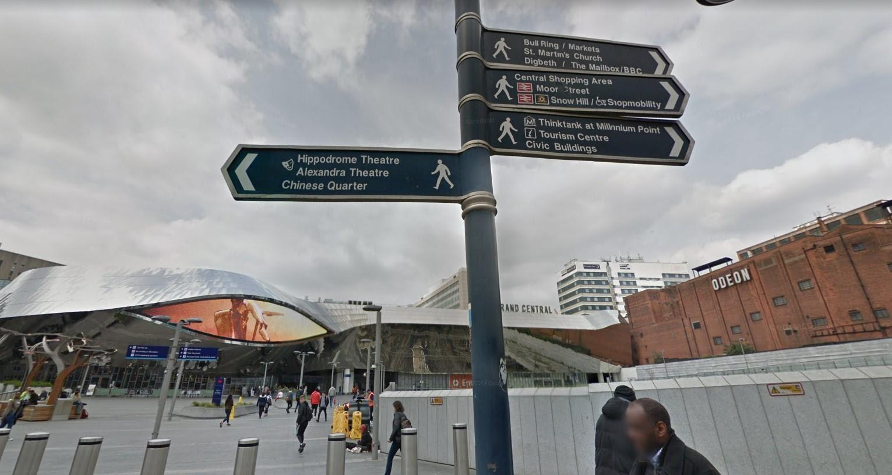
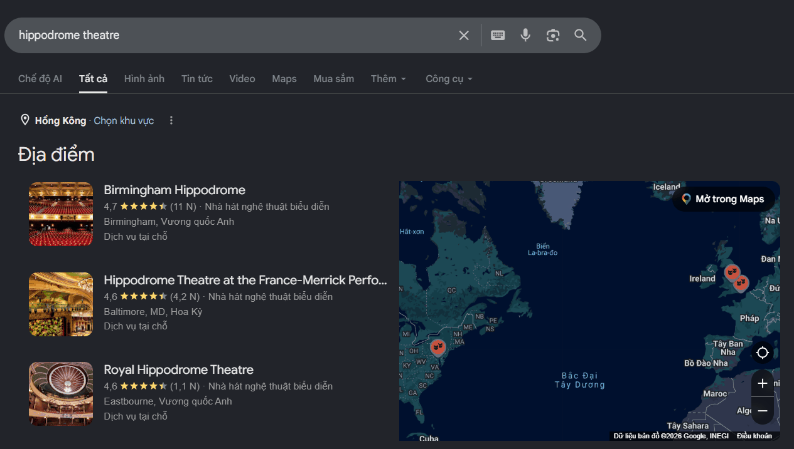
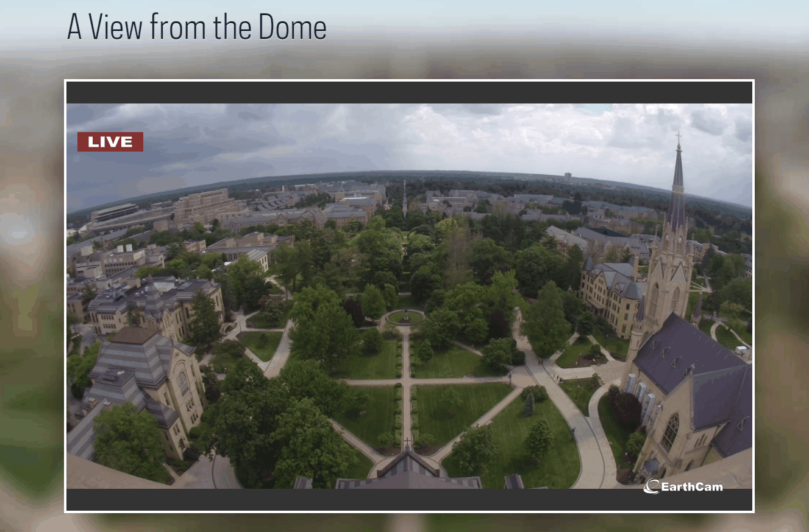
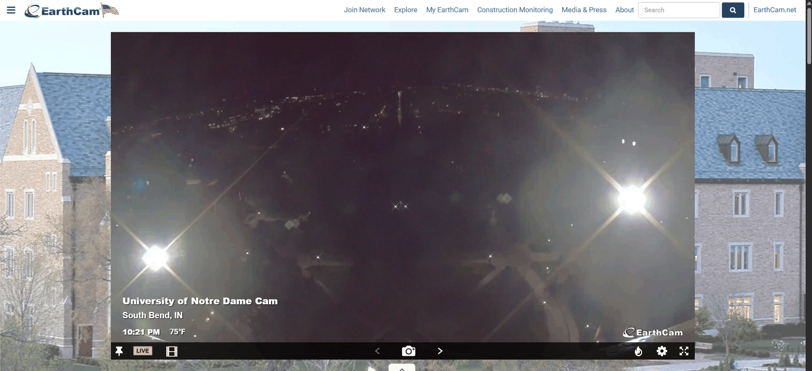

# Lespion – OSINT Investigation

# Scenario & Objective

A suspect leaves a trail of public information online. Starting from his public accounts, I have to see what he exposed by accident and where he is.

- **Category**: OSINT
- **Tools**: GitHub, CyberChef, Google Maps, public webcams

## Overview

The suspect's public GitHub account has a login-page project whose source contains an API key and a Base64-encoded password in plain text. The same account forks the XMRig miner, last updated on 13 May 2020. His social-media photos match Birmingham, United Kingdom (Bull Ring / Mailbox area and the Birmingham Hippodrome), and a live EarthCam view helped confirm the angle. Personal data and the secrets themselves are removed from this write-up.

# Analysis

I started with the suspect's public GitHub repositories. One of them is a small login-page project, and its source has an API key sitting in the code (blacked out in my screenshot).

    
  <em>Image 1: Hard-coded API key in the repository (redacted)</em>

The password field is not much better: it is stored as a Base64 string in the HTML/JSP form. Base64 is only an encoding, so I pasted it into CyberChef with *From Base64* and got the plain password back (also redacted here).

    
  <em>Image 2: Base64-encoded password in the HTML/JSP form (redacted)</em>

    
  <em>Image 3: CyberChef *From Base64* (output redacted)</em>

Looking at what else the account contains, there is a fork of `xmrig`, the Monero miner, last updated on 13 May 2020. A fork alone does not prove anything, but a miner next to leaked credentials is worth a note.

    
  <em>Image 4: Forked <code>xmrig</code> repository</em>

The location part came from photos on his social-media account (I removed those screenshots on purpose). The buildings and the street layout pointed to Birmingham. I lined them up in map imagery and in Google Maps around the Birmingham Hippodrome, then used a public webcam, the "View from the Dome" camera on EarthCam, to check that the viewpoint matched.

    
  <em>Image 5: Map imagery used to match the landmarks</em>

    
  <em>Image 6: Google Maps view of Birmingham Hippodrome</em>

    
  <em>Image 7: Live webcam: View from the Dome</em>

    
  <em>Image 8: EarthCam network page</em>

# Answer the Questions

**Q1: What is the real name of the threat actor?**

Émilie Marseille.

**Q2: What is the programming language used in the login page project?**

JavaScript (`Login Page.js`).

**Q3: What is the API key found in the repository?**

Left out on purpose; it sits in plain text in the repository's `Login Page.js` (`API Key =`).

**Q4: What is the plaintext password recovered from the repository?**

Left out on purpose; it is Base64 in the same project and decodes in CyberChef.

**Q5: What cryptomining software is found on the threat actor's GitHub?**

XMRig (a fork of `xmrig/xmrig`).

**Q6: What city is the suspect currently in based on their Instagram?**

Singapore.

**Q7: What city was the suspect previously in based on their Instagram?**

Dubai.

**Q8: What city is the suspect's office located in?**

Birmingham.

**Q9: What is the state in which the webcam is located?**

Indiana.
