# NerisBot – Suricata and Zeek Log Investigation

# Scenario & Objective

Unusual network activity was reported in a university network on 10 August 2011. The lab provides Suricata and Zeek logs loaded in Splunk. The job is to find the infected host, see where it connected and which files it downloaded.

- **Category**: Network Forensics
- **Tools**: Splunk (SPL), Suricata, Zeek, VirusTotal

## Overview

An investigation into unusual network activity on August 10, 2011, revealed a successful malware infection within the university network environment. The compromised internal host (147.32.84.165) generated an overwhelming number of Suricata alerts, accounting for 99.44% of the total alert volume in the monitored period. The investigation tracked the attacker's actions from the initial payload delivery, which included obfuscated executables, to the establishment of persistent Command and Control (C2) communications.

# Analysis

**Phase 1: Reconnaissance and Victim Identification** The investigation began by assessing the available log sources, identifying suricata and zeek logs as the primary datasets 

  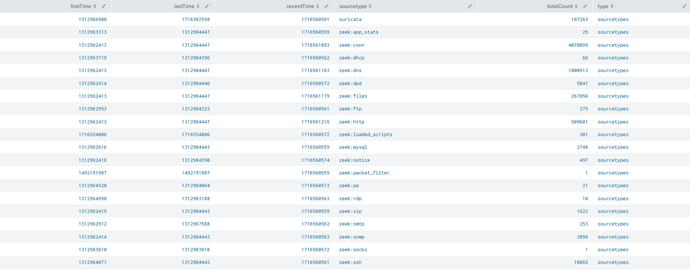  
  <em>Image 1</em>

To pinpoint the compromised machine, an analysis of suricata alert volumes was conducted. The host at 147.32.84.165 was identified as the clear victim, generating 2,856 alerts (99.44% of all alerts).

  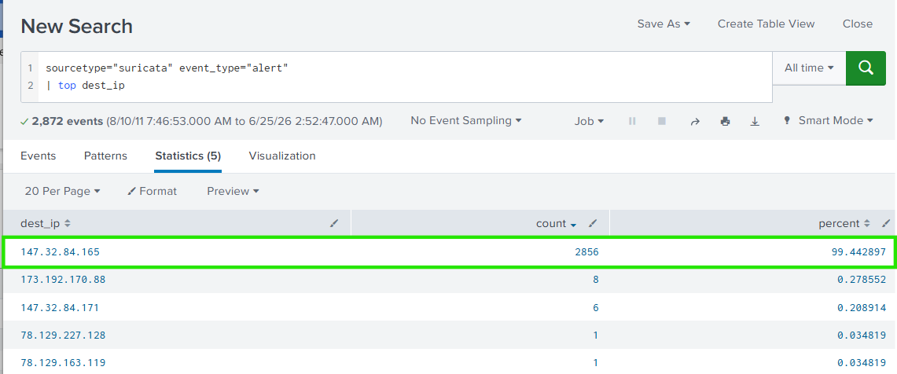  
  <em>Image 2</em>

The vast majority of these alerts (2,632 events) were flagged as SURICATA TCPv4 invalid checksum.

  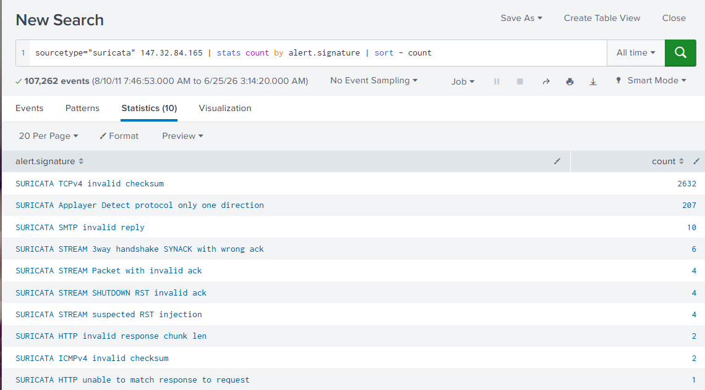  
  <em>Image 3</em>

**Phase 2: Identifying the Command and Control (C2) Infrastructure**:

By examining the HTTP traffic originating from the victim host, connections were observed reaching out to external IP addresses, most notably 195[.]88[.]191[.]59.

  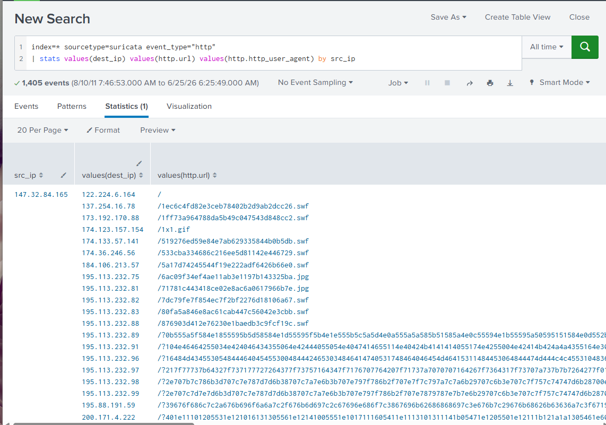  
  <em>Image 4</em>

Querying the zeek:dns logs confirmed that the victim machine repeatedly requested resolutions for the domain nocomcom[.]com, which directly mapped back to the attacker's IP address (195[.]88[.]191[.]59).

  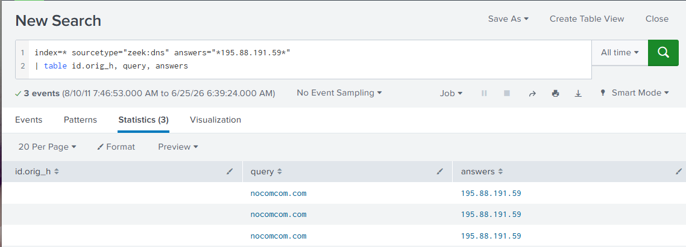  
  <em>Image 5</em>

**Phase 3: Payload Delivery and Evasion Tactics**

The attacker's actions were heavily focused on dropping malware onto the victim host throughout the morning of August 10, 2011.

- At **09:01:40.475**, the first observed action was the victim host initiating an HTTP request to the C2 server for the executable /temp/3425.exe?t=0.3419458

  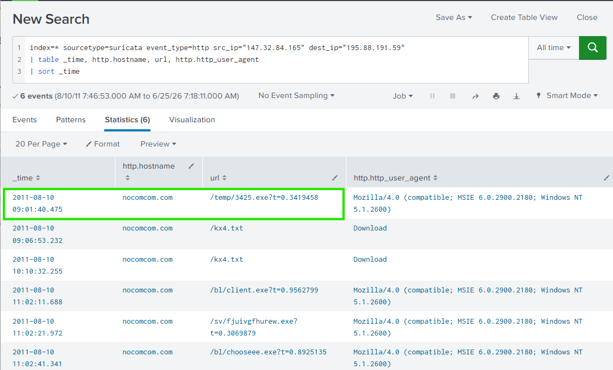  
  <em>Image 6</em>

- Between **09:06:50.804** and **09:09:01.090**, Zeek logs captured a rapid succession of application/x-dosexec file transfers

  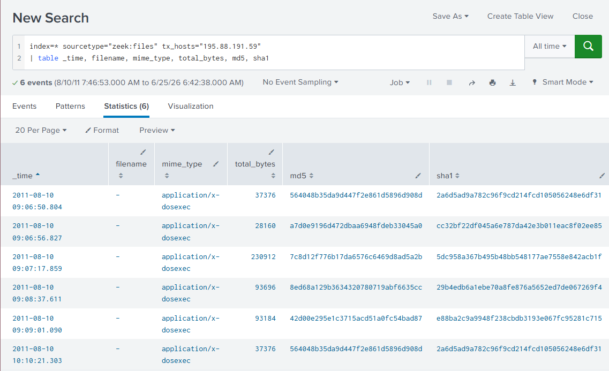  
  <em>Image 7</em>

- These transfers resulted in five unique malicious MD5 hashes successfully landing on the system.

  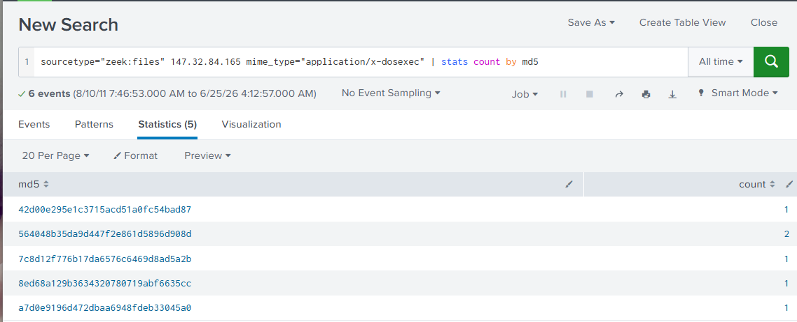  
  <em>Image 8</em>

- During this window, the attacker employed Defense Evasion techniques. At **09:06:53.232** (and again later at **10:10:32.255**), Suricata logged the victim downloading a file named /kx4.txt.

  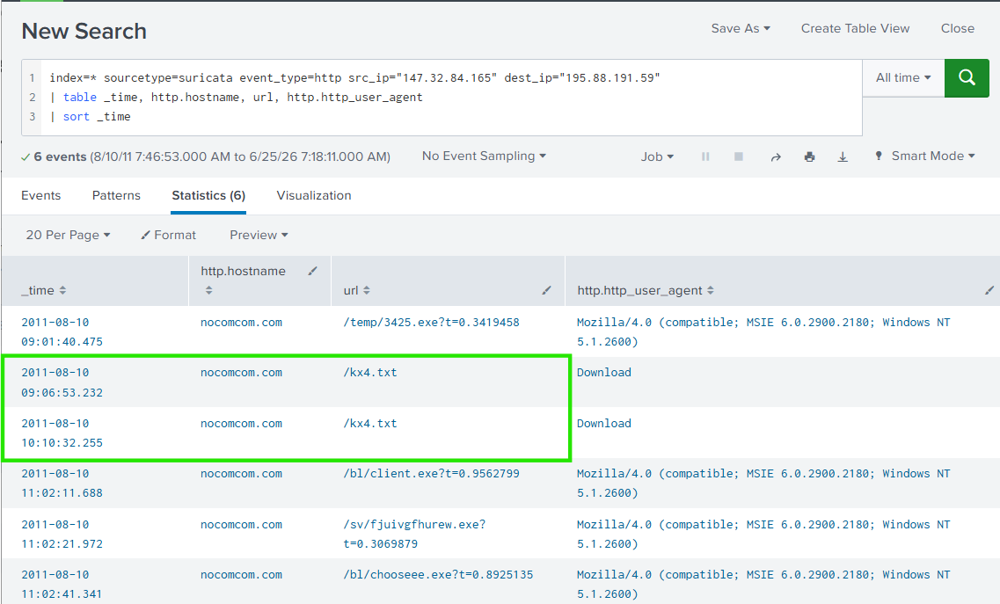  
  <em>Image 9</em>

- By correlating the byte sizes between Suricata and Zeek logs, it was proven that this seemingly harmless text file was actually an obfuscated executable associated with the MD5 hash 564048b35da9d447f2e861d5896d908d.

  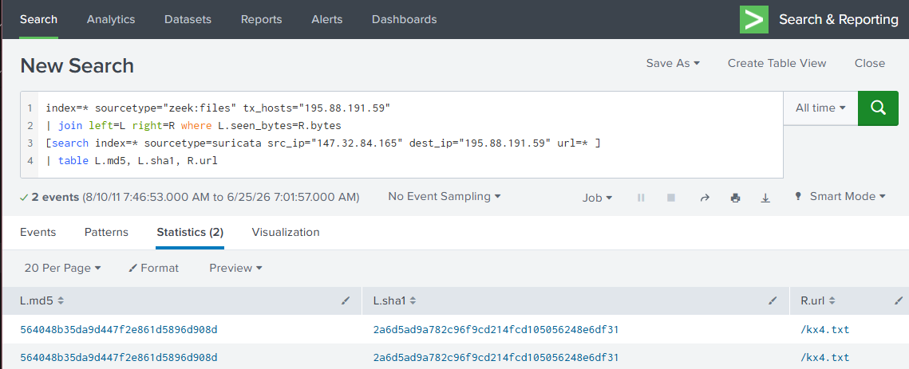  
  <em>Image 10</em>

- The attacker continued to drop secondary payloads later that morning. Between **11:02:11.688** and **11:02:41.341**, the victim requested additional files explicitly named as executables, including /bl/client.exe, /sv/fjuivgfhurew.exe, and /bl/chooseee.exe.

  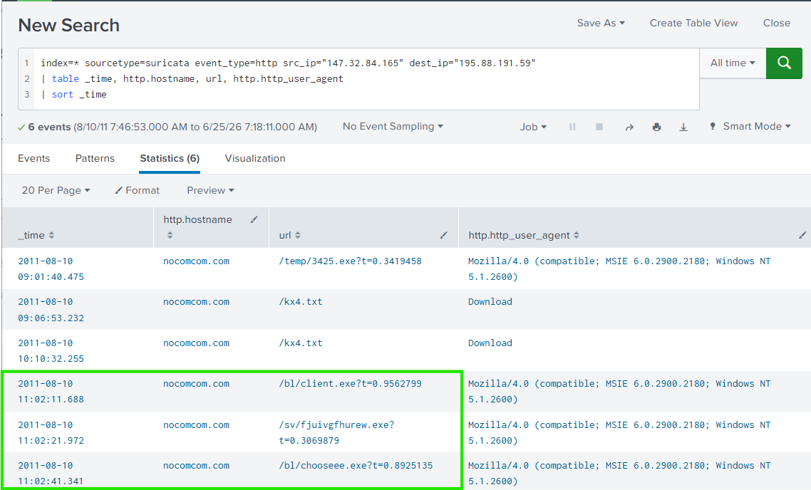  
  <em>Image 11</em>

**3. Indicators of Compromise (IoCs) & Threat Intelligence**

The hashes extracted from the Zeek file transfers were submitted to VirusTotal for threat intelligence validation. The analysis confirmed that these payloads belong to well-known malware families (including Neris, Dacic, and Emotet variants).

- **Disguised Payload (kx4.txt):** SHA256 6fbc4d506f4d4e0a64ca09fd826408d3103c1a258c370553583a07a4cb9a6530 (Flagged by 64/71 vendors as trojan.dacic/vbagent)**.**

  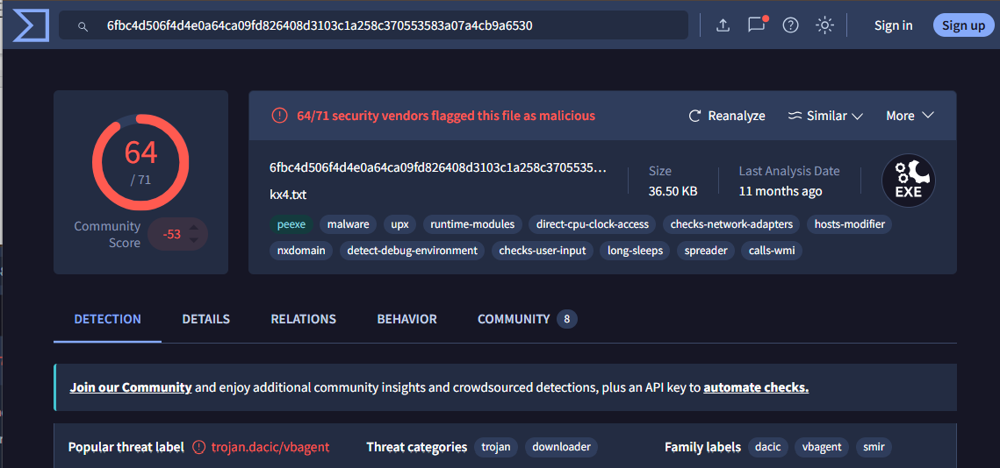  
  <em>Image 12</em>

- **Payload (mousedriver.exe):** SHA-256 2ed4a4ad94c6148b013aecacae783748d51d429de4f1d477a79bbf025d03d47a (Flagged by 61/71 vendors as trojan.razy/dugenpal).

  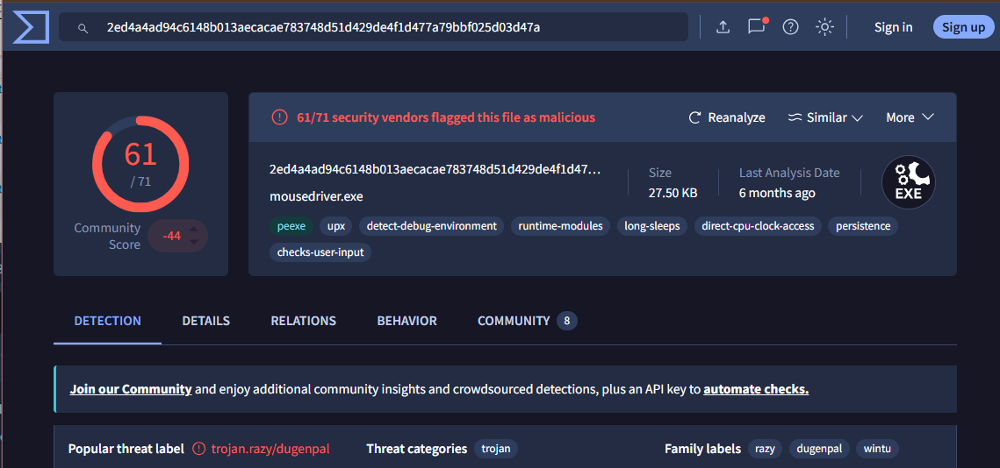  
  <em>Image 13</em>

- **Payload (hmm.exe):** SHA-256 617520dbb4c29f0d072ffb6f9f637c558dc224441d235943957aaa8f5de8db6f (Flagged by 62/72 vendors as trojan.zusy/acne).

  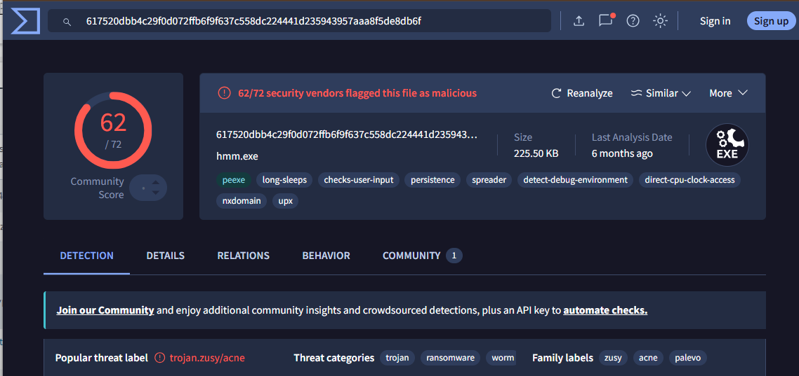  
  <em>Image 14</em>

- **Payload (client.exe):** SHA-256 6d8353efda8438bf2dff79d6a4c174d5593450858c74c45c6f2718927546c1bd (Flagged by 51/67 vendors as trojan.yakes/barys).

  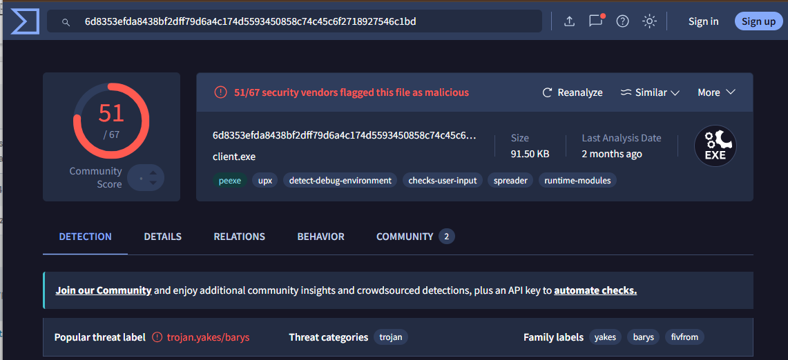  
  <em>Image 15</em>

- **Payload (fjuivgfhurew.exe):** SHA-256 00f15e22ab95632fc51d09f179eb22f5a36e92f6e99390f08a4161f2f93e1717 (Flagged by 65/72 vendors as trojan.emotetu/lethic).

  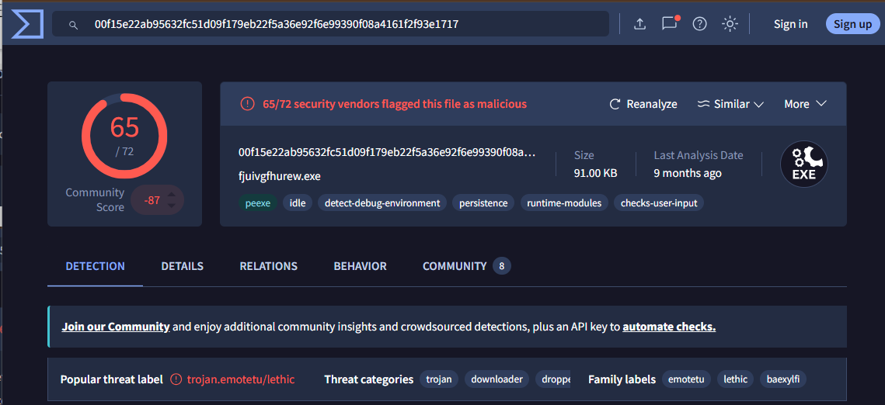  
  <em>Image 16</em>

## Indicators of Compromise

| Type | Value |
|---|---|
| C2 IP / domain | `195[.]88[.]191[.]59` / `nocomcom[.]com` |
| Download paths | `/temp/3425.exe`, `/kx4.txt`, `/bl/client.exe`, `/sv/fjuivgfhurew.exe`, `/bl/chooseee.exe` |
| MD5 (kx4.txt) | `564048b35da9d447f2e861d5896d908d` |
| SHA-256 (kx4.txt) | `6fbc4d506f4d4e0a64ca09fd826408d3103c1a258c370553583a07a4cb9a6530` |
| SHA-256 (mousedriver.exe) | `2ed4a4ad94c6148b013aecacae783748d51d429de4f1d477a79bbf025d03d47a` |
| SHA-256 (hmm.exe) | `617520dbb4c29f0d072ffb6f9f637c558dc224441d235943957aaa8f5de8db6f` |
| SHA-256 (client.exe) | `6d8353efda8438bf2dff79d6a4c174d5593450858c74c45c6f2718927546c1bd` |
| SHA-256 (fjuivgfhurew.exe) | `00f15e22ab95632fc51d09f179eb22f5a36e92f6e99390f08a4161f2f93e1717` |

## MITRE ATT&CK mapping (analyst mapping)

| Technique | Evidence |
|---|---|
| T1105 – Ingress Tool Transfer | Repeated HTTP downloads of executables (`application/x-dosexec`) |
| T1071.001 – Application Layer Protocol: Web Protocols | HTTP communication with the C2 |
| T1036 – Masquerading | Executable delivered as `/kx4.txt` |
