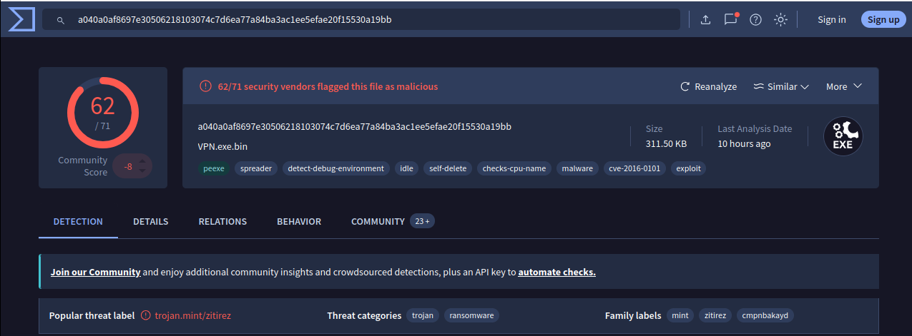
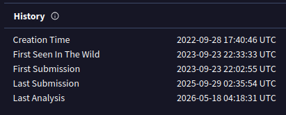
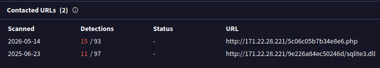
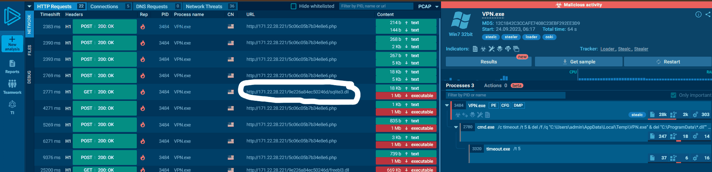
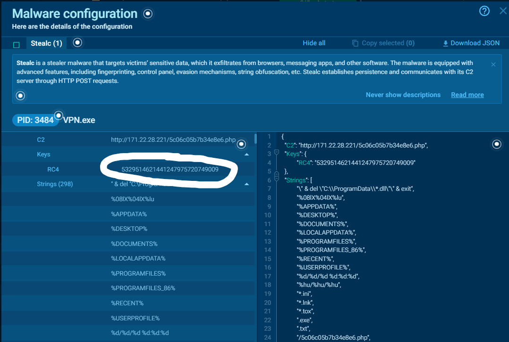
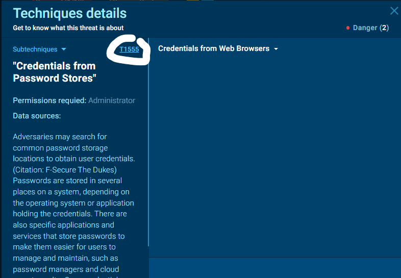
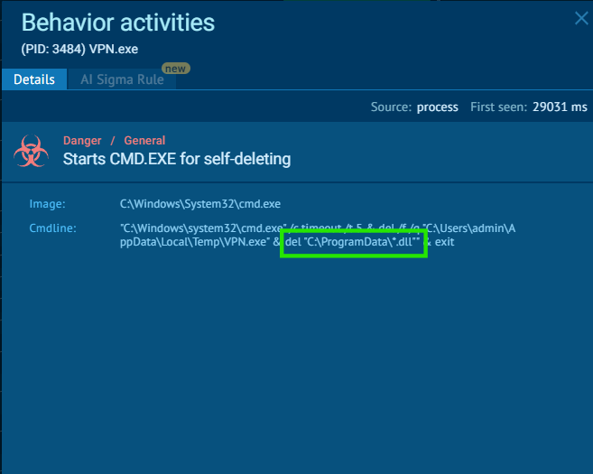
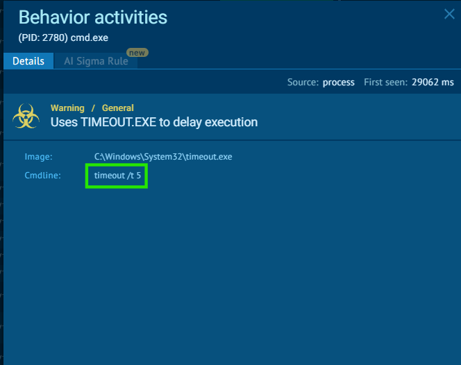

# Oski Stealer – Any.run Triage of a Malicious PowerPoint

# Scenario & Objective

The accountant at the company received an email titled "Urgent New Order" from a client late in the afternoon. When he attempted to access the attached invoice, he discovered it contained false order information. Subsequently, the SIEM solution generated an alert regarding downloading a potentially malicious file. Upon initial investigation, it was found that the PPT file might be responsible for this download. Could you please conduct a detailed examination of this file?

- **Category**: Malware Analysis / Threat Intelligence
- **Tools**: Any.run, VirusTotal, MITRE ATT&CK

## Overview

An accountant received an email called "Urgent New Order" with a PowerPoint attachment, and the SIEM raised an alert for a potentially malicious download. The file turns out to deliver Oski Stealer (`VPN.exe.bin`, MD5 `12c1842c3ccafe7408c23ebf292ee3d9`, compiled on 2022-09-28 at 17:40:46 UTC). After infection the malware downloads `sqlite3.dll` from its C2 at `171[.]22[.]28[.]22`, decrypts its strings with an RC4 key, steals stored credentials (T1555), deletes the DLLs it dropped under `C:\ProgramData\` and removes itself five seconds later.

# Analysis

- Hash: 12c1842c3ccafe7408c23ebf292ee3d9.

- This malware is highly malicious with a score of 62.

- The main file name which is shared is VPN.exe.bin.

- Checking the threat categories, we can see that it has trojan and ransomware.

- The file type is an windows executable file.

    
  <em>Image 1</em>

## Step 1 – Creation time of the sample

    
  <em>Image 2</em>

- In the history tab, the time of malware creation was 2022-09-28 17:40:46 UTC. This timestamp reflects the moment when the malicious file was compiled.

## Step 2 – C2 server

    
  <em>Image 3</em>

- A Command-and-Control (C2) server is a system used by cybercriminals to communicate with compromised devices inside a network. Once malware infects a device, it establishes a connection to a C2 server to receive instructions, send stolen data, and maintain persistent control.

- In this case, there were two links connected with this malware, one was PHP file and the other was DLL file. By definition, PHP file is used for maintaining the access and connectivity between the server and the client. Where as a DLL file is a library that contains code and data that can be used by more than one program. Therefore, the identified C2C server is associated with the IP address 171[.]22[.]28[.]22 which is linked to URL with PHP file.

## Step 3 – First library requested after infection

    
  <em>Image 4</em>

- In the analysis of this malware through any.run report, the first library that the malware requests post-infection is sqlite3.dll. This library acts as the "brain" that an application plugs into to read and write database files directly, so that the malware may be preparing to access or manipulate structured data, potentially to collect credentials or other sensitive information stored in databases.

## Step 4 – RC4 key for the Base64 string

    
  <em>Image 5</em>

- Key RC4: 5329514621441247975720749009.

- RC4 (Rivest Cipher 4) is a widely used symmetric key stream cipher. It encrypts and decrypts data one byte at a time by combining a continuous pseudorandom keystream with the plaintext using a bitwise XOR operation. In this case, It is often utilized for encrypting or decrypting data such as strings, configuration files, or payloads to evade detection or obscure functionality.

## Step 5 – Credential-theft technique (ATT&CK)

    
  <em>Image 6</em>

- The main MITRE technique is T1555 - Adversaries may search for common password storage locations to obtain user credentials. Passwords are stored in several places on a system, depending on the operating system or application holding the credentials. There are also specific applications and services that store passwords to make them easier for users to manage and maintain, such as password managers and cloud secrets vaults. Once credentials are obtained, they can be used to perform lateral movement and access restricted information.

## Step 6 – DLL deletion target

    
  <em>Image 7</em>

- In the Behavior activities of any.run report, It showed that the malware targeted `C:\ProgramData\*.dll` directory to delete all DLL file.

## Step 7 – Self-deletion delay

    
  <em>Image 8</em>

- Through the processes tab, there is one process of timeout.exe, which had the cmdline is “timeout /t 5”. Therefore, it takes 5 seconds for the malware to self-delete.

## Indicators of Compromise

| Type | Value |
|---|---|
| MD5 | `12c1842c3ccafe7408c23ebf292ee3d9` |
| SHA-256 (from Any.run report URL) | `a040a0af8697e30506218103074c7d6ea77a84ba3ac1ee5efae20f15530a19bb` |
| File name | `VPN.exe.bin` |
| C2 URL | `hxxp[://]171[.]22[.]28[.]221/5c06c05b7b34e8e6[.]php` |
| Payload URL | `hxxp[://]171[.]22[.]28[.]221/9e226a84ec50246d/sqlite3[.]dll` |
| RC4 key (string decryption) | `5329514621441247975720749009` |
| Behaviour | `timeout /t 5` self-delete; deletes `C:\ProgramData\*.dll` |

## MITRE ATT&CK mapping

| Technique | Evidence |
|---|---|
| T1566.001 – Phishing: Spearphishing Attachment | Scenario: "Urgent New Order" email with PPT attachment |
| T1555 – Credentials from Password Stores | Main technique shown in the Any.run report (Q5) |
| T1140 – Deobfuscate/Decode Files or Information | RC4-decrypted Base64 strings (Q4) |
| T1071.001 – Application Layer Protocol: Web Protocols | HTTP requests to the C2 PHP endpoint (analyst mapping) |
| T1070.004 – Indicator Removal: File Deletion | `timeout /t 5` followed by self-delete (Q7) |

# Answer the Questions

**Q1: Determining the creation time of the malware can provide insights into its origin. What was the time of malware creation?**

`2022-09-28 17:40:46` UTC.

**Q2: Identifying the command and control (C2) server that the malware communicates with can help trace back to the attacker. Which C2 server does the malware in the PPT file communicate with?**

`hxxp[://]171[.]22[.]28[.]221/5c06c05b7b34e8e6[.]php`

**Q3: Identifying the initial actions of the malware post-infection can provide insights into its primary objectives. What is the first library that the malware requests post-infection?**

`sqlite3.dll`

**Q4: By examining the provided [Any.run report](https://any.run/report/a040a0af8697e30506218103074c7d6ea77a84ba3ac1ee5efae20f15530a19bb/d55e2294-5377-4a45-b393-f5a8b20f7d44), what RC4 key is used by the malware to decrypt its base64-encoded string?**

`5329514621441247975720749009`

**Q5: By examining the MITRE ATT&CK techniques displayed in the [Any.run sandbox report](https://app.any.run/tasks/d55e2294-5377-4a45-b393-f5a8b20f7d44), identify the main MITRE technique (not sub-techniques) the malware uses to steal the user’s password.**

`T1555` – Credentials from Password Stores.

**Q6: By examining the child processes displayed in the [Any.run sandbox report](https://app.any.run/tasks/d55e2294-5377-4a45-b393-f5a8b20f7d44), which directory does the malware target for the deletion of all DLL files?**

`C:\ProgramData\*.dll` (`del "C:\ProgramData\*.dll"`).

**Q7: Understanding the malware's behavior post-data exfiltration can give insights into its evasion techniques. By analyzing the child processes, after successfully exfiltrating the user's data, how many seconds does it take for the malware to self-delete?**

`5` seconds (`timeout /t 5`).
