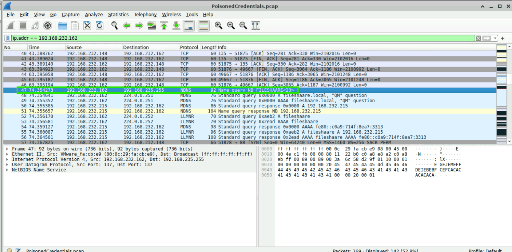
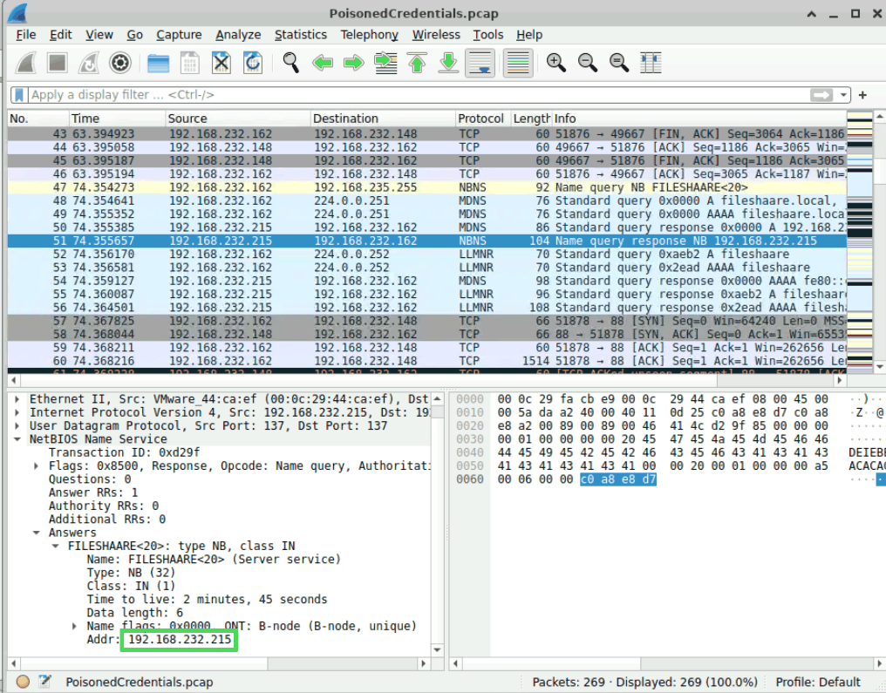
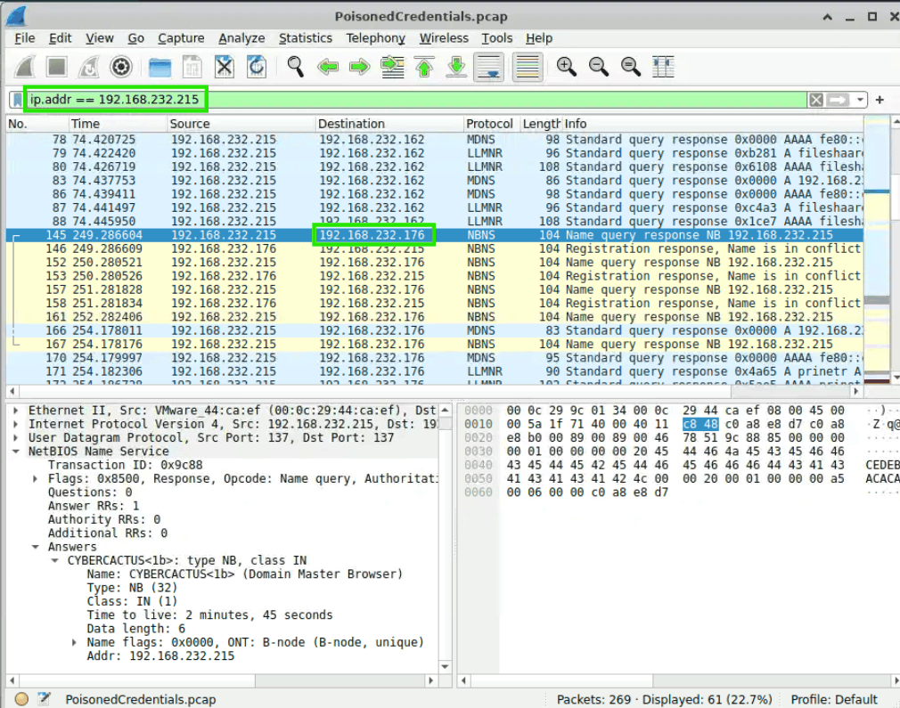
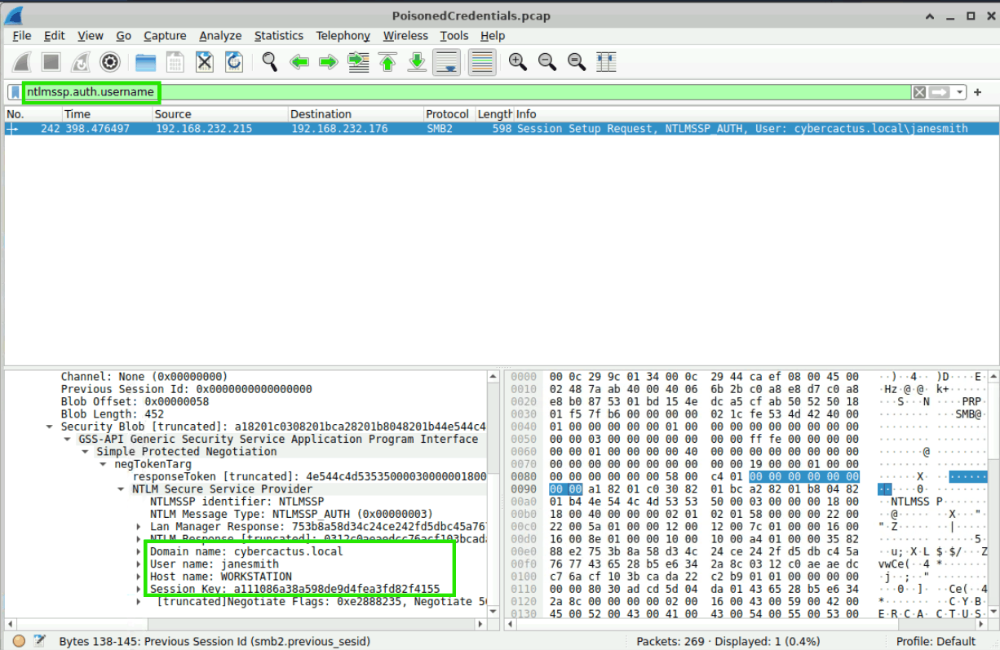
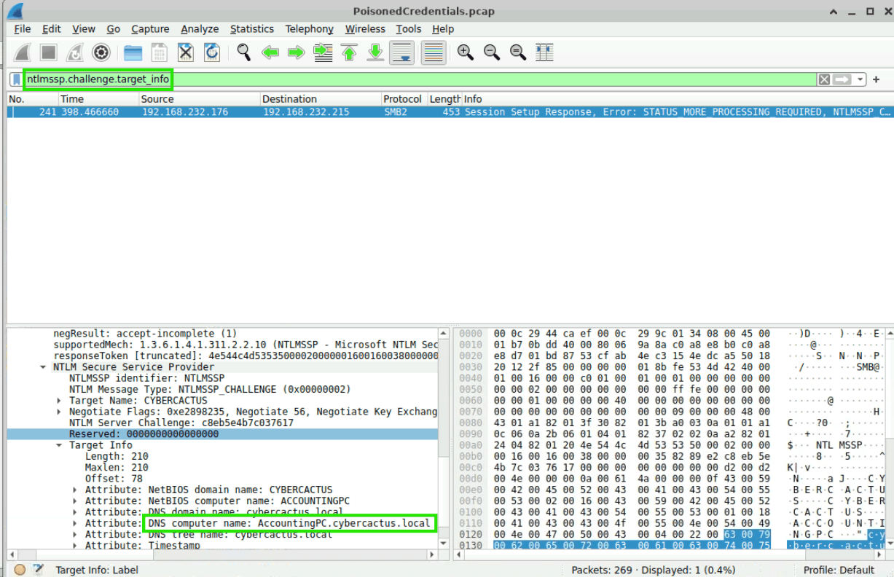

# Poisoned Credentials – LLMNR / NBT-NS / mDNS Poisoning

# Scenario & Objective

The SOC saw signs of an attack on the internal network. In the capture, a machine seems to answer name-resolution requests that were not meant for it. I have to find the rogue host, who it fooled, and which account and machine ended up compromised.

- **Category**: Network Forensics
- **Tools**: Wireshark

## Overview

A host at `192.168.232.162` mistyped a share name (`FILESHAARE` instead of *fileshare*). When DNS failed, the request fell back to NBNS, mDNS and LLMNR, and the rogue machine `192.168.232.215` answered all of them with its own address. A second host, `192.168.232.176` (`ACCOUNTINGPC`), was poisoned too. The capture then shows an NTLM authentication for `cybercactus.local\janesmith` going from the rogue host to `192.168.232.176`, which is what you would expect from a Responder-style attack followed by a relay.

# Analysis

I started in the name-resolution traffic. `192.168.232.162` keeps asking for `FILESHAARE`, once as NBNS (`FILESHAARE<20>`), once as mDNS (`fileshaare.local`) and once over LLMNR. It is just a typo of *fileshare*, but because DNS has nothing for it, Windows falls back to the broadcast and multicast protocols, and that is exactly what a poisoner waits for.

    
  <em>Image 1: Victim <code>192.168.232.162</code> asking for <code>FILESHAARE</code> (NBNS / mDNS)</em>

Right after the questions come the answers, and all of them point to `192.168.232.215`. It answers over mDNS, NBNS and LLMNR, so I take it to be the rogue machine.

    
  <em>Image 2: Same exchange with the answers from <code>192.168.232.215</code></em>

To see who else it tricked, I filtered on `ip.addr == 192.168.232.215`. Besides the replies to the first victim, the list contains LLMNR/mDNS answers and an NBNS conflict involving `192.168.232.176`, so that is the second poisoned machine.

    
  <em>Image 3: All traffic of <code>192.168.232.215</code> (LLMNR/mDNS responses, NBNS conflict from another host)</em>

For the accounts, I switched to NTLM. With `ntlmssp.auth.username` I found a single user, `janesmith` in the domain `cybercactus.local`, in packet 242 (about 398.48 s into the capture), sent from `192.168.232.215` to `192.168.232.176`. The `WORKSTATION` value inside that authentication message is the attacker's own workstation name, not the target's.

    
  <em>Image 4: <code>ntlmssp.auth.username</code> filter showing <code>janesmith</code></em>

The target is named in the NTLM challenge (`ntlmssp.challenge.target_info`): the NetBIOS computer name is `ACCOUNTINGPC` and the DNS name is `AccountingPC.cybercactus.local`.

    
  <em>Image 5: NTLM challenge: computer name <code>ACCOUNTINGPC</code>, DNS <code>AccountingPC.cybercactus.local</code></em>

This matches LLMNR/NBT-NS poisoning followed by SMB relay (T1557.001). If the NTLMv2 response was captured, cracking it offline (T1110.002) would be the next step, but I did not see that in the capture.

# Answer the Questions

**Q1: In the context of the incident described in the scenario, the attacker initiated their actions by taking advantage of benign network traffic from legitimate machines. Can you identify the specific mistyped query made by the machine with the IP address 192.168.232.162?**

`fileshaare`

**Q2: We are investigating a network security incident. To conduct a thorough investigation, We need to determine the IP address of the rogue machine. What is the IP address of the machine acting as the rogue entity?**

`192.168.232.215`

**Q3: As part of our investigation, identifying all affected machines is essential. What is the IP address of the second machine that received poisoned responses from the rogue machine?**

`192.168.232.176`

**Q4: We suspect that user accounts may have been compromised. To assess this, we must determine the username associated with the compromised account. What is the username of the account that the attacker compromised?**

`janesmith`

**Q5: As part of our investigation, we aim to understand the extent of the attacker's activities. What is the hostname of the machine that the attacker accessed via SMB?**

`AccountingPC`

# References

- [Poisoned Credentials write-up (bernie6401)](https://bernie6401.github.io/CyberDefender-PoisonedCredentials)
- [Poisoned Credentials write-up (zakaria-elomari)](https://zakaria-elomari.github.io/posts/cyberdefenders-poisonedcredentials-llmnr-smb-relay/)
- [Poisoned Credentials write-up (nicoleman0)](https://nicoleman0.github.io/security.github.io/blog/2025/03/11/PoisonedCredentials)
