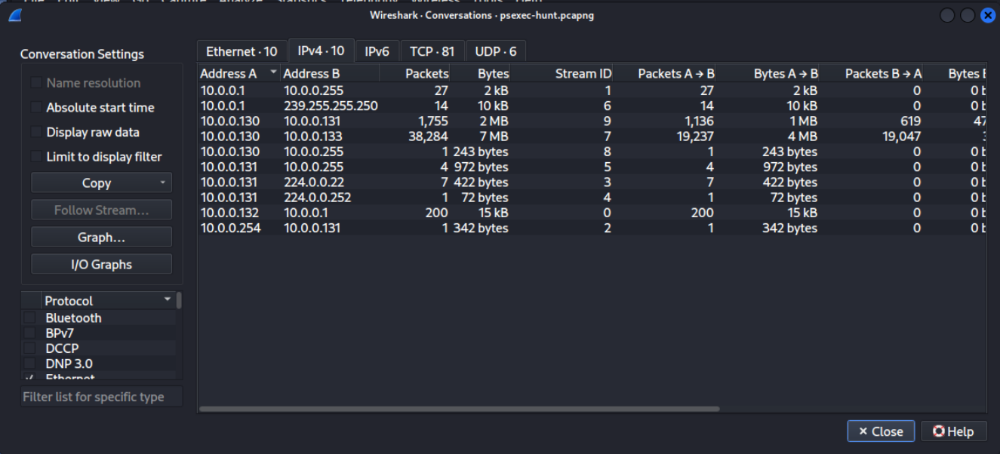
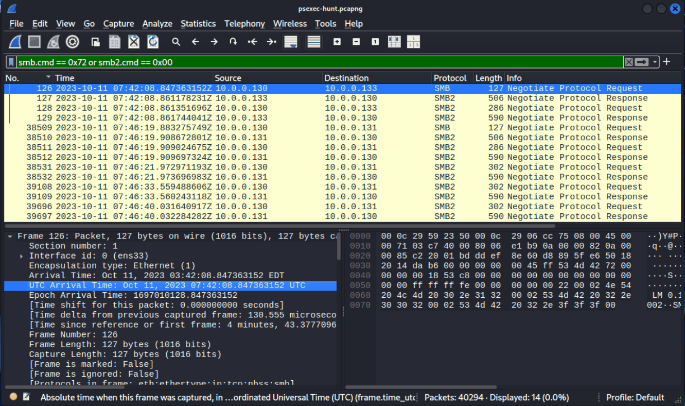
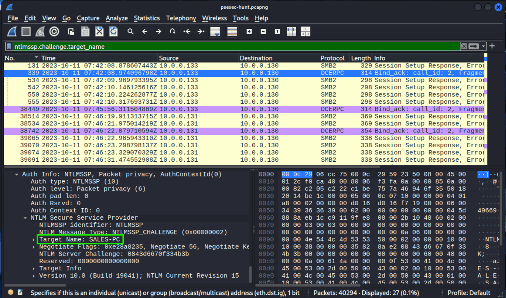
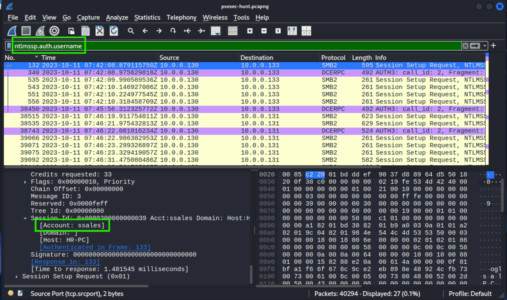
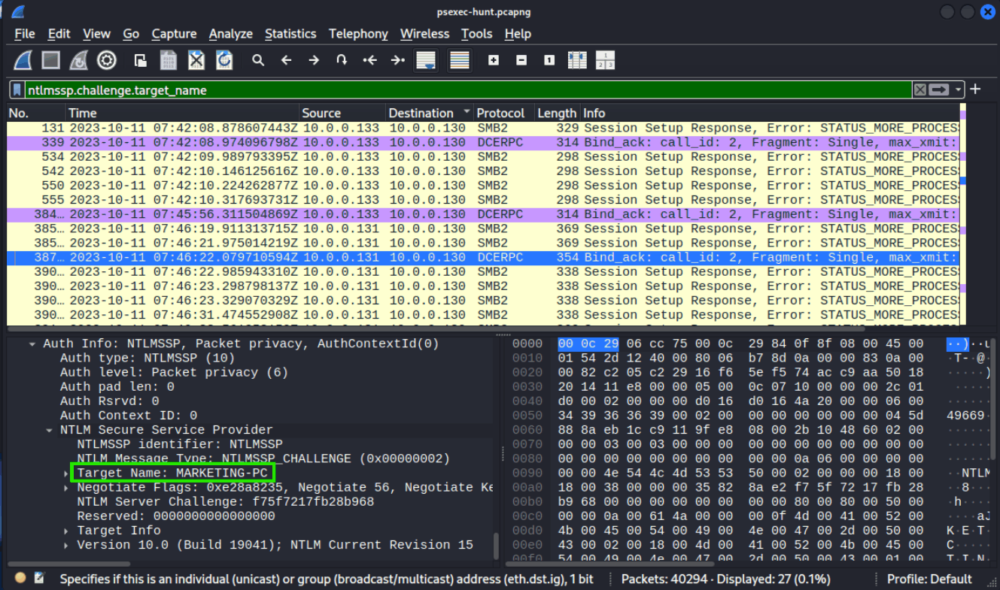
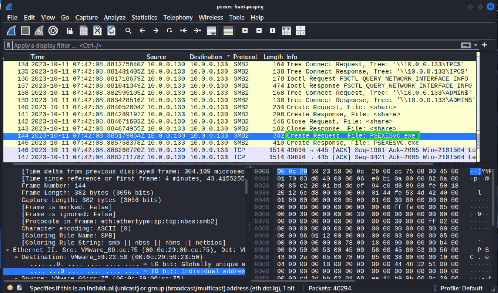
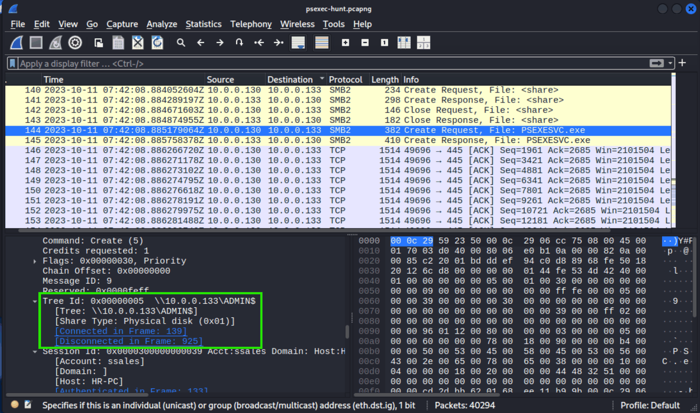
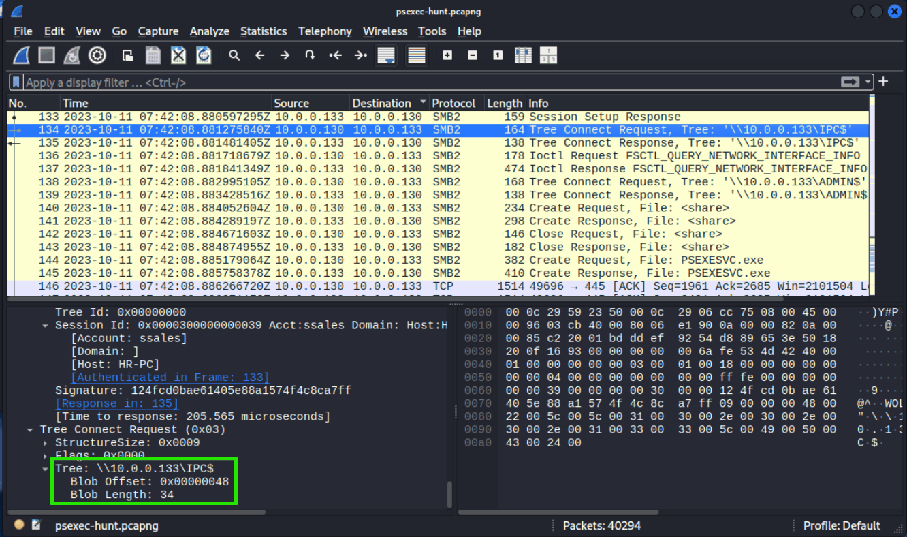

# PsExec Hunt – Lateral Movement over SMB

# Scenario & Objective

The SOC suspects that someone moved laterally inside the network with PsExec. I get a capture and have to find the source host, the machines it reached, the account it used and the evidence of remote execution.

- **Category**: Network Forensics
- **Tools**: Wireshark

## Overview

`10.0.0.130` (SMB client name `HR-PC`) authenticated as `ssales` to `SALES-PC` (`10.0.0.133`) at 2023-10-11 07:42:08 UTC and then to `MARKETING-PC` (`10.0.0.131`). Both times the tree connects went to `IPC$` and `ADMIN$`, followed by the creation of `PSEXESVC.exe`, which is the service binary PsExec installs on the remote machine. SMB activity goes on until at least 07:46:22 UTC.

# Analysis

I opened Statistics → Conversations to find the heavy talkers. Two SMB conversations from `10.0.0.130` dominate the capture: one to `10.0.0.133` (38,284 packets, about 7 MB) and a smaller one to `10.0.0.131` (1,755 packets, about 2 MB).

    
  <em>Image 1: Conversations: <code>10.0.0.130</code> to <code>10.0.0.133</code> and <code>10.0.0.131</code></em>

The SMB negotiation towards `10.0.0.133` starts at 07:42:08.847 UTC. Authentication takes a few round trips (the `STATUS_MORE_PROCESSING_REQUIRED` answers) until 07:42:10.

    
  <em>Image 2: First SMB negotiate packets (07:42:08.847 UTC)</em>

To learn who was involved I used `ntlmssp.challenge.target_name` and `ntlmssp.auth.username`. The challenge for the first connection names `SALES-PC`, and the authentication belongs to the account `ssales`, with the client host name `HR-PC`.

    
  <em>Image 3: NTLMSSP challenge target name: <code>SALES-PC</code></em>

    
  <em>Image 4: NTLMSSP authentication username: <code>ssales</code></em>

The same exchange against `10.0.0.131` shows the target name `MARKETING-PC`, so the attacker reached a second machine as well.

    
  <em>Image 5: NTLMSSP challenge for the second target, <code>MARKETING-PC</code></em>

After authentication the client connects to the trees `\\10.0.0.133\IPC$` and `\\10.0.0.133\ADMIN$`. Right after the `ADMIN$` connect, a file called `PSEXESVC.exe` is created, which is the PsExec service. That is what I was looking for: admin-share access plus a service binary dropped remotely (T1021.002 and T1569.002).

    
  <em>Image 6: Tree connect to <code>IPC$</code> / <code>ADMIN$</code> and <code>PSEXESVC.exe</code></em>

    
  <em>Image 7: <code>PSEXESVC.exe</code> in the SMB file operations</em>

Activity on the connection continues for a few minutes, with traffic still visible at 07:46:22 UTC.

    
  <em>Image 8: Later activity at 07:46:22 UTC</em>

# Answer the Questions

**Q1: To effectively trace the attacker's activities within our network, can you identify the IP address of the machine from which the attacker initially gained access?**

`10.0.0.130`

**Q2: To fully understand the extent of the breach, can you determine the machine's hostname to which the attacker first pivoted?**

`SALES-PC` (`10.0.0.133`; the `Target Name` field of the SMB session setup).

**Q3: Knowing the username of the account the attacker used for authentication will give us insights into the extent of the breach. What is the username utilized by the attacker for authentication?**

`ssales`

**Q4: After figuring out how the attacker moved within our network, we need to know what they did on the target machine. What's the name of the service executable the attacker set up on the target?**

`PSEXESVC.exe`

**Q5: We need to know how the attacker installed the service on the compromised machine to understand the attacker's lateral movement tactics. This can help identify other affected systems. Which network share was used by PsExec to install the service on the target machine?**

`ADMIN$`

**Q6: We must identify the network share used to communicate between the two machines. Which network share did PsExec use for communication?**

`IPC$`

**Q7: Now that we have a clearer picture of the attacker's activities on the compromised machine, it's important to identify any further lateral movement. What is the hostname of the second machine the attacker targeted to pivot within our network?**

`MARKETING-PC` (`10.0.0.131`).

# References

- [PsExec Hunt write-up (zakaria-elomari)](https://zakaria-elomari.github.io/posts/cyberdefenders-psexec-hunt-network-forensics/)
- [PsExec Hunt walkthrough (ittechnetworkk)](https://ittechnetworkk.github.io/walkthroughs/psexec-hunt)
- [PsExec Hunt lab (jawszero)](https://jawszero.gitbook.io/jaws/network-forensic-labs/psexec-hunt-lab)
