# Red Stealer – RedLine Sample Triage

# Scenario & Objective

A suspicious executable was found. Without running it myself, I have to identify the family, find where it reports to and understand what it can do, using VirusTotal, sandbox reports and community sources.

- **Category**: Malware Analysis / Threat Intelligence
- **Tools**: VirusTotal (detection, behaviour, relations), MalwareBazaar, Malpedia

## Overview

The sample is `wextract.exe` (SHA-256 `248fcc901aff4e4b4c48c91e4d78a939bf681c9a1bc24addc3551b32768f907b`), flagged by 59 of 70 vendors and labelled stealer malware by the VMRay and C2AE sandboxes. The family is RedLine Stealer (Malpedia also lists RECORDSTEALER). The decoded configuration gives the C2 `77[.]91[.]124[.]55:19071`, the Bot ID `frant` and a second C2 list at `http://77[.]91[.]68[.]29/fks/`. Its first submission to VirusTotal was on 2023-10-06 at 04:41:50 UTC.

# Analysis

I started with the detection page: 59 of 70 vendors flag it. The VMRay and C2AE sandbox verdicts both say stealer malware.

  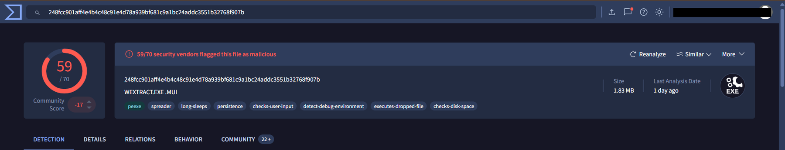  
  <em>Image 1: VirusTotal detection page (59/70), account name redacted</em>

  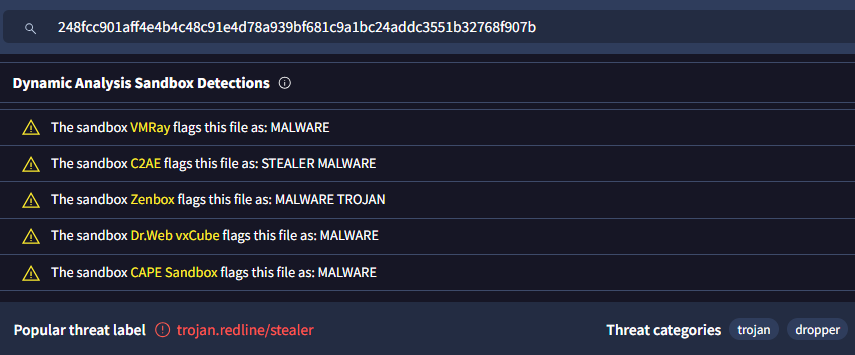  
  <em>Image 2: Sandbox verdicts: VMRay / C2AE</em>

The details tab shows the file as `wextract.exe` (the resource name is `WEXTRACT.EXE .MUI`), which is the Windows self-extractor stub. In the history, the PE creation time is 2022-05-24 22:49:06 UTC, it was first seen in the wild on 2023-10-07 07:20:23 UTC, and the first submission is 2023-10-06 04:41:50 UTC. The compile time most likely belongs to the extractor and not to the payload, so I would not lean on it.

  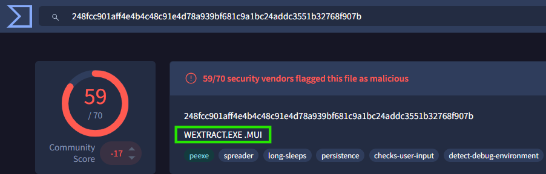  
  <em>Image 3: File names (<code>wextract.exe</code> / <code>WEXTRACT.EXE .MUI</code>)</em>

  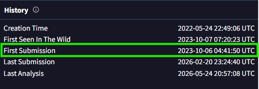  
  <em>Image 4: History: creation time, first seen, last submission</em>

For behaviour I used the sandbox view. The ATT&CK tactics listed are Credential Access, Discovery, Collection, Command and Control and Impact. The DNS list is mostly harmless noise (Bing, Facebook, Azure CDN) and I would not block it because of this sample; the actual C2 is in the IP traffic and, more clearly, in the decoded configuration text, which shows `77[.]91[.]124[.]55:19071`, the Bot ID `frant` and the second list `http://77[.]91[.]68[.]29/fks/`.

  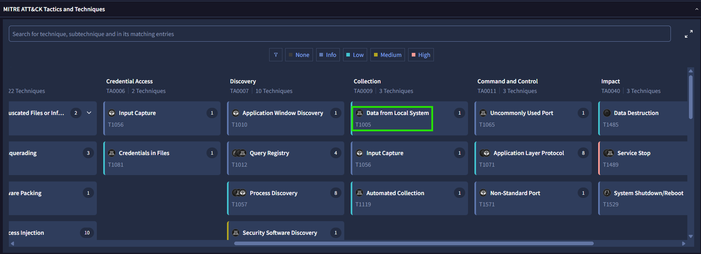  
  <em>Image 5: ATT&amp;CK tactics and techniques from the sandbox</em>

  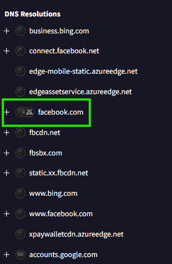  
  <em>Image 6: DNS resolutions (mostly benign background)</em>

  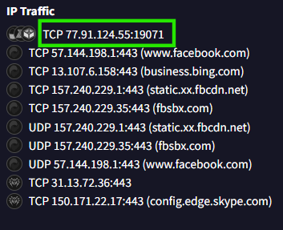  
  <em>Image 7: IP traffic</em>

  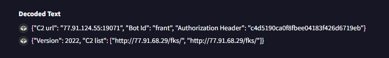  
  <em>Image 8: Decoded configuration text with C2 URL and Bot ID</em>

For family context I checked MalwareBazaar (YARA signatures) and Malpedia, whose entry `win.redline_stealer` lists the alias RECORDSTEALER. The imports of the sample include `OpenProcessToken` and `AdjustTokenPrivileges` from `ADVAPI32.dll`, which fits a stealer that adjusts its own privileges.

  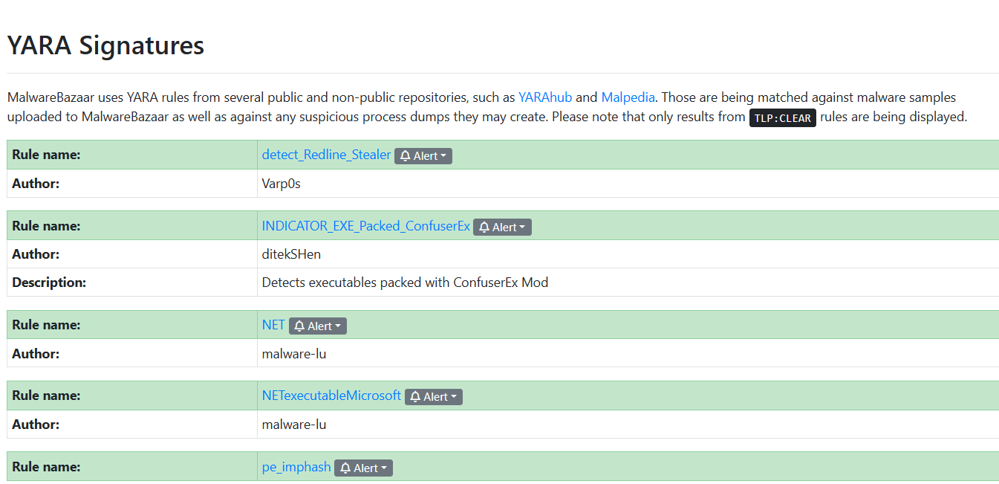  
  <em>Image 9: MalwareBazaar YARA signatures</em>

  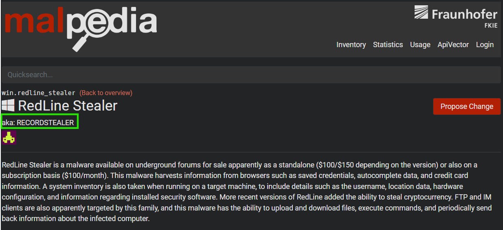  
  <em>Image 10: Malpedia: <code>win.redline_stealer</code></em>

  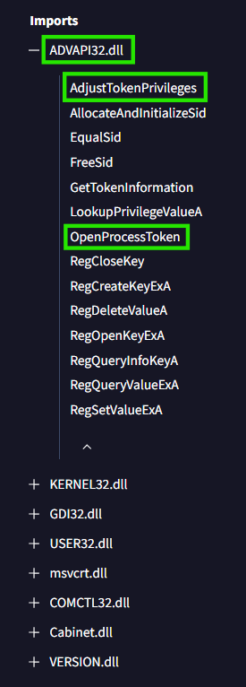  
  <em>Image 11: Imports of the sample</em>

# Answer the Questions

**Q1: Categorizing malware enables a quicker and clearer understanding of its unique behaviors and attack vectors. What category has Microsoft identified for that malware in VirusTotal?**

`Trojan:Win32/Redline!rfn`

**Q2: Clearly identifying the name of the malware file improves communication among the SOC team. What is the file name associated with this malware?**

`WexTract` (`Wextract`).

**Q3: Knowing the exact timestamp of when the malware was first observed can help prioritize response actions. Newly detected malware may require urgent containment and eradication compared to older, well-documented threats. What is the UTC timestamp of the malware's first submission to VirusTotal?**

`2023-10-06 04:41:50` UTC.

**Q4: Understanding the techniques used by malware helps in strategic security planning. What is the MITRE ATT&CK technique ID for the malware's data collection from the system before exfiltration?**

`T1005` – Data from Local System.

**Q5: Following execution, which social media-related domain names did the malware resolve via DNS queries?**

`facebook.com`

**Q6: Once the malicious IP addresses are identified, network security devices such as firewalls can be configured to block traffic to and from these addresses. Can you provide the IP address and destination port the malware communicates with?**

`77[.]91[.]124[.]55:19071`

**Q7: YARA rules are designed to identify specific malware patterns and behaviors. Using MalwareBazaar, what's the name of the YARA rule created by "`Varp0s`" that detects the identified malware?**

`detect_Redline_Stealer`

**Q8: Understanding which malware families are targeting the organization helps in strategic security planning for the future and prioritizing resources based on the threat. Can you provide the different malware alias associated with the malicious IP address according to ThreatFox?**

`RECORDSTEALER`

**Q9: By identifying the malware's imported DLLs, we can configure security tools to monitor for the loading or unusual usage of these specific DLLs. Can you provide the DLL utilized by the malware for privilege escalation?**

`ADVAPI32.dll` (imports `AdjustTokenPrivileges` and `LookupPrivilegeValueA`).
