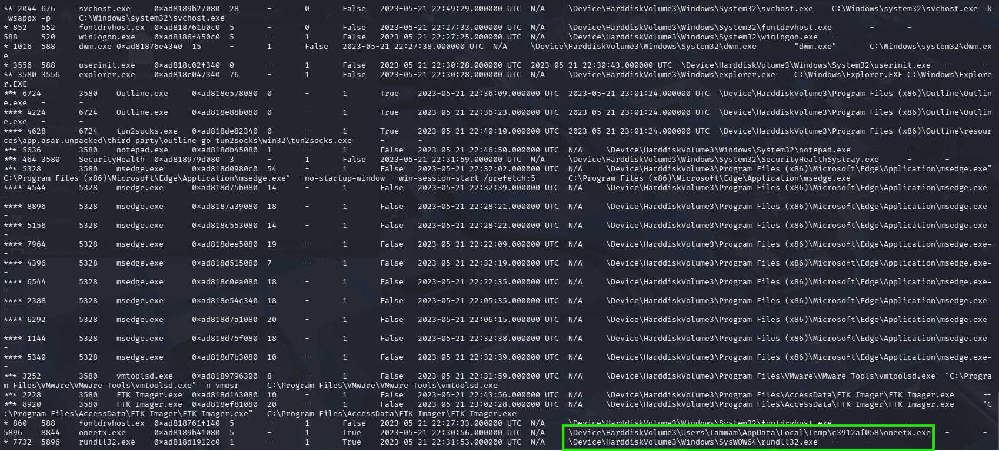
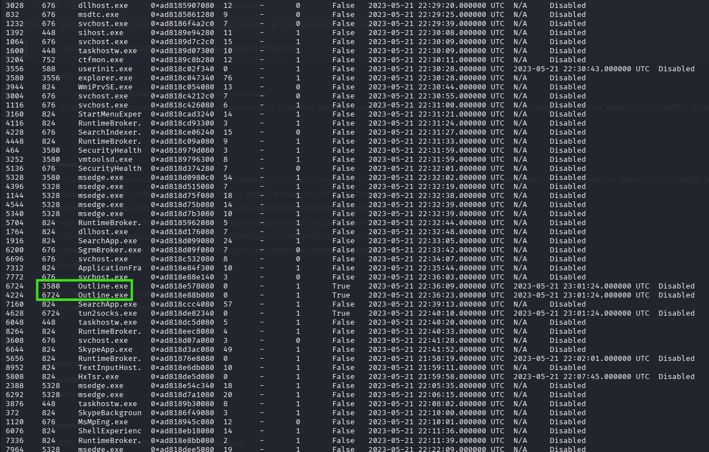
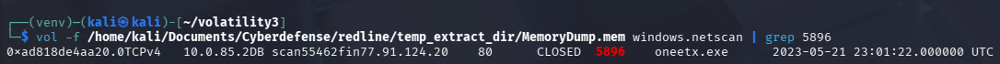
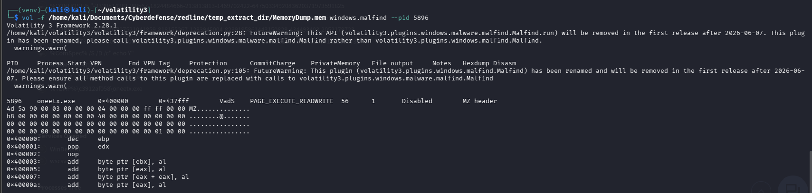
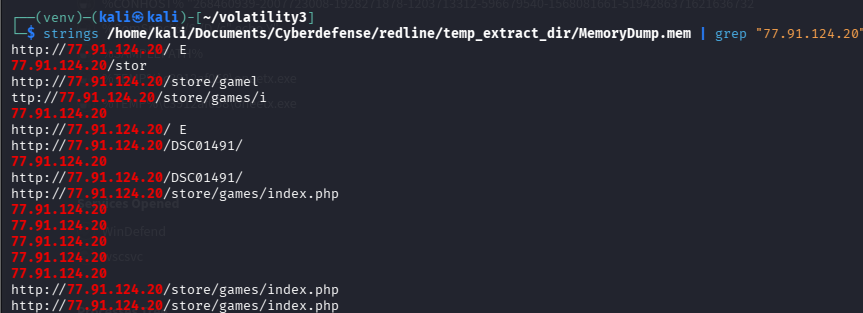
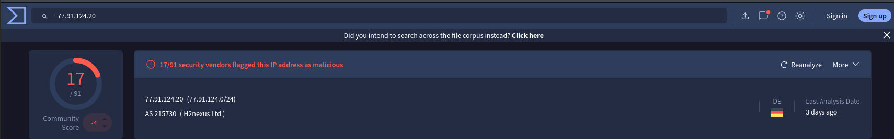
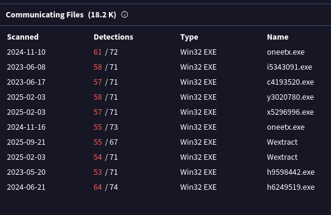
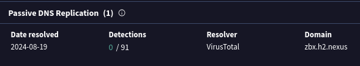
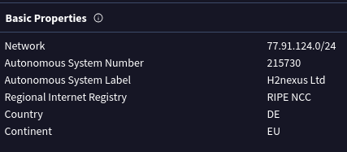

# RedLine – Memory Forensics (Windows 10 Dump)

# Scenario & Objective

A workstation is suspected of being infected with an infostealer. I get a memory dump and have to find the process, its network connection, and learn more about the server it talks to.

- **Category**: Memory Forensics
- **Tools**: Volatility 3 (`pslist`, `netscan`, `malfind`), `strings`, VirusTotal

## Overview

The process `oneetx.exe` (PID 5896) connected to `77[.]91[.]124[.]20` on port 80 on 2023-05-21 at 23:01:22 UTC. That address is flagged by 17 of 91 vendors on VirusTotal (AS215730, H2nexus, Germany), and the files that communicate with it include `oneetx.exe` and a series of similarly named executables. The process list also shows `Outline.exe` (PIDs 3580 and 6724), a VPN client, which is something RedLine goes after.

# Analysis

First, `windows.pslist` for the process tree. Next to the usual Windows processes, `oneetx.exe` (PID 5896) stands out, running out of a random folder under `Temp\c3912af058`. `Outline.exe` also appears twice (PIDs 3580 and 6724).

    
  <em>Image 1: <code>pslist</code>: process tree</em>

    
  <em>Image 2: Further <code>pslist</code> output</em>

I filtered `windows.netscan` on that PID. It shows `oneetx.exe` connecting to `77[.]91[.]124[.]20:80` (state CLOSED, created 2023-05-21 23:01:22 UTC).

    
  <em>Image 3: <code>netscan</code> filtered on PID 5896</em>

`malfind --pid 5896` looks for injected or executable memory regions in the same process. I ran it, but I did not interpret the output in my screenshots, so I can't say whether there is injection.

    
  <em>Image 4: <code>malfind --pid 5896</code></em>

With `strings` over the image I searched for the IP and found HTTP paths of the form `http://<IP>/store/games/…`, so the process was fetching content from that server.

    
  <em>Image 5: <code>strings</code> search for the C2 IP</em>

Then I looked the IP up on VirusTotal. It has 17 of 91 detections, AS215730 (H2nexus Ltd, Germany), and passive DNS shows `zbx.h2.nexus`. The communicating files are `oneetx.exe` (61/72 detections) and several lookalikes (`i5343091.exe`, `c4193520.exe`, `y3020780.exe`, `x5296996.exe`).

    
  <em>Image 6: VirusTotal IP page</em>

    
  <em>Image 7: Communicating files</em>

    
  <em>Image 8: Passive DNS</em>

    
  <em>Image 9: Basic properties: network, ASN, country</em>

Mapped to ATT&CK: T1071.001 (web protocols for C2), and T1055 for the `malfind` check, which I only ran.

# Answer the Questions

**Q1: What is the name of the suspicious process?**

`oneetx.exe`

**Q2: What is the child process name of the suspicious process?**

`rundll32.exe`

**Q3: What is the memory protection applied to the suspicious process memory region?**

`PAGE_EXECUTE_READWRITE`

**Q4: What is the name of the process responsible for the VPN connection?**

`outline.exe`

**Q5: What is the attacker's IP address?**

`77[.]91[.]124[.]20`

**Q6: What is the full URL of the PHP file that the attacker visited?**

`hxxp[://]77[.]91[.]124[.]20/store/games/index[.]php`

**Q7: What is the full path of the malicious executable?**

`C:\Users\Tammam\AppData\Local\Temp\c3912af058\oneetx.exe`
