# REvil – Ransomware Investigation in Splunk

# Scenario & Objective

> You are a Threat Hunter working for a cybersecurity consulting firm. One of your clients has been recently affected by a ransomware attack that caused the encryption of multiple of their employees' machines. The affected users have reported encountering a ransom note on their desktop and a changed desktop background. You are tasked with using Splunk SIEM containing Sysmon event logs of one of the encrypted machines to extract as much information as possible.

- **Category**: SIEM Investigation (Splunk)
- **Tools**: Splunk (SPL), Sysmon, CyberChef, VirusTotal

## Overview

The investigation revealed a complete compromise resulting in the deployment of the REvil (GOLD SOUTHFIELD) ransomware. The attack commenced when an Administrator executed a disguised malicious payload  “**facebook assistant.exe**”. Immediately after execution, the malware utilized advanced evasion techniques—specifically Base64-encoded PowerShell commands—to silently eradicate local system backups. Following the destruction of backups, the malware initiated a rapid, offline encryption sweep of the file system. By correlating endpoint telemetry with Open Source Intelligence (OSINT), the investigation successfully identified the threat actor's external Command and Control (C2) infrastructure for containment and generated a precise chronological ledger of all compromised assets to facilitate IT recovery.

# Analysis

## Initial Access & Payload Delivery

- The investigation was initiated by analyzing file creation events to pinpoint the origin of the ransom notes. Because the environment utilized a Winlogbeat schema, we executed a Splunk query filtering for the specific note format: index=revil winlog.event_id=11 winlog.event_data.TargetFilename="\*-readme.txt".

  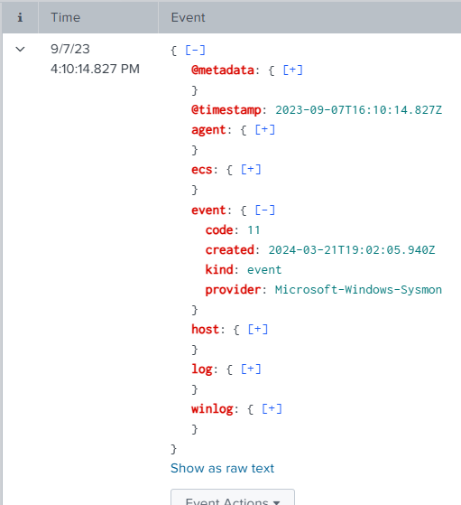  
  <em>Image 1</em>

  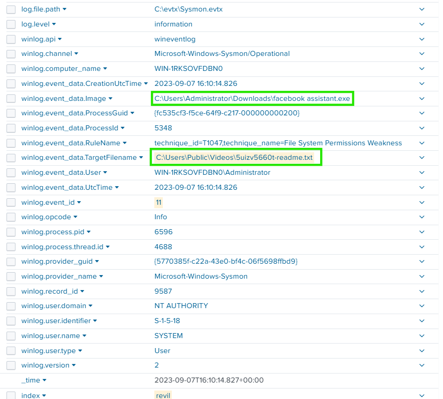  
  <em>Image 2</em>

- This analysis isolated the initial ransom note and exposed the malware's core **ProcessGuid ({fc535cf3-f5ce-64f9-c217-000000000200})**. By pivoting to Process Creation logs (Event ID 1) using **index="revil" winlog.event_id=1 winlog.event_data.ProcessGuid="{fc535cf3-f5ce-64f9-c217-000000000200}"**, we uncovered the exact moment of initial compromise

  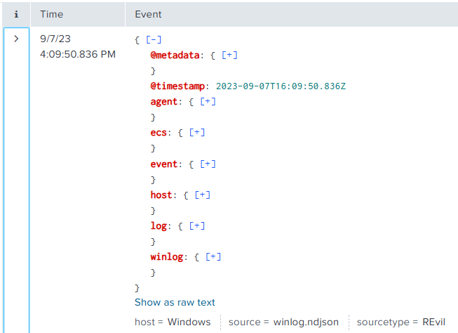  
  <em>Image 3</em>

  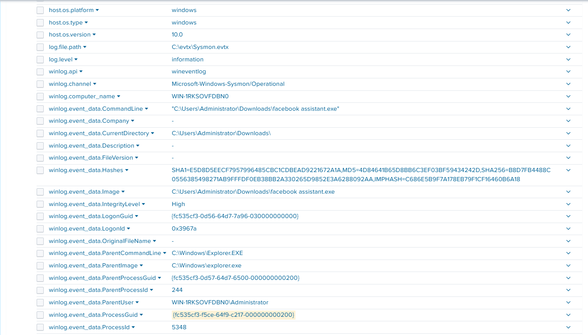  
  <em>Image 4</em>

- The telemetry shows that at precisely **04:09:50.836PM**, the Administrator downloaded and executed a disguised binary named **C:\Users\Administrator\Downloads\facebook assistant.exe**. Additionally, this log allowed us to extract the payload's SHA256 hash, which was crucial for external threat intelligence tracking.

## Advanced Evasion & Execution

- Following the successful initial access, the threat actor wasted no time. They immediately pivoted to destroy local Volume Shadow Copies to prevent data restoration. Because standard searches for known backup-deletion tools yielded zero results, we queried all process creations grouped by their command lines: **index="revil" winlog.event_id=1 \| stats count by winlog.event_data.CommandLine.**

  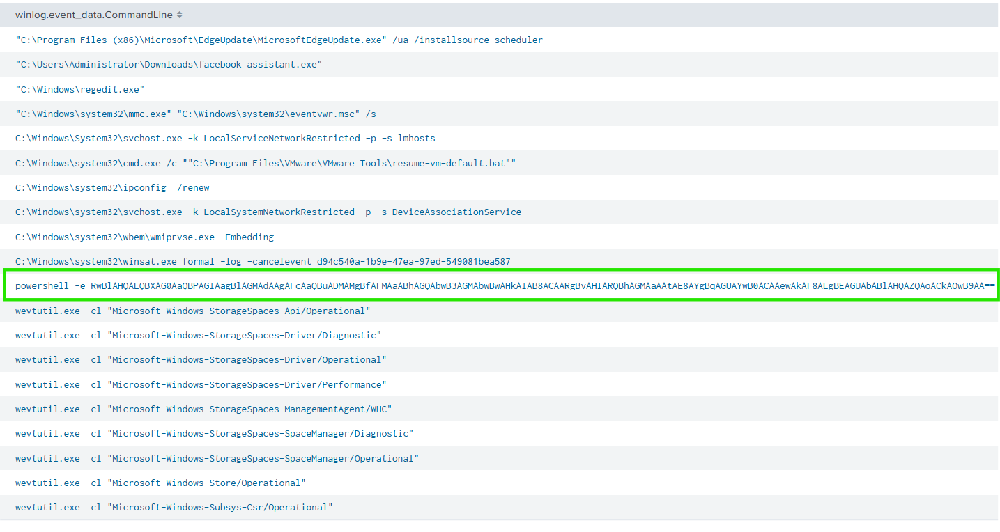  
  <em>Image 5</em>

>

  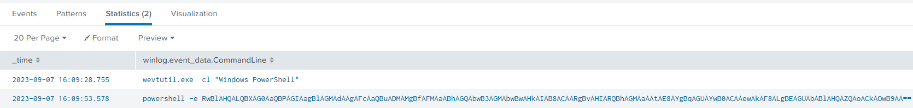  
  <em>Image 6</em>

- The forensic logs revealed a textbook evasion mechanism. At **04:09:53.578PM**, merely three seconds after the initial infection, the malware spawned a PowerShell process executing a Base64-encoded payload (powershell -e RwBlAHQALQBX...).

  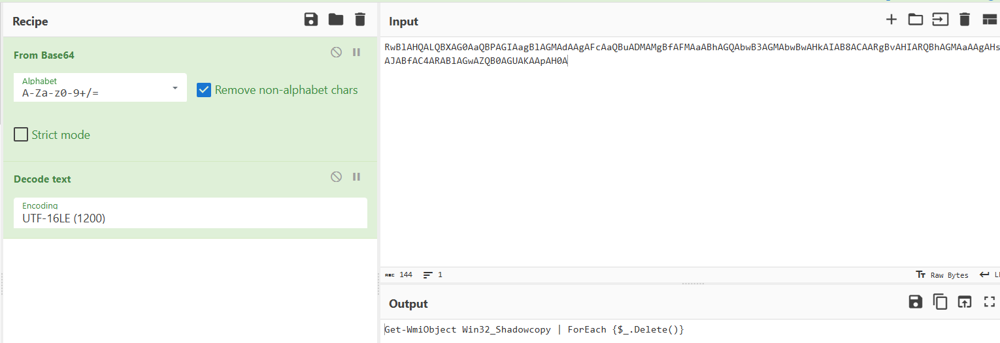  
  <em>Image 7</em>

- Decoding this string using UTF-16LE exposed the attacker's true destructive command: **Get-WmiObject Win32_Shadowcopy \| ForEach {\$\_.Delete()}.** This action completely and silently wiped all local backups from the host system while bypassing standard detection rules.

## External Tracking

- While local network connection logs did not record direct outbound communication—indicating the encryption routine ran offline or via a hidden child process—we extracted the SHA256 hash of the initial payload. We pivoted to global Threat Intelligence by querying the hash on VirusTotal.

  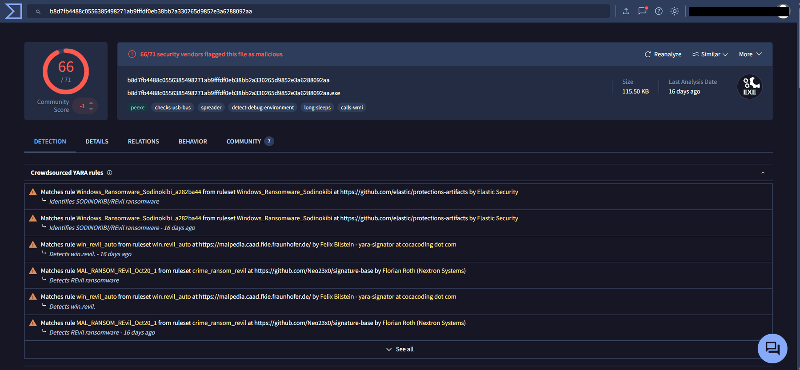  
  <em>Image 8</em>

  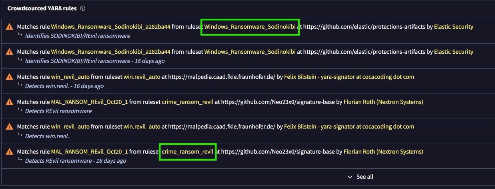  
  <em>Image 9</em>

  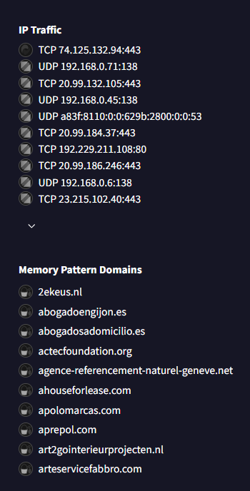  
  <em>Image 10</em>

- The analysis confirmed the attribution to **Windows_Ransomware_Sodinokibi** and **crime_ransom_revil**. Through this OSINT pivot, we successfully extracted the associated Command and Control (C2) infrastructure, identifying critical malicious IP addresses (e.g., **74[.]125[.]132[.]94:443** (low confidence – this address is in Google's range and probably comes from benign contacted-IP noise on VirusTotal; verify before blocking)) and memory pattern domains. This intelligence was mapped out to be immediately blocked at the organization's firewall.

## Data Encryption & Damage Assessment

- With the backups destroyed, the ransomware commenced its primary objective. We mapped the entire scope of the destruction by tracking the creation of files bearing the attacker's unique randomized extension using the query: **index=revil winlog.event_id=11 "\*5uizv5660t\*"**.

  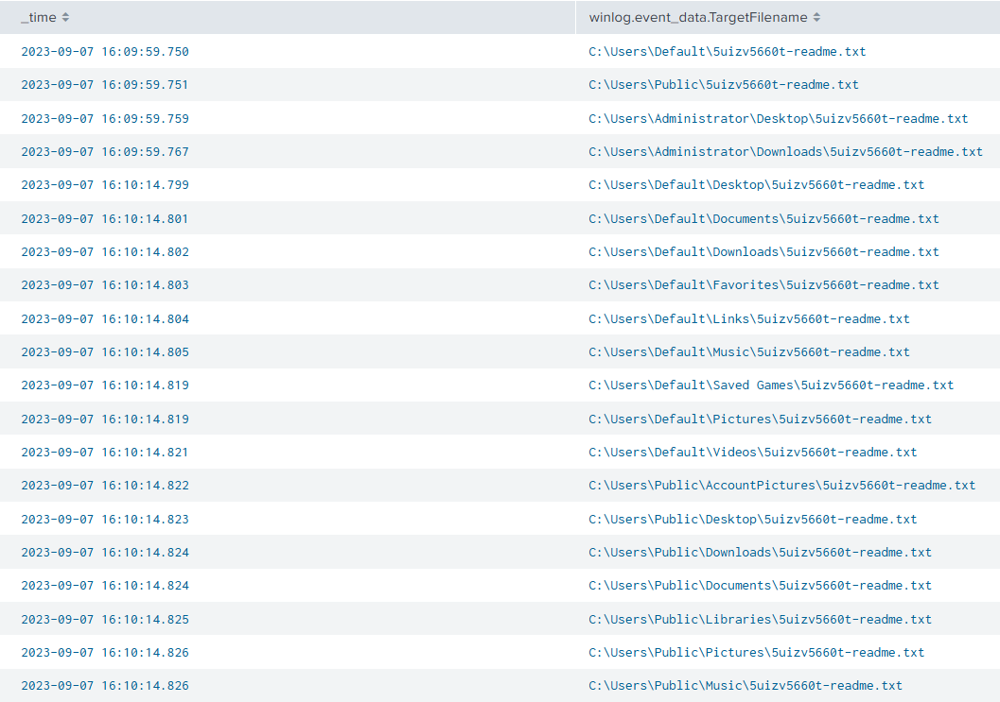  
  <em>Image 11</em>

- The data encryption was executed rapidly. At **04:09:59.750PM**, exactly six seconds after the backups were deleted, the attacker dropped the first localized ransom note **(C:\Users\Default\5uizv5660t-readme.txt)**.

## Indicators of Compromise

| Type | Value |
|---|---|
| SHA-256 | `b8d7fb4488c0556385498271ab9fffdf0eb38bb2a330265d9852e3a6288092aa` |
| File | `C:\Users\Administrator\Downloads\facebook assistant.exe` |
| Ransom note | `5uizv5660t-readme.txt` (first dropped at `C:\Users\Default\`) |
| Encrypted-file extension | `.5uizv5660t` |
| Command (decoded) | `Get-WmiObject Win32_Shadowcopy | ForEach {$_.Delete()}` |

## MITRE ATT&CK mapping

| Tactic | Technique |
|---|---|
| Execution | T1204.002 – User Execution: Malicious File |
| Execution | T1059.001 – PowerShell |
| Defense Evasion | T1027 – Obfuscated Files or Information (Base64 `-e` payload) |
| Impact | T1490 – Inhibit System Recovery |
| Impact | T1486 – Data Encrypted for Impact |

# Answer the Questions

**Q1: To begin your investigation, can you identify the filename of the note that the ransomware left behind?**

`5uizv5660t-readme.txt`

**Q2: After identifying the ransom note, the next step is to pinpoint the source. What's the process ID of the ransomware that's likely involved**

`5348`

**Q3: Having determined the ransomware's process ID, the next logical step is to locate its origin. Where can we find the ransomware's executable file?**

`C:\Users\Administrator\Downloads\facebook assistant.exe`

**Q4: Now that you've pinpointed the ransomware's executable location, let's dig deeper. It's a common tactic for ransomware to disrupt system recovery methods. Can you identify the command that was used for this purpose?**

`Get-WmiObject Win32_Shadowcopy | ForEach-Object {$_.Delete();}` (decoded from the `powershell -e` Base64 string).

**Q5: As we trace the ransomware's steps, a deeper verification is needed. Can you provide the sha256 hash of the ransomware's executable to cross-check with known malicious signatures?**

`B8D7FB4488C0556385498271AB9FFFDF0EB38BB2A330265D9852E3A6288092AA`

**Q6: One crucial piece remains: identifying the attacker's communication channel. Can you leverage threat intelligence and known Indicators of Compromise (IoCs) to pinpoint the ransomware author's onion domain?**

`aplebzu47wgazapdqks6vrcv6zcnjppkbxbr6wketf56nf6aq2nmyoyd[.]onion`
