# ShadowRoast – Active Directory Attack Investigation in Splunk

# Scenario & Objective

An Active Directory environment shows signs of credential abuse. All I have is Splunk with Sysmon and Windows Security logs (Winlogbeat, index `shadowroast`). From the alerts I have to rebuild what the attacker did on the domain and who was affected.

- **Category**: SIEM Investigation (Splunk)
- **Tools**: Splunk (SPL), Sysmon, Windows Security logs, VirusTotal

## Overview

A user on `Office-PC.CORPNET.local`, `sanderson`, ran `AdobeUpdater.exe` from the Downloads folder. A registry Run key was added at 01:05:58 UTC (value `wyW5PZyF`) that runs a Base64 PowerShell stored in the registry. At about 01:14 UTC a chain `cmd.exe` → `powershell -ep bypass` → `DefragTool.exe` ran, and by 01:15 a renamed Mimikatz and Rubeus were running as `CORPNET\tcooper`. At 01:15:21 UTC the DC logged Event ID 4929 with the workstation as replication source, which is the mark of DCShadow. A `tcooper` logon from the external address `223[.]247[.]47[.]74` also shows up.

# Analysis

I started with the logons, because it is the cheapest way to see who is active: `index=shadowroast winlog.event_id=4624 LogonType=3 | stats count by IpAddress, TargetUserName`. `tcooper` logs in from `10.0.0.184` 15 times, `ocors` from `10.0.0.147` twice and `sanderson` from `10.0.0.184` once. One more `tcooper` logon comes from the external IP `223[.]247[.]47[.]74`, which I flagged straight away. I also searched for the typical group and object-change events (4728, 4732, 5136, 4742) and got no results.

<p align="center">
  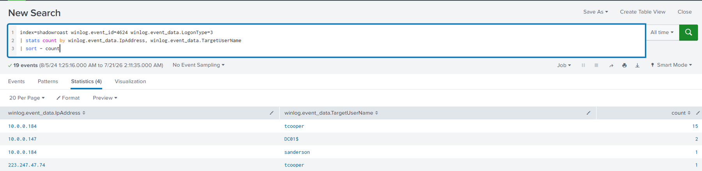 <br />
  <em>Image 1: <code>index=shadowroast winlog.event_id=4624 LogonType=3 | stats count by IpAddress, TargetUserName</code></em>
</p>

<p align="center">
  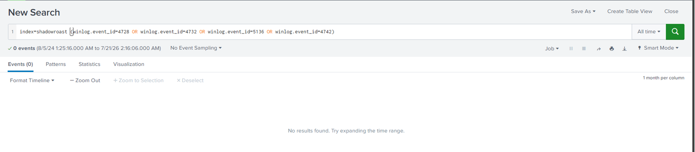 <br />
  <em>Image 2: Search for 4728/4732/5136/4742: no results</em>
</p>

A count of event IDs gives an idea of the data set: 4624 (167), 4768 (149 Kerberos TGT requests) and 4672 (143 special-privilege logons). The 4768 volume is worth a look when Rubeus is around, but I did not isolate suspicious requests.

<p align="center">
  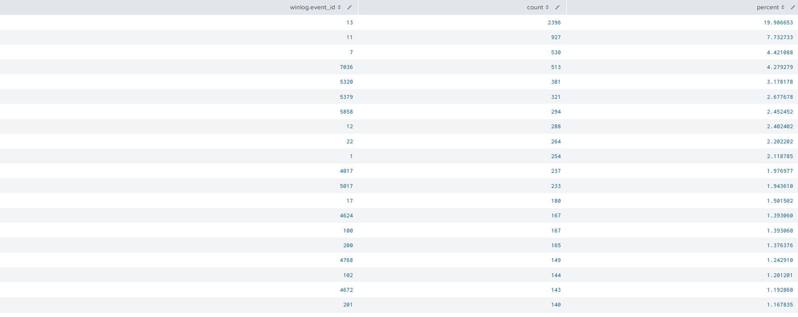 <br />
  <em>Image 3: <code>winlog.event_id</code> counts</em>
</p>

For the execution I looked at Sysmon process creation on `Office-PC`. At 01:14:08 a `cmd.exe` (PID 2008, parent 4928) starts, then at 01:14:21 `powershell -ep bypass` (PID 4780) with `cmd.exe` as parent, and a child of that PowerShell is `C:\Users\Default\AppData\Local\Temp\DefragTool.exe` (PID 5740, 01:14:46).

<p align="center">
  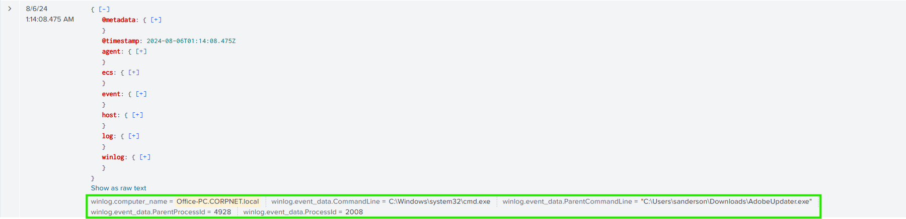 <br />
  <em>Image 4: Process-create at 01:14:08: <code>cmd.exe</code> PID 2008 (parent PID 4928)</em>
</p>

<p align="center">
  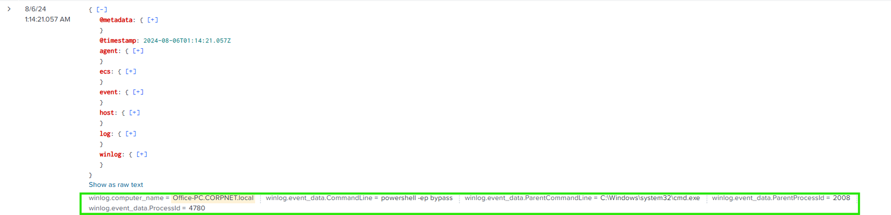 <br />
  <em>Image 5: Process-create at 01:14:21: <code>powershell -ep bypass</code> PID 4780</em>
</p>

<p align="center">
  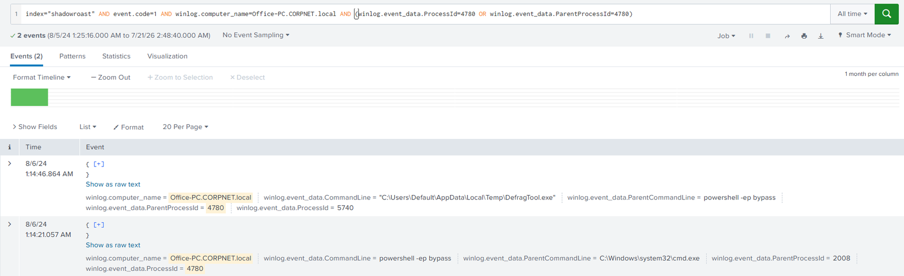 <br />
  <em>Image 6: Children of PID 4780 on <code>Office-PC</code>: <code>DefragTool.exe</code></em>
</p>

Right after that, at 01:15, Sysmon shows a process whose PE metadata says "mimikatz for Windows" (gentilkiwi, 2.2.0.0), launched by `CORPNET\tcooper` from a Temp folder. Sysmon tagged it T1036 (masquerading) because the file name was changed. A second binary carries the description Rubeus and runs with high integrity. On VirusTotal the Mimikatz hash is `92804faaab2175dc501d73e814663058c78c0a042675a8937266357bcfb96c50` and Rubeus is `1bfbefa4ff4d0df3ee0090b5079cf84ed2e8d5377ba5b7a30afd88367d57b9ff` (59/69).

<p align="center">
  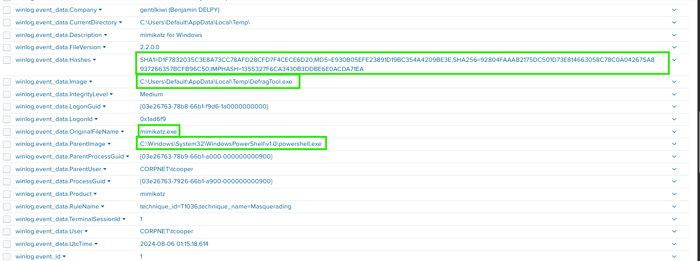 <br />
  <em>Image 7: Process metadata: "mimikatz for Windows" (renamed binary)</em>
</p>

<p align="center">
  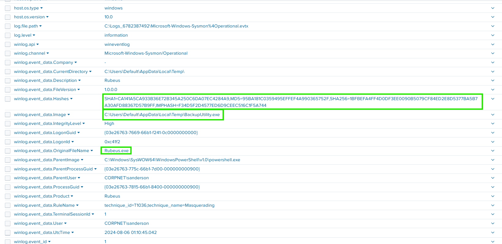 <br />
  <em>Image 8: Process metadata: Rubeus</em>
</p>

<p align="center">
  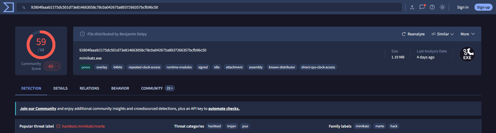 <br />
  <em>Image 9: VirusTotal: Mimikatz</em>
</p>

<p align="center">
  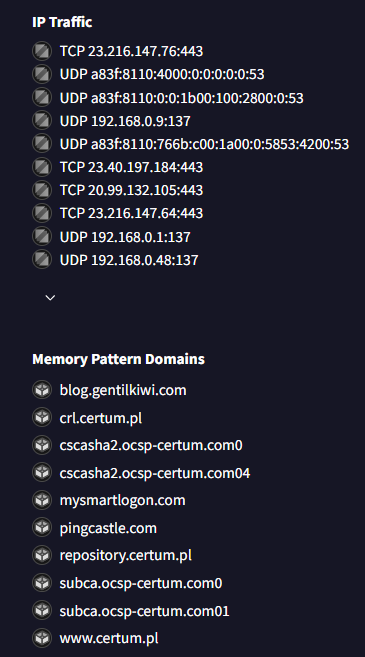 <br />
  <em>Image 10: VirusTotal behaviour: mimikatz</em>
</p>

<p align="center">
  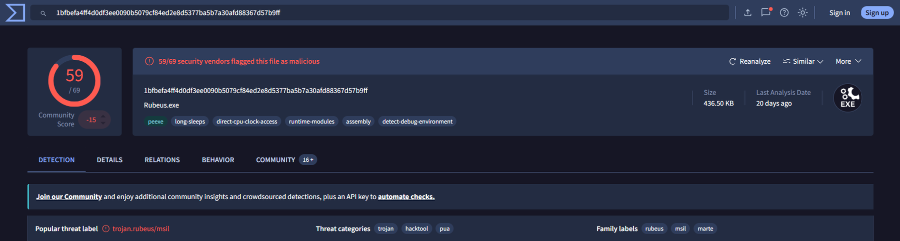 <br />
  <em>Image 11: VirusTotal: Rubeus</em>
</p>

<p align="center">
  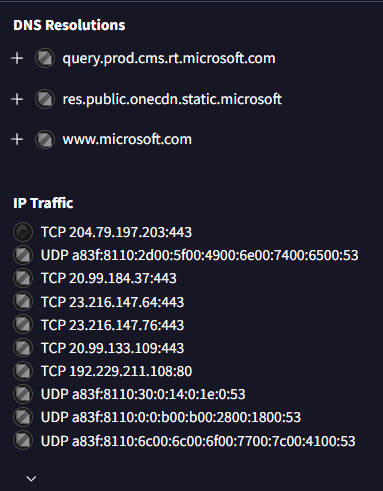 <br />
  <em>Image 12: VirusTotal behaviour: Rubeus</em>
</p>

Looking back in time for persistence, Sysmon Event ID 13 at 01:05:58 UTC shows `CORPNET\sanderson` writing a Run-key value (tagged T1547.001) named `wyW5PZyF`. The data is `%COMSPEC% /b /c start /b /min powershell -nop -w hidden -c "…FromBase64String((Get-Item 'HKCU:Software\…').GetValue('…'))"`, so the payload itself lives in the registry and the Run key only starts it.

<p align="center">
  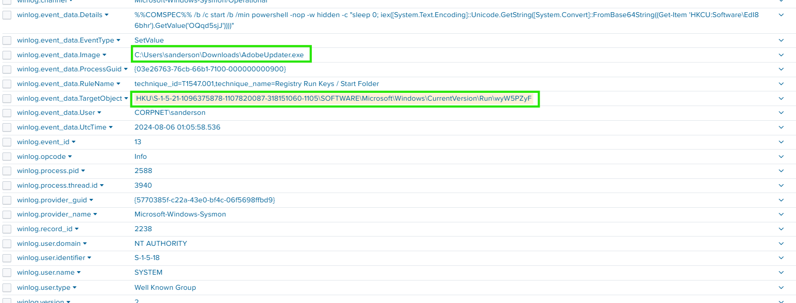 <br />
  <em>Image 13: Sysmon Event 13: Run key value starting a Base64 PowerShell from the registry</em>
</p>

Last, the network side and the domain controller. I listed outbound connections by user and process (`winlog.event_id=3`), and in the Security log I found Event ID 4929 at 01:15:21 UTC, about three seconds after Mimikatz, with `Office-PC.CORPNET.local` as source address and the replication partner on `DC01`. A workstation that suddenly acts as replication source is how DCShadow looks in the logs (T1207).

<p align="center">
  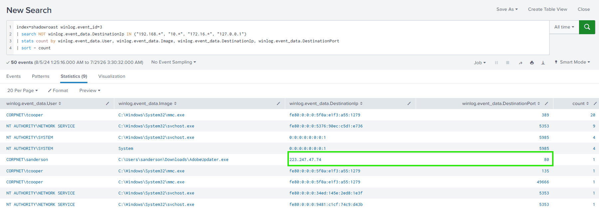 <br />
  <em>Image 14: Outbound connections by user/process (<code>winlog.event_id=3</code>)</em>
</p>

<p align="center">
  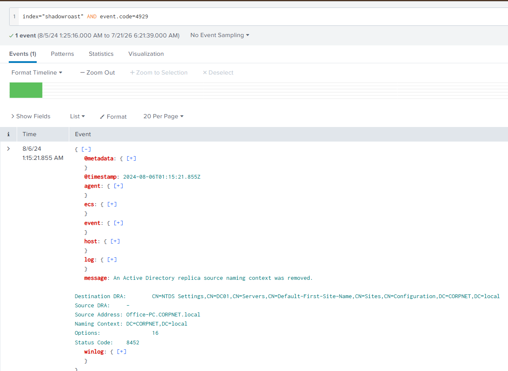 <br />
  <em>Image 15: Event ID 4929 at 01:15:21 UTC</em>
</p>

One detection idea I would use for the tool-renaming part (I did not test it, so run it on a test instance first):

```spl
index=<INDEX> sourcetype=<SOURCETYPE> winlog.event_id=1 earliest=-24h@h latest=now
    (winlog.event_data.Description IN ("mimikatz for Windows","Rubeus") OR winlog.event_data.Product IN ("mimikatz","Rubeus"))
| table _time winlog.computer_name winlog.event_data.User winlog.event_data.Image winlog.event_data.OriginalFileName winlog.event_data.Hashes winlog.event_data.CommandLine
```

It needs Sysmon Event ID 1 with the PE-metadata fields extracted. Red-team exercises will trigger it, so allow-list those hosts and users.

# Answer the Questions

**Q1: What's the malicious file name utilized by the attacker for initial access?**

`AdobeUpdater.exe`.

**Q2: What's the registry run key name created by the attacker for maintaining persistence once gained foothold?**

`wyW5PZyF`.

**Q3: What's the full path of the directory used by the attacker for storing his dropped tools?**

`C:\Users\Default\AppData\Local\Temp\`.

**Q4: What tool was used by the attacker for privilege escalation and credential harvesting?**

Rubeus.

**Q5: Was the attacker's credential harvesting successful? If so, can you provide the compromised domain account username?**

Yes, the compromised account is `tcooper`.

**Q6: What's the tool used by the attacker for registering a rogue Domain Controller to manipulate Active Directory data?**

mimikatz.

**Q7: What's the first command used by the attacker for enabling RDP on remote machines for lateral movement?**

`reg add "hklm\system\currentcontrolset\control\terminal server" /f /v fDenyTSConnections /t REG_DWORD /d 0`

**Q8: What's the file name created by the attacker after compressing confidential files?**

`CrashDump.zip`.

# References

- [ShadowRoast lab write-up (faresbltagy)](https://faresbltagy.gitbook.io/footprintinglabs/cyberdefenders/shadowroast-lab)
