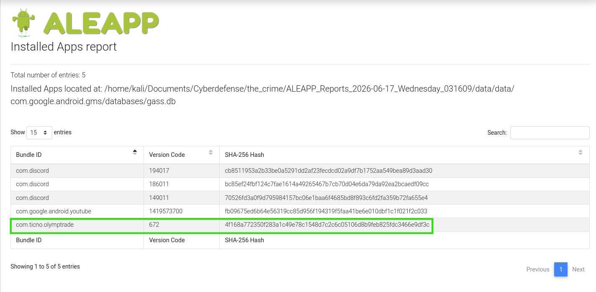
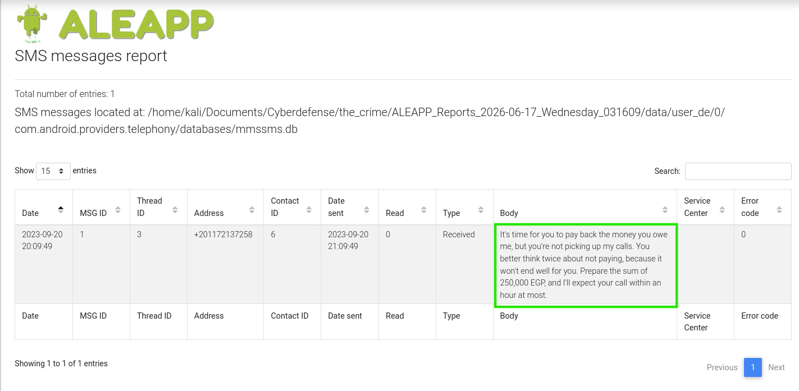
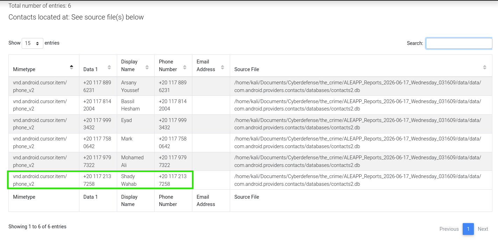
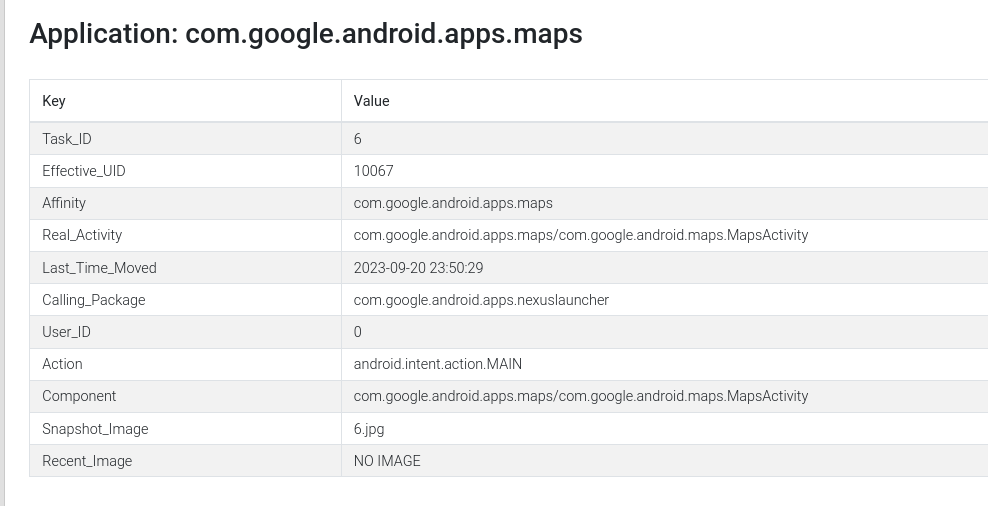
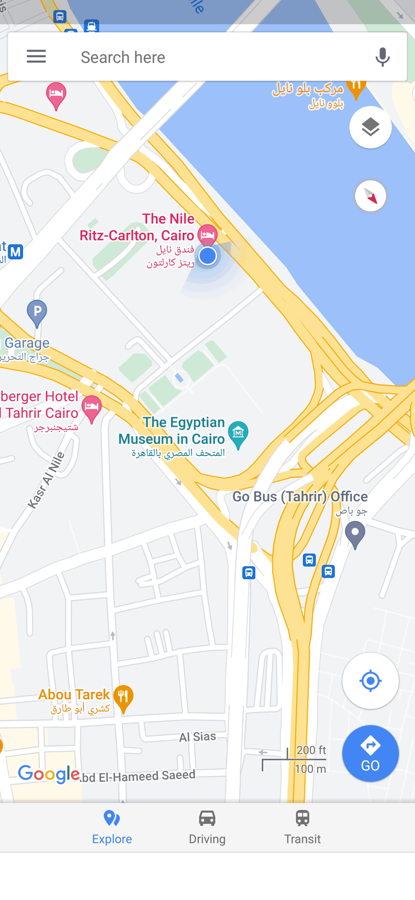
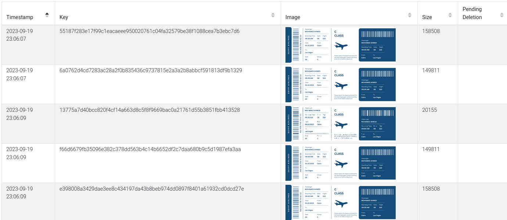
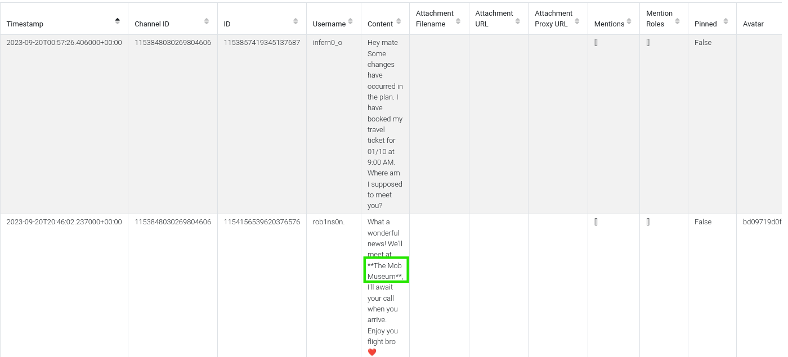

# The Crime – Android Forensics with ALEAPP

# Scenario & Objective

The data from an Android phone is part of a (fictional) criminal case. With the ALEAPP reports I have to find the evidence on the device: apps, messages, contacts, locations and chats.

- **Category**: Mobile Forensics
- **Tools**: ALEAPP (Android Logs, Events And Protobuf Parser) report viewer

## Overview

All names, numbers and conversations in this lab are fictional. The phone has a trading app (`com.ticno.olymptrade`), a received SMS demanding that the owner pay back money, six contacts (one of them Shady Wahab) and Discord messages from 2023-09-20 where two people agree to meet at The Mob Museum; one of them has booked a travel ticket for 01/10 at 09:00.

# Analysis

I opened the Installed Apps report first. There are five entries: three versions of `com.discord`, `com.google.android.youtube` and `com.ticno.olymptrade` (version code 672), which is a trading app and the only one that stands out.

    
  <em>Image 1: ALEAPP: Installed Apps report</em>

The SMS report has one received message on 2023-09-20 telling the owner to pay back the money and hinting at consequences, which looks like the motive. In the contacts report there are six contacts with Egyptian numbers, and the one I highlighted is Shady Wahab (+20 117 213 7258).

    
  <em>Image 2: ALEAPP: SMS messages report</em>

    
  <em>Image 3: ALEAPP: Contacts report</em>

For the location, the Recent Tasks report shows Google Maps as the last moved app at 2023-09-20 23:50:29, and the Maps snapshot is centred on central Cairo. I would not read more into it than that.

    
  <em>Image 4: Recent tasks: Google Maps (<code>Last_Time_Moved</code> 2023-09-20 23:50:29)</em>

    
  <em>Image 5: Maps snapshot of Cairo</em>

There are also several cached images queued for deletion on 2023-09-19 around 23:06 UTC.

    
  <em>Image 6: Pending-deletion image cache entries (2023-09-19)</em>

The Discord report is the most useful one. On 2023-09-20 at 00:57 UTC `infern0_o` writes that the plan changed, that he booked a ticket for 01/10 at 09:00 and asks where to meet. At 20:46 UTC `rob1ns0n.` answers that they will meet at The Mob Museum and that he will wait for the call when he arrives.

    
  <em>Image 7: Discord messages report (2023-09-20)</em>

# Answer the Questions

**Q1: Based on the accounts of the witnesses and individuals close to the victim, it has become clear that the victim was interested in trading. This has led him to invest all of his money and acquire debt. Can you identify the `SHA256` of the trading application the victim primarily used on his phone?**

Olymp Trade (`com.ticno.olymptrade`), SHA256 `4f168a772350f283a1c49e78c1548d7c2c6c05106d8b9feb825fdc3466e9df3c` (the value ALEAPP shows under Installed Apps).

**Q2: According to the testimony of the victim's best friend, he said, "`While we were together, my friend got several calls he avoided. He said he owed the caller a lot of money but couldn't repay now`". How much does the victim owe this person?**

`250,000 EGP`, from the SMS sent by `+201172137258`, the number the victim kept avoiding.

**Q3: What is the name of the person to whom the victim owes money?**

Shady Wahab

**Q4: Based on the statement from the victim's family, they said that on `September 20, 2023`, he departed from his residence without informing anyone of his destination. Where was the victim located at that moment?**

The Nile Ritz-Carlton (Cairo), from the Google Maps snapshot in Recent Activity.

**Q5: The detective continued his investigation by questioning the hotel lobby. She informed him that the victim had reserved the room for 10 days and had a flight scheduled thereafter. The investigator believes that the victim may have stored his ticket information on his phone. Look for where the victim intended to travel.**

Las Vegas (cached ticket Cairo → Las Vegas, 01.10.2023).

**Q6: After examining the victim's Discord conversations, we discovered he had arranged to meet a friend at a specific location. Can you determine where this meeting was supposed to occur?**

The Mob Museum (Discord message from `rob1ns0n.`).
