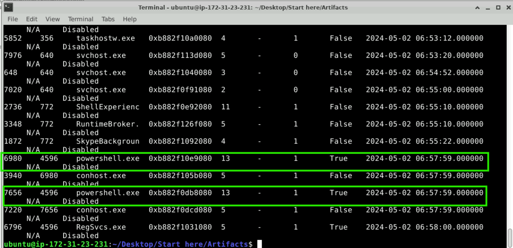
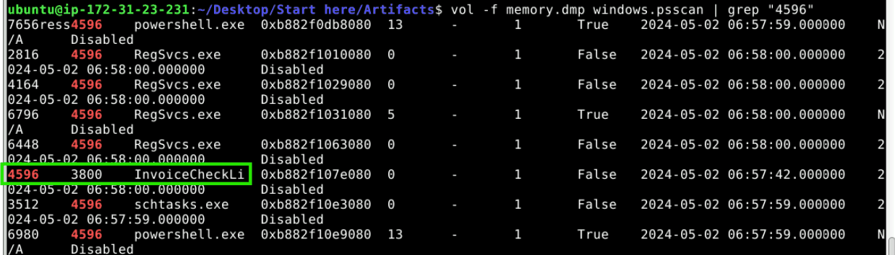
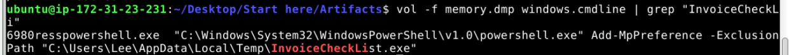
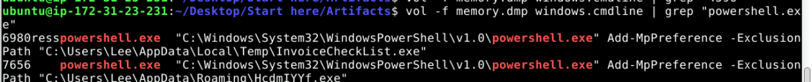
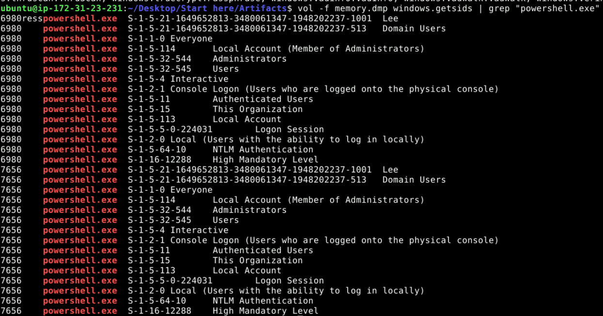
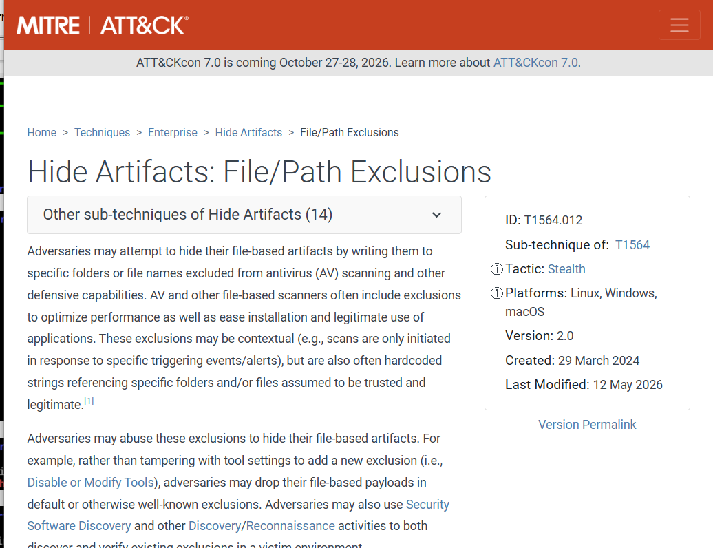

# Volatility Traces – Defender Exclusions and RegSvcs Children

# Scenario & Objective

A memory dump comes from a machine where antivirus seems to have been tampered with. I have to find the suspicious parent process, what it spawned and how it kept Defender quiet.

- **Category**: Memory Forensics
- **Tools**: Volatility 3 (`pslist`, `psscan`, `cmdline`, `getsids`), MITRE ATT&CK

## Overview

`InvoiceCheckList.exe` (PID 4596, started 2024-05-02 at 06:57:42 UTC by PID 3800) is the parent of two PowerShell processes, four `RegSvcs.exe` and a `schtasks.exe`. The PowerShells ran `Add-MpPreference -ExclusionPath` for `InvoiceCheckList.exe` and `HcdmIYYf.exe`, so Defender would ignore both. The account behind it is `Lee`.

# Analysis

I listed the processes with `windows.pslist`, but it was `psscan | grep 4596` that told me the story. PID 4596 is `InvoiceCheckList.exe` (parent 3800, 06:57:42 UTC), and it has a lot of children: two `powershell.exe` (PIDs 6980 and 7656), four `RegSvcs.exe` (PIDs 2816, 4164, 6796 and 6448) and a `schtasks.exe` (PID 3512). `RegSvcs.exe` is a signed .NET utility that is often abused to host injected code, and `schtasks.exe` makes me think of scheduled-task persistence, but I did not verify either.

    
  <em>Image 1: <code>windows.pslist</code> (partial)</em>

    
  <em>Image 2: <code>psscan | grep 4596</code>: <code>InvoiceCheckList.exe</code> and its children</em>

The command lines of the PowerShells explain what they did. PID 6980 runs `Add-MpPreference -ExclusionPath "C:\Users\Lee\AppData\Local\Temp\InvoiceCheckList.exe"` and PID 7656 does the same for `C:\Users\Lee\AppData\Roaming\HcdmIYYf.exe`, so both files are excluded from Defender scanning.

    
  <em>Image 3: <code>cmdline</code> filtered on <code>InvoiceCheckList</code></em>

    
  <em>Image 4: <code>cmdline</code> filtered on <code>powershell.exe</code></em>

The user comes from `getsids` (PID 6980): `Lee`.

    
  <em>Image 5: <code>getsids</code> for PID 6980: user <code>Lee</code></em>

For the technique, my own screenshot shows T1564.012 (Hide Artifacts: File/Path Exclusions), which is the more specific ID. The public answer to the lab is T1562.001 (Impair Defenses: Disable or Modify Tools). Both describe the same behaviour, so I would use T1562.001 when answering the lab and mention T1564.012 as the finer mapping.

    
  <em>Image 6: MITRE: T1564.012 File/Path Exclusions</em>

# Answer the Questions

**Q1: Identifying the parent process reveals the source and potential additional malicious activity. What is the name of the suspicious process that spawned two malicious PowerShell processes?**

`InvoiceCheckList.exe` (PID 4596).

**Q2: By determining which executable is utilized by the malware to ensure its persistence, we can strategize for the eradication phase. Which executable is responsible for the malware's persistence?**

`schtasks.exe`

**Q3: Understanding child processes reveals potential malicious behavior in incidents. Aside from the PowerShell processes, what other active suspicious process, originating from the same parent process, is identified?**

`RegSvcs.exe`

**Q4: Analyzing malicious process parameters uncovers intentions like defense evasion for hidden, stealthy malware. What PowerShell cmdlet used by the malware for defense evasion?**

`Add-MpPreference`

**Q5: Recognizing detection-evasive executables is crucial for monitoring their harmful and malicious system activities. Which two applications were excluded by the malware from the previously altered application's settings?**

`InvoiceCheckList.exe,HcdmIYYf.exe`

**Q6: What is the specific MITRE sub-technique ID associated with PowerShell commands that aim to disable or modify antivirus settings to evade detection during incident analysis?**

`T1564.012` – File/Path Exclusions (the page in my screenshot). The older, broader ID for "disable or modify tools" is `T1562.001`.

**Q7: Determining the user account offers valuable information about its privileges, whether it is domain-based or local, and its potential involvement in malicious activities. Which user account is linked to the malicious processes?**

`Lee` (domain user).

# References

- [Volatility Traces lab write-up](https://portfolio-v2-f2y.pages.dev/blue-team/labs/volatilitytraces/)
