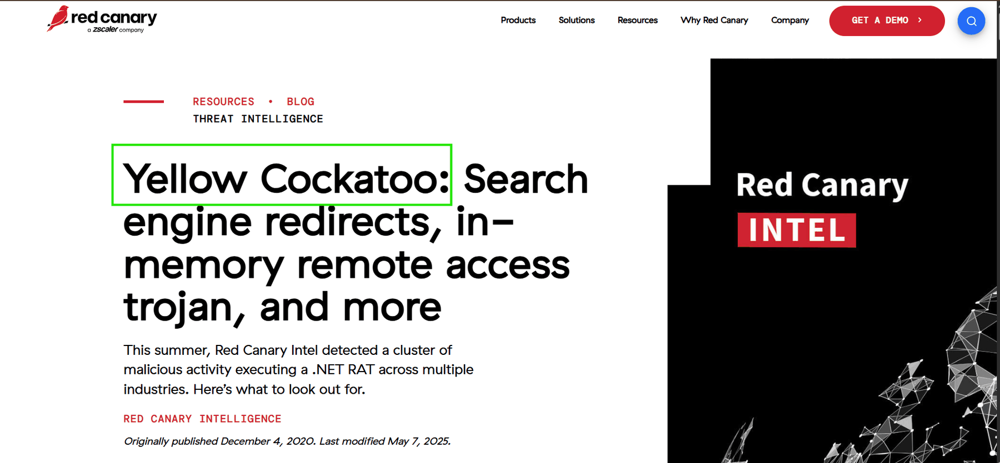
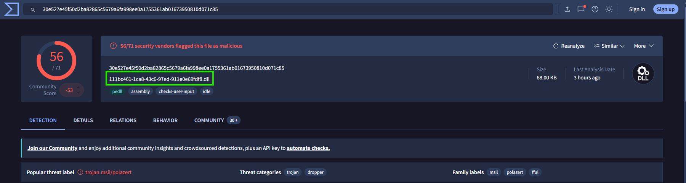
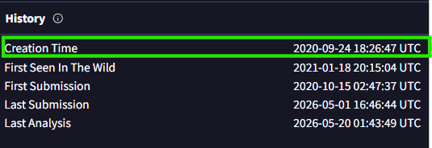
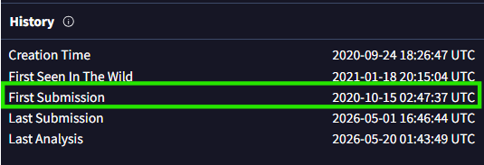
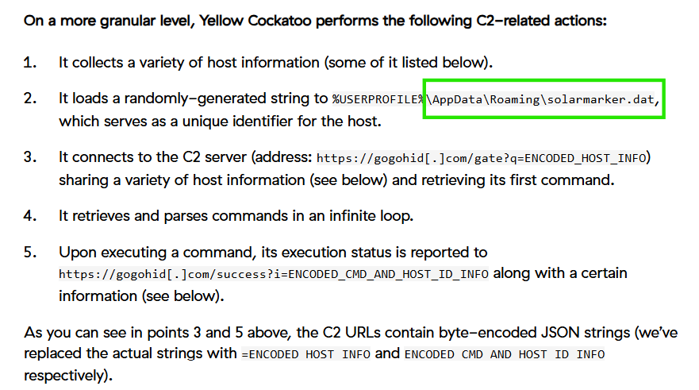

# Yellow RAT – Yellow Cockatoo Threat Intelligence

# Scenario & Objective

During a regular IT security check at GlobalTech Industries, abnormal network traffic was detected from multiple workstations. Upon initial investigation, it was discovered that certain employees' search queries were being redirected to unfamiliar websites. This discovery raised concerns and prompted a more thorough investigation. Your task is to investigate this incident and gather as much information as possible.

- **Category**: Malware Analysis / Threat Intelligence
- **Tools**: VirusTotal, Red Canary threat intelligence report

## Overview

Abnormal traffic and redirected searches at GlobalTech Industries led to a sample with SHA-256 `30e527e45f50d2ba82865c5679a6fa998ee0a1755361ab01673950810d071c85`. It belongs to the Yellow Cockatoo family (a .NET RAT, per Red Canary). It is commonly installed as `111bc461-1ca8-43c6-97ed-911e0e69fdf8.dll`, was compiled on 2020-09-24 at 18:26:47 UTC and first submitted to VirusTotal on 2020-10-15 at 02:47:37 UTC. It drops `solarmarker.dat` in AppData and talks to the C2 `gogohid[.]com`.

# Analysis

- Hash: 30e527e45f50d2ba82865c5679a6fa998ee0a1755361ab01673950810d071c85

## Step 1 – Malware family

- By searching the hash, we can see the report by Red Canary Intel about this malware. In that report, the malware has been named Yellow Cockatoo since Red Canary Intel detected a cluster of malicious activity executing a .NET RAT across multiple industries.

    
  <em>Image 1</em>

## Step 2 – Filename seen on the workstations

    
  <em>Image 2</em>

- Filename:111bc461-1ca8-43c6-97ed-911e0e69fdf8.dll

## Step 3 – Compilation timestamp

    
  <em>Image 3</em>

- The compilation timestamp of the malware was 2020-09-24 18:26:47 UTC.

## Step 4 – First submission to VirusTotal

    
  <em>Image 4</em>

- The first submission of the malware was 2020-10-15 02:47:37 UTC.

## Step 5 – Dropped .dat file

    
  <em>Image 5</em>

- In the report by Red Canary Intel, we found that the malware dropped solarmarker.dat file in the AppData folder.

## Step 6 – C2 server

    
  <em>Image 6</em>

- In Memory Pattern Domains and Memory Pattern Urls tabs, they show that the malware is only communicating with C2 server via gogohid[.]com

## Indicators of Compromise

| Type | Value |
|---|---|
| SHA-256 | `30e527e45f50d2ba82865c5679a6fa998ee0a1755361ab01673950810d071c85` |
| File name | `111bc461-1ca8-43c6-97ed-911e0e69fdf8.dll` |
| Dropped file | `solarmarker.dat` (AppData) |
| C2 domain | `gogohid[.]com` |

# Answer the Questions

**Q1: Understanding the adversary helps defend against attacks. What is the name of the malware family that causes abnormal network traffic?**

Yellow Cockatoo RAT.

**Q2: As part of our incident response, knowing common filenames the malware uses can help scan other workstations for potential infection. What is the common filename associated with the malware discovered on our workstations?**

`111bc461-1ca8-43c6-97ed-911e0e69fdf8.dll`

**Q3: Determining the compilation timestamp of malware can reveal insights into its development and deployment timeline. What is the compilation timestamp of the malware that infected our network?**

`2020-09-24 18:26:47` UTC.

**Q4: Understanding when the broader cybersecurity community first identified the malware could help determine how long the malware might have been in the environment before detection. When was the malware first submitted to VirusTotal?**

`2020-10-15 02:47:37` UTC.

**Q5: To completely eradicate the threat from Industries' systems, we need to identify all components dropped by the malware. What is the name of the .dat file that the malware dropped in the AppData folder?**

`solarmarker.dat`

**Q6: It is crucial to identify the C2 servers with which the malware communicates to block its communication and prevent further data exfiltration. What is the C2 server that the malware is communicating with?**

`hxxps[://]gogohid[.]com`
